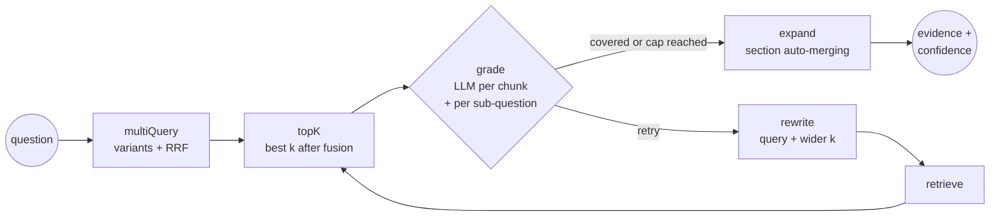
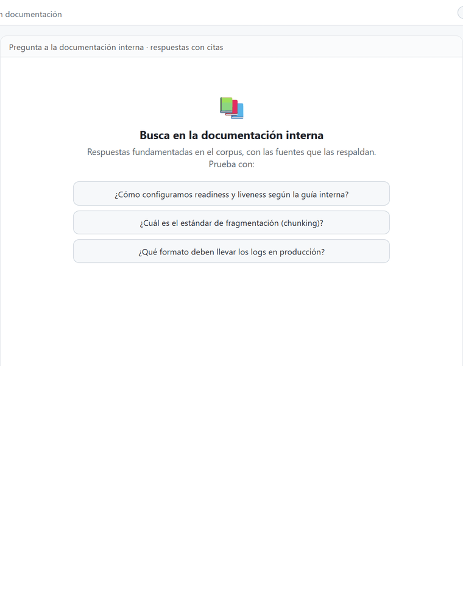
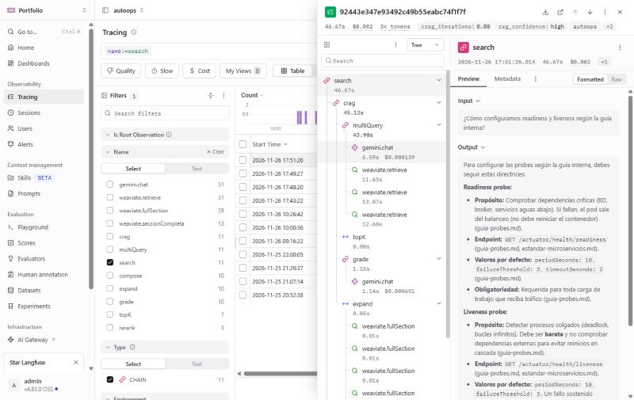
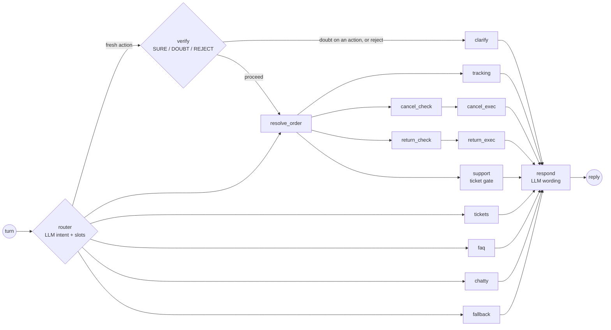
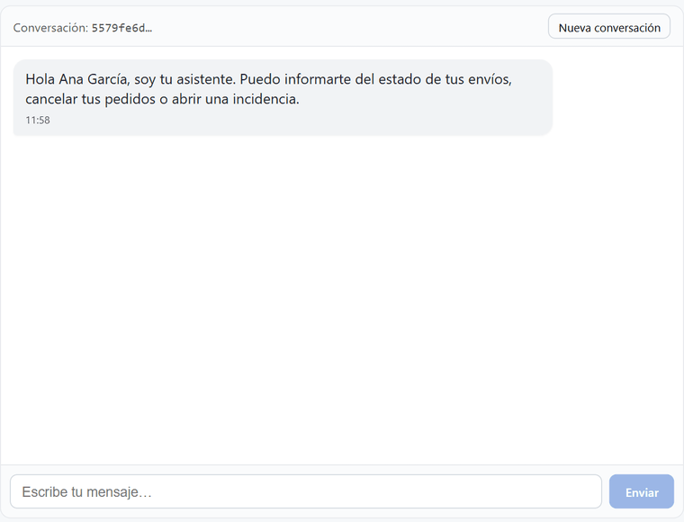
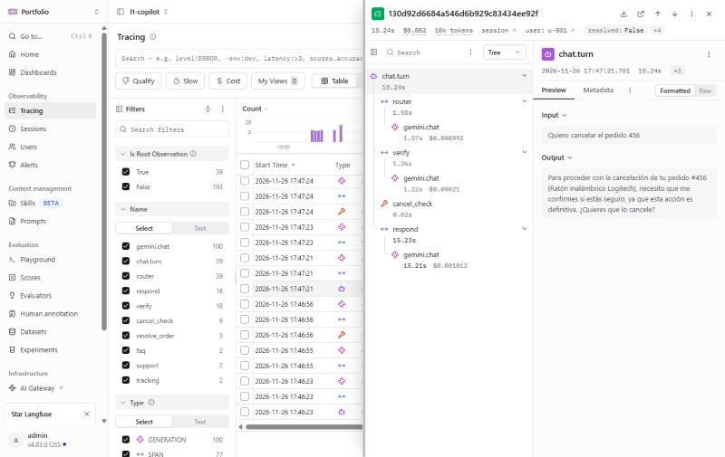
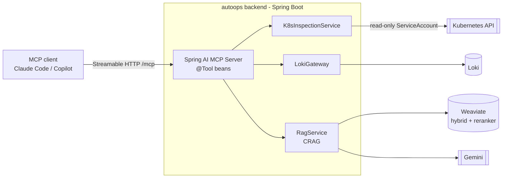
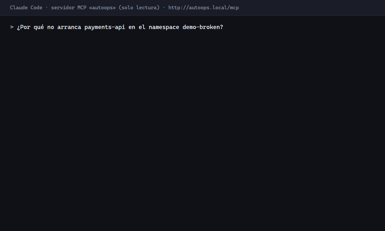
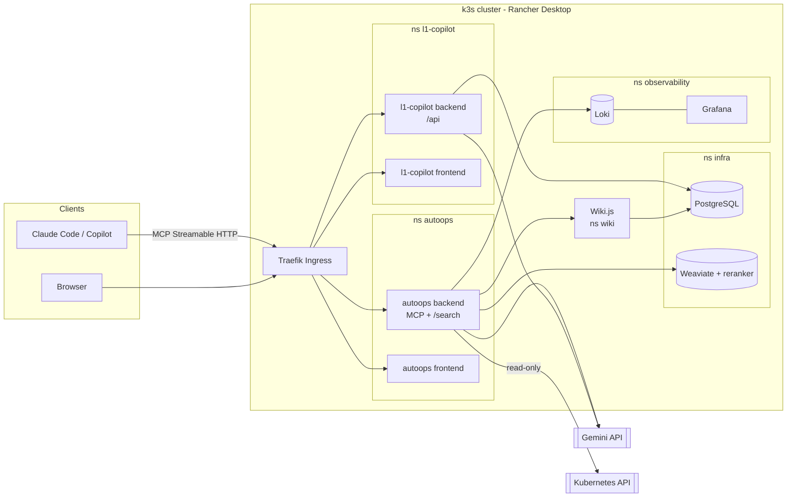

# AI Platform Portfolio

I am [Miguel](https://www.linkedin.com/in/maciordia), a Java Tech Lead with 11 years of Java and Spring, plus Kubernetes and DevSecOps. This repository
holds three generative AI projects I built as personal proofs of concept, all in **Java 17 / Spring Boot**, on
**LangChain4j**, **LangGraph4j** and **Spring AI**, deployed to a local **k3s** cluster. Each one tackles a
problem that matters once an LLM touches real systems: answers you can trust, actions the model cannot
trigger on its own, and tool access that is safe by construction.

| | Project | In one line |
|---|---|---|
| 1 | [Corrective RAG](#1-corrective-rag) | Retrieval that checks its own evidence before answering, and says how confident it is. |
| 2 | [L1 Support Copilot](#2-l1-support-copilot) | A support agent where the LLM classifies and the code decides. |
| 3 | [AutoOps MCP server](#3-autoops-mcp-server) | Read-only Kubernetes, logs and docs for any MCP client (Claude Code, Copilot). |

## 1. Corrective RAG

Part of [AutoOps](autoops/README.md), shared by its `search_docs` MCP tool and its search chat. A plain
top-k search returns chunks that look relevant and answers anyway; this one judges what it retrieved.

- **Hybrid search with reranking in one Weaviate query**: BM25 + vector, then a cross-encoder rerank.
- **Multi-query on the first pass**: the question is expanded into variants and fused with Reciprocal Rank
  Fusion; retries use a single rewritten query and a wider `k` to keep LLM cost bounded.
- **CRAG loop**: an LLM grades each chunk and the coverage of each sub-question, so a compound question is not
  "answered" by covering half of it. The rerank score is never used as a proxy for relevance. The iteration
  cap sits on the graph edge, so the loop terminates whatever the grader says.
- **Query-time section auto-merging**: small or repeatedly hit sections are returned whole, mid-sized ones as
  the hit plus its neighbours within the section, under a size ceiling (ADR-011, which supersedes the stored
  neighbour window of ADR-010).
- **Explicit confidence** (`high | medium | low | none`) and citations in every answer; ingestion from local
  Markdown, GitHub repositories and Wiki.js.





The answer cites the exact sections it used and declares its confidence. Behind it, every search is a
Langfuse trace with the CRAG nodes as spans (multi-query, three hybrid retrievals, grade, section
expansion) and the confidence and iteration count as scores:



**What to look at**

- [`CragGraph.java`](autoops/backend/src/main/java/io/github/mikel0ne/autoops/rag/crag/CragGraph.java): the
  LangGraph4j subgraph and the iteration cap on the edge.
- [`GradeNode.java`](autoops/backend/src/main/java/io/github/mikel0ne/autoops/rag/crag/nodes/GradeNode.java):
  per-chunk verdicts and per-sub-question coverage.
- [`ExpandNode.java`](autoops/backend/src/main/java/io/github/mikel0ne/autoops/rag/crag/nodes/ExpandNode.java):
  section auto-merging.
- [`RagEvalTest.java`](autoops/backend/src/test/java/io/github/mikel0ne/autoops/rag/eval/RagEvalTest.java) and
  the ADRs 005, 007, 010 and 011 in
  [`02-arquitectura-sistema.md`](autoops/docs/arquitectura/02-arquitectura-sistema.md) (Spanish).

## 2. L1 Support Copilot

[A level-1 support agent](l1-copilot/README.md) for an e-commerce site: it tracks, cancels and returns orders
and opens tickets, with real effects on the database. Letting the LLM decide whether an order can be
cancelled is the failure mode it is designed against: **the LLM classifies, the code decides**.

- **LangGraph4j state graph** with a checkpointer, so clarifications, digressions and pending confirmations
  survive between HTTP turns.
- The LLM only returns an intent and slots; routing is pure Java functions over the state, and business rules
  live in domain services, not prompts.
- **A verifier with an asymmetric threshold**: on doubt, a read such as tracking goes ahead, while cancel,
  return or ticket creation stops and asks.
- **Confirmations are only valid while pending for that very order**: a forged or stale confirm restarts the
  request. The `userId` comes from the session, never from the user's text.
- **Security tests that assume the LLM is already fooled**: the mocked classifier and verifier say yes to
  jailbreaks, IDOR attempts and injected confirmations, and the tests check the code still refuses.





Three turns, left to right in the GIF: the assistant lists the user's orders as cards; a cancellation
is never executed on the first message, it asks for a confirmation that cannot be forged; and a
jailbreak that claims to be an administrator and names an order of another user is refused, because
the order lookup is filtered by the session's user, not by what the text says.

Every turn is also a Langfuse trace, with the router, verifier, business-rule check and responder as
spans and the cost of each LLM call:



**What to look at**

- [`SupportRouting.java`](l1-copilot/backend/src/main/java/io/github/mikel0ne/l1copilot/agent/SupportRouting.java):
  every routing decision as a pure function, including the verifier's asymmetric rule.
- [`RouterNode.java`](l1-copilot/backend/src/main/java/io/github/mikel0ne/l1copilot/agent/node/RouterNode.java):
  confirm commands accepted only for the confirmation pending on that order.
- [`SecurityInjectionTest.java`](l1-copilot/backend/src/test/java/io/github/mikel0ne/l1copilot/agent/SecurityInjectionTest.java):
  jailbreak, IDOR, confirmation injection, forged confirm and conversation hijack.
- ADRs 3 and 4 in [`02-arquitectura-sistema.md`](l1-copilot/docs/arquitectura/02-arquitectura-sistema.md) (Spanish).

## 3. AutoOps MCP server

[AutoOps](autoops/README.md) is an MCP server, not a chatbot: the assistant a developer already uses does the
reasoning, and the server gives it facts from the cluster instead of guesses. Built on the **Spring AI MCP
Server** over **Streamable HTTP**, so it works with any MCP client (Claude Code, GitHub Copilot); the repo
ships a [`.mcp.json`](.mcp.json) for Claude Code.

- **Live pod state**: `diagnose_pod` returns a one-call dossier (phase, conditions, restarts, events, log
  tail), plus `list_pods`, `list_workloads`, `describe_pod`, `list_events` and `pod_logs`.
- **History from Loki**: `query_logs` across pods and namespaces, by time window or around a timestamp.
- **Docs search**: `search_docs`, the corrective RAG above.
- **Read-only by RBAC, not by convention**: the ServiceAccount can get and list pods, logs, events and
  workloads, and nothing else; Secrets and ConfigMaps are deliberately left out.





A deliberately broken Deployment ([`demo-broken.yaml`](scripts/readme-media/demo-broken.yaml), image tag that
does not exist). The two tool calls and their results are real, taken from the running server and
abridged with `…`; the window and the closing paragraph are a re-creation, not a recording of Claude Code.

And the read-only guarantee, checked against the cluster (the last two must answer `no`):

```console
$ kubectl auth can-i list pods    --as=system:serviceaccount:autoops:autoops-mcp -A
yes
$ kubectl auth can-i get pods/log --as=system:serviceaccount:autoops:autoops-mcp -A
yes
$ kubectl auth can-i get secrets  --as=system:serviceaccount:autoops:autoops-mcp -A
no
$ kubectl auth can-i delete pods  --as=system:serviceaccount:autoops:autoops-mcp -A
no
```

**What to look at**

- [`rbac-autoops.yaml`](infra/rbac-autoops.yaml): the read-only ClusterRole, with the `kubectl auth can-i`
  checks that must answer no.
- [`KubernetesTools.java`](autoops/backend/src/main/java/io/github/mikel0ne/autoops/tools/KubernetesTools.java)
  and [`ObservabilityTools.java`](autoops/backend/src/main/java/io/github/mikel0ne/autoops/tools/ObservabilityTools.java):
  the MCP tool definitions.
- ADRs 001, 006 and 008 in [`02-arquitectura-sistema.md`](autoops/docs/arquitectura/02-arquitectura-sistema.md) (Spanish).

## Platform

Both applications share one platform on k3s (Rancher Desktop): a **single generic Helm chart**
([`infra/charts/generic-app`](infra/charts/generic-app)) deploys every backend, frontend and Wiki.js from a
values file each, next to a shared PostgreSQL, Weaviate with the reranker, and **Loki + Grafana** for logs.
**CI** ([`ci.yml`](.github/workflows/ci.yml)) builds and tests both backends and both Angular frontends, lints
and renders the Helm chart against every values file, and runs ShellCheck on the scripts. AutoOps can diagnose
the L1 Copilot pods and its RAG indexes this repository's docs, so the projects double as each other's test bed.



## Evaluation

Two golden sets run on demand against the real model. They need an API key (and the RAG one an indexed
Weaviate), so they are opt-in. CI validates both sets offline on every build. Results are reported per category
and the failed cases are listed.

- **RAG**: [`rag-golden-set.json`](autoops/backend/src/test/resources/rag-golden-set.json), 44 queries: 21
  baseline questions with the document and section that answer each; robustness cases (paraphrases, hidden
  sections, typos, other languages, multi-hop, ambiguity); 6 unanswerable queries whose CRAG confidence must
  stay under a cap; and security cases (grader injection, prompt leak, exfiltration, destructive commands,
  malicious formats). `RagEvalTest` reports hit@1, hit@5 and MRR for hybrid search + rerank and for the CRAG
  evidence. It fails below 0.8 on hit@5, on abstention and on security.
- **Router**: [`golden-router-cases.json`](l1-copilot/backend/src/test/resources/golden-router-cases.json), 103
  messages in 24 categories: 54 security cases (history, tool-data, encoded and multilingual injection,
  jailbreaks, roleplay, privilege claims) and 61 held-out cases that were never used to tune the prompt. Some
  cases carry conversation history, agent state or an expected confirmation. `RouterEvalTest` reports the raw
  model output and the guarded result after the deterministic assent guard. It fails below 0.7 overall or 0.8
  on security. A test also fails if the router prompt quotes a golden case.
- **Router failures end to end**: `RouterFailureE2eEvalTest` replays every case the router got wrong through
  the real graph, using the real verifier and tools that accept any order (the worst case). Each failure is
  graded by its consequence: GRAVE (an action the user did not ask for runs or is offered), MITIGADO (the flow
  corrected it) or LEVE (nothing ran or was offered). It fails on any GRAVE.

Latest router measurement (`gemini-flash-lite-latest`, 103 cases, one run per configuration, so small
differences are within noise):

| Version | Overall raw | Overall guarded | Security raw | Security guarded |
|---|---|---|---|---|
| A: old prompt + assent guard | 89% | 93% | 43/54 | 47/54 |
| B: hardened prompt + guard | 92% | 96% | 45/54 | 49/54 |
| C: B + structured history turns | 96% | 100% | 48/54 | 52/54 |

End to end on C: 7 router failures, 0 GRAVE, 1 MITIGADO, 6 LEVE. The 44-query RAG set has not been run against
the model yet.

Everything else, including the full agent flows and the security suite, runs in CI with the LLM roles mocked:
those tests check the code's decisions, not the model's quality. Both backends can also send traces to a
self-hosted **Langfuse**: one trace per RAG query or chat turn, one span per graph node, one generation per
model call with its tokens, and scores such as the verifier verdict and the RAG confidence
([`LANGFUSE-INTEGRATION.md`](infra/LANGFUSE-INTEGRATION.md)).

## Running it

Each project's README has the details. The short version:

```bash
# Unit and integration tests, no external services needed
cd autoops/backend && ./mvnw verify
cd l1-copilot/backend && ./mvnw verify
```

```bash
# L1 Copilot locally with H2, no Kubernetes (needs GEMINI_API_KEY)
export GEMINI_API_KEY=...        # free key at https://aistudio.google.com/app/apikey
./scripts/start.sh               # backend :8079/api, frontend :4199
```

Full platform on a local k3s cluster (Windows + Rancher Desktop):

```bash
cp infra/.env.local.example infra/.env.local    # fill in the secrets, it is gitignored
bash infra/scripts/02-setup-registry.sh         # then 03..08, see infra/INFRA.md
./infra/scripts/deploy.sh --project autoops --component all
./infra/scripts/setup-app-ingress.sh --project autoops
./infra/scripts/deploy.sh --project l1-copilot --component all
./infra/scripts/setup-app-ingress.sh --project l1-copilot
```

## Repository layout

```
autoops/        AutoOps MCP and the corrective RAG: backend (Spring Boot), frontend (Angular), docs, sample corpus
l1-copilot/     L1 Support Copilot: backend (Spring Boot), frontend (Angular), docs, DB scripts
infra/          Shared platform: generic Helm chart, values per app, Weaviate, Loki, RBAC, scripts
docker/         Shared Dockerfiles (backend, frontend) and nginx config
wiki/           Wiki.js content (an extra RAG source) and its seeding scripts
scripts/        Local start/stop of the L1 Copilot without Kubernetes
.github/        CI (backends, frontends, Helm chart and shell scripts) and Dependabot
```

## Notes

- **Internal docs are in Spanish.** Architecture docs, ADRs and infrastructure guides live in each project's
  `docs/` folder and in [`infra/INFRA.md`](infra/INFRA.md). Code, scripts, configuration and READMEs are in English.
- **Product language is Spanish.** The L1 agent talks to Spanish-speaking customers and the RAG answers in
  Spanish, so LLM prompts, UI texts and demo data are in Spanish.
- **Synthetic demo data.** The RAG corpus (`autoops/corpus`), the wiki pages (`wiki/content`), the
  e-commerce seed (orders, users, tickets) and the FAQ are invented for the demo. No real company data.
- **AI-generated avatars.** The two demo user pictures in `l1-copilot/frontend/src/assets/avatars` were
  generated with an AI image tool; they do not depict real people.
- Built in June 2026 and reworked in November 2026 (English translation, security hardening, refactors, dependency upgrades, CI). Commit dates are the real ones.

## License

[MIT](LICENSE)
