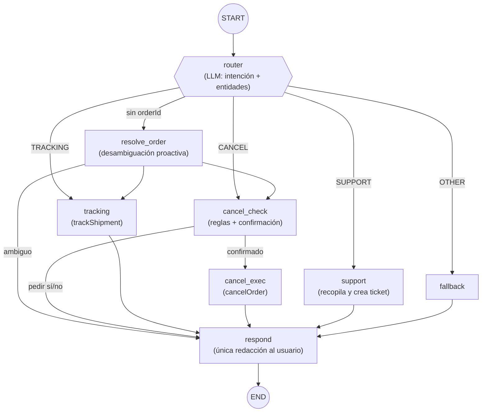

# L1 Support Copilot

Agente de soporte de nivel 1 **autónomo** para un e-commerce, construido con
**Spring Boot 3.5 + LangChain4j 1.16 + LangGraph4j 1.8 + Gemini (Google AI Studio)**.

No es un bot de comandos: el agente enruta semánticamente la conversación, maneja
ambigüedad de forma proactiva, mantiene estado conversacional entre turnos mediante
un grafo de estado con checkpointing, ejecuta acciones reales contra base de datos a
través de herramientas Java deterministas y escala a un humano creando tickets.

```text
Usuario:  ¿Dónde está mi pedido?
Agente:   Tienes dos pedidos recientes: un portátil (#123) y un ratón (#456).
          ¿Sobre cuál quieres consultar el estado?
Usuario:  El portátil
Agente:   Tu pedido #123 está EN REPARTO y llegará mañana con SEUR.
```

Ese diálogo ejercita lo que diferencia a este prototipo: detección de intención,
detección de información faltante, ejecución proactiva de tools (buscar los pedidos
recientes en vez de pedir el ID a ciegas), un **ciclo de clarificación** que sobrevive
entre peticiones HTTP y resolución de referencias ("el portátil" → #123).

## Arquitectura



Principios de diseño (los ADR completos están en [docs/arquitectura](docs/arquitectura/README.md)):

- **El LLM clasifica, el código decide.** El router produce una etiqueta estructurada;
  las aristas condicionales son funciones Java puras ([SupportRouting](backend/src/main/java/io/github/mikel0ne/l1copilot/agent/SupportRouting.java)) testeables sin modelo.
- **Un turno HTTP = una invocación del grafo.** El checkpointer (`MemorySaver`) con
  `threadId` = `conversationId` restaura el estado entre turnos: así se implementan
  los ciclos de clarificación y la confirmación human-in-the-loop de las cancelaciones.
- **La IA orquesta, Java ejecuta.** Todo acceso a datos pasa por tools deterministas;
  el `userId` viene de la sesión HTTP y las queries son `findByIdAndUserId`: un prompt
  malicioso no puede cruzar datos entre usuarios.
- **Las reglas de negocio viven en código.** Cancelar un pedido ya enviado lo rechaza
  `OrderStatus.isCancellable()`, no un prompt.

## Arranque rápido

Requisitos: Java 17, Maven y una API key gratuita de
[Google AI Studio](https://aistudio.google.com/app/apikey).

**Opción A — IntelliJ IDEA (recomendado):** abre el repo como proyecto y usa las Run Configurations incluidas en `.run/`:
- **Backend - Spring Boot** → arranca el servidor en `:8079`
- **Frontend - Angular** → arranca la SPA en `:4199`
- **Full Stack (Backend + Frontend)** → lanza ambos a la vez
- **Backend - Tests** → ejecuta los 28 tests

**Opción B — Scripts de consola:**
```powershell
$env:GEMINI_API_KEY = "tu-api-key"   # NUNCA en el repo
.\scripts\start.bat      # Windows (doble clic también funciona)
bash scripts/start.sh    # Git Bash / WSL / Linux / Mac
```

**Opción C — Manual (terminal):**
```powershell
$env:GEMINI_API_KEY = "tu-api-key"
cd backend
mvn spring-boot:run
```

- Swagger UI: http://localhost:8079/swagger-ui/index.html — probar `POST /api/copilot/chat` con cabecera `X-User-Id: u-001`
- Consola H2 (perfil `dev`, con seed de demo): http://localhost:8079/h2-console (`jdbc:h2:mem:copilot`)

```powershell
cd backend && mvn test    # 28 tests: aristas puras, tools contra H2, flujo completo del grafo con LLM fake, API
```

## Estructura

| Ruta | Contenido |
|---|---|
| `backend/` | Proyecto Spring Boot (Java) — `pom.xml`, `src/`, `.mvn/` |
| `backend/src/main/java/.../agent/` | El grafo LangGraph4j: estado, nodos, aristas, AiServices |
| `backend/src/main/java/.../tools/` | Herramientas Java deterministas (reglas de negocio y seguridad) |
| `backend/src/main/java/.../domain/` | Entidades JPA y repositorios |
| `frontend/` | SPA Angular |
| `scripts/` | Scripts del proyecto (arranque/parada local, `setup-l1-copilot-db.sh`) |
| `.run/` | Run Configurations de IntelliJ IDEA (versioned, aparecen en el menú Run) |
| `docker/` | Dockerfiles multi-stage para backend y frontend |
| `infra/` | Infra compartida del clúster: scripts de instalación, chart Helm `generic-app` y values del proyecto |
| `docs/arquitectura/` | Diseño completo: ADRs, modelo de datos, grafo, API, plan por fases |
| `docs/infraestructura/` | Despliegue en Kubernetes local paso a paso |

## Despliegue en Kubernetes

Modelo sobre **Rancher Desktop (k3s) + Helm**: un **PostgreSQL compartido** en el
namespace `infra` (una BD por proyecto) y un **registry local** en el namespace
`registry`, ambos desplegados por los scripts de [`infra/scripts/`](infra/scripts).
Las aplicaciones (backend y frontend) se despliegan con el chart Helm reutilizable
[`infra/charts/generic-app`](infra/charts/generic-app) parametrizado con
`infra/values-l1-copilot-*.yaml`. Guías paso a paso en
[docs/infraestructura](docs/infraestructura/README.md).

El backend local/dev usa `gemini-2.5-flash-lite`; el despliegue en Kubernetes
usa `gemini-2.5-flash` para separar cuotas.

```bash
# 1. Infra compartida (una vez por clúster, desde WSL)
bash infra/scripts/02-setup-registry.sh
bash infra/scripts/03-setup-postgres.sh

# 2. BD del proyecto dentro del Postgres compartido
bash scripts/setup-l1-copilot-db.sh

# 3. Namespace y Secrets de la app
kubectl apply -f infra/namespace-l1-copilot.yaml
kubectl create secret generic gemini-api-key -n l1-copilot --from-literal=GEMINI_API_KEY=<key>
kubectl create secret generic postgres-credentials -n l1-copilot \
  --from-literal=POSTGRES_USER=appuser --from-literal=POSTGRES_PASSWORD=change-me

# 4. Build + push de imágenes al registry
docker build -t localhost:30500/l1-copilot-backend:1.0.0 -f docker/backend.Dockerfile ./backend
docker push localhost:30500/l1-copilot-backend:1.0.0
docker build -t localhost:30500/l1-copilot-frontend:1.0.0 -f docker/frontend.Dockerfile ./frontend
docker push localhost:30500/l1-copilot-frontend:1.0.0

# 5. Aplicación con el chart genérico
helm upgrade --install l1-copilot-backend  infra/charts/generic-app -f infra/values-l1-copilot-backend.yaml
helm upgrade --install l1-copilot-frontend infra/charts/generic-app -f infra/values-l1-copilot-frontend.yaml
```

## Estado y hoja de ruta

- [x] Fase 0 — Alineación de dependencias (LangChain4j 1.16.2 + LangGraph4j 1.8.17)
- [x] Fases 1-2 — Dominio, seed y tools deterministas
- [x] Fases 3-4 — Grafo del agente y API REST
- [ ] Fase 5 — Frontend Angular (chat con login simulado)
- [ ] Fase 6 — Demo guiada y documentación de cierre
- [ ] Fase 7 — Despliegue en Kubernetes (guías e infraestructura ya preparadas)

Limitación consciente (documentada como ADR-6): la memoria conversacional vive en
`MemorySaver` (memoria de proceso) → el backend corre con 1 réplica. El punto de
extensión para escalar es implementar `BaseCheckpointSaver` sobre PostgreSQL.
