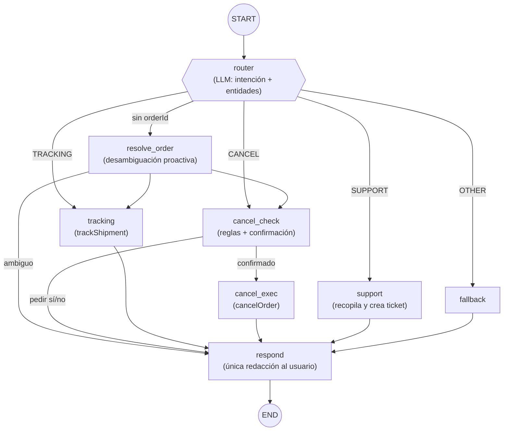

# L1 Support Copilot

Agente de soporte de nivel 1 **autónomo** para un e-commerce, construido con
**Spring Boot 3.5 + LangChain4j 1.16 + LangGraph4j 1.8 + Gemini (Google AI Studio)**.

No es un bot de comandos: el agente enruta semánticamente la conversación, maneja
ambigüedad de forma proactiva, mantiene estado conversacional entre turnos mediante
un grafo de estado con checkpointing, ejecuta acciones reales contra base de datos a
través de herramientas Java deterministas y escala a un humano creando tickets.

```text
Usuario:  ¿Dónde está mi pedido?
Agente:   Tienes dos pedidos recientes: un portátil (#123) y un ratón (#456).
          ¿Sobre cuál quieres consultar el estado?
Usuario:  El portátil
Agente:   Tu pedido #123 está EN REPARTO y llegará mañana con SEUR.
```

Ese diálogo ejercita lo que diferencia a este prototipo: detección de intención,
detección de información faltante, ejecución proactiva de tools (buscar los pedidos
recientes en vez de pedir el ID a ciegas), un **ciclo de clarificación** que sobrevive
entre peticiones HTTP y resolución de referencias ("el portátil" → #123).

## Arquitectura



Principios de diseño (los ADR completos están en [docs/arquitectura](docs/arquitectura/README.md)):

- **El LLM clasifica, el código decide.** El router produce una etiqueta estructurada;
  las aristas condicionales son funciones Java puras ([SupportRouting](src/main/java/io/github/mikel0ne/l1copilot/agent/SupportRouting.java)) testeables sin modelo.
- **Un turno HTTP = una invocación del grafo.** El checkpointer (`MemorySaver`) con
  `threadId` = `conversationId` restaura el estado entre turnos: así se implementan
  los ciclos de clarificación y la confirmación human-in-the-loop de las cancelaciones.
- **La IA orquesta, Java ejecuta.** Todo acceso a datos pasa por tools deterministas;
  el `userId` viene de la sesión HTTP y las queries son `findByIdAndUserId`: un prompt
  malicioso no puede cruzar datos entre usuarios.
- **Las reglas de negocio viven en código.** Cancelar un pedido ya enviado lo rechaza
  `OrderStatus.isCancellable()`, no un prompt.

## Arranque rápido

Requisitos: Java 17, Maven y una API key gratuita de
[Google AI Studio](https://aistudio.google.com/app/apikey).

```powershell
$env:GEMINI_API_KEY = "tu-api-key"   # NUNCA en el repo
mvn spring-boot:run
```

- Swagger UI: http://localhost:8080/swagger-ui/index.html — probar `POST /api/copilot/chat` con cabecera `X-User-Id: u-001`
- Consola H2 (perfil `dev`, con seed de demo): http://localhost:8080/h2-console (`jdbc:h2:mem:copilot`)

```powershell
mvn test    # 28 tests: aristas puras, tools contra H2, flujo completo del grafo con LLM fake, API
```

## Estructura

| Ruta | Contenido |
|---|---|
| `src/main/java/.../agent/` | El grafo LangGraph4j: estado, nodos, aristas, AiServices |
| `src/main/java/.../tools/` | Herramientas Java deterministas (reglas de negocio y seguridad) |
| `src/main/java/.../domain/` | Entidades JPA y repositorios |
| [docs/arquitectura](docs/arquitectura/README.md) | Diseño completo: ADRs, modelo de datos, grafo, API, plan por fases |
| [docs/infraestructura](docs/infraestructura/README.md) | Despliegue en Kubernetes local paso a paso |
| `k8s/` + `docker/` | Manifiestos listos para `kubectl apply` y Dockerfiles multi-stage |

## Despliegue en Kubernetes

El repo incluye la infraestructura completa para un clúster local (Docker Desktop):
PostgreSQL con seed por initdb, backend con probes de Actuator, Secrets para la API
key y credenciales de BD, e Ingress. Guías paso a paso en
[docs/infraestructura](docs/infraestructura/README.md).

```powershell
kubectl apply -f k8s/namespace.yaml
kubectl create secret generic gemini-api-key -n l1-copilot --from-literal=GEMINI_API_KEY=<key>
kubectl create secret generic postgres-credentials -n l1-copilot `
  --from-literal=POSTGRES_USER=copilot --from-literal=POSTGRES_PASSWORD=<pwd> --from-literal=POSTGRES_DB=copilot
kubectl apply -f k8s/
```

## Estado y hoja de ruta

- [x] Fase 0 — Alineación de dependencias (LangChain4j 1.16.2 + LangGraph4j 1.8.17)
- [x] Fases 1-2 — Dominio, seed y tools deterministas
- [x] Fases 3-4 — Grafo del agente y API REST
- [ ] Fase 5 — Frontend Angular (chat con login simulado)
- [ ] Fase 6 — Demo guiada y documentación de cierre
- [ ] Fase 7 — Despliegue en Kubernetes (guías e infraestructura ya preparadas)

Limitación consciente (documentada como ADR-6): la memoria conversacional vive en
`MemorySaver` (memoria de proceso) → el backend corre con 1 réplica. El punto de
extensión para escalar es implementar `BaseCheckpointSaver` sobre PostgreSQL.
