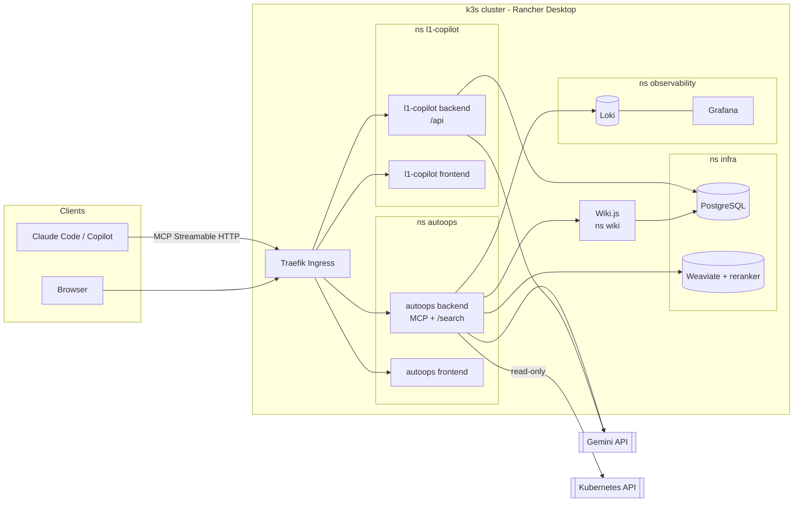

# AI Platform Portfolio: AutoOps MCP and L1 Support Copilot

Two generative-AI applications in **Java 17 / Spring Boot**, built on **LangChain4j** and **LangGraph4j**,
deployed to a local **Kubernetes (k3s)** cluster that they share with a common platform: one Helm chart, one
PostgreSQL, one Weaviate, one Loki/Grafana stack and one deployment script.

| Project | What it is | Highlights |
|---|---|---|
| [**AutoOps MCP**](autoops/README.md) | An **MCP server** that gives AI assistants (Claude Code, GitHub Copilot) read-only access to a Kubernetes cluster and an advanced RAG over internal docs | Spring AI MCP Server, corrective RAG (CRAG) as a LangGraph4j subgraph, hybrid search + reranking on Weaviate, Loki log queries, least-privilege RBAC |
| [**L1 Support Copilot**](l1-copilot/README.md) | An autonomous **level-1 support agent** for an e-commerce site that tracks, cancels and returns orders and opens tickets | LangGraph4j state graph with checkpointing, the LLM classifies but Java code decides, human-in-the-loop confirmations, prompt-injection test suite |



AutoOps can diagnose the L1 Copilot pods, and its RAG indexes this very repository's documentation, so the
two projects double as each other's test bed.

## Repository layout

```
autoops/        AutoOps MCP: backend (Spring Boot), frontend (Angular), docs, sample corpus
l1-copilot/     L1 Support Copilot: backend (Spring Boot), frontend (Angular), docs, DB scripts
infra/          Shared platform: generic Helm chart, values per app, Weaviate, Loki, RBAC, scripts
docker/         Shared Dockerfiles (backend, frontend) and nginx config
wiki/           Wiki.js content (an extra RAG source) and its seeding scripts
scripts/        Local start/stop of the L1 Copilot without Kubernetes
.github/        CI (backends, frontends, Helm chart and shell scripts) and Dependabot
```

## Quick start

Each project's README has the details. The short version:

```bash
# Unit and integration tests, no external services needed
cd autoops/backend && ./mvnw verify
cd l1-copilot/backend && ./mvnw verify
```

```bash
# L1 Copilot locally with H2, no Kubernetes (needs GEMINI_API_KEY)
export GEMINI_API_KEY=...        # free key at https://aistudio.google.com/app/apikey
./scripts/start.sh               # backend :8079/api, frontend :4199
```

Full platform on a local k3s cluster (Windows + Rancher Desktop):

```bash
cp infra/.env.local.example infra/.env.local    # fill in the secrets, it is gitignored
bash infra/scripts/02-setup-registry.sh         # then 03..08, see infra/INFRA.md
./infra/scripts/deploy.sh --project autoops --component all
./infra/scripts/setup-app-ingress.sh --project autoops
./infra/scripts/deploy.sh --project l1-copilot --component all
./infra/scripts/setup-app-ingress.sh --project l1-copilot
```

## Notes

- **Internal docs are in Spanish.** Architecture docs, ADRs and infrastructure guides live in each project's
  `docs/` folder and in [`infra/INFRA.md`](infra/INFRA.md). Code, scripts, configuration and READMEs are in English.
- **Product language is Spanish.** The L1 agent talks to Spanish-speaking customers and the RAG answers in
  Spanish, so LLM prompts, UI texts and demo data are in Spanish.
- **Synthetic demo data.** The RAG corpus (`autoops/corpus`), the wiki pages (`wiki/content`), the
  e-commerce seed (orders, users, tickets) and the FAQ are invented for the demo. No real company data.
- **AI-generated avatars.** The two demo user pictures in `l1-copilot/frontend/src/assets/avatars` were
  generated with an AI image tool; they do not depict real people.
- Developed between May and June 2026. Commit dates are the real ones.

## License

[MIT](LICENSE)
