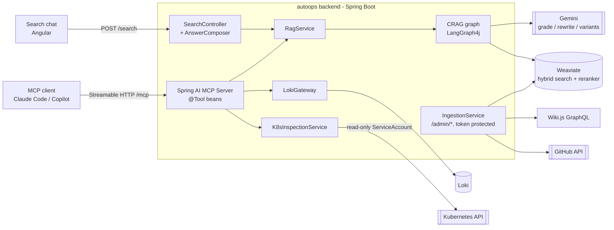
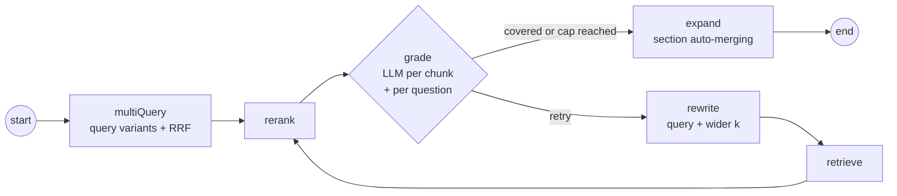

# AutoOps MCP

An **MCP (Model Context Protocol) server** that gives an AI assistant (Claude Code, GitHub Copilot or any MCP
client) **read-only access to a Kubernetes cluster** and an **advanced RAG over internal documentation**, so
it can debug running applications with real data instead of guessing.

AutoOps is not a chatbot: the MCP client does the reasoning. The server only exposes tools and data, safely.

## The problem

When an application fails in the cluster, a developer jumps between `kubectl describe`, events, logs, Grafana
and the internal wiki to work out what happened. AutoOps puts all of that within reach of the assistant they
already use: the assistant asks for a pod diagnosis, aggregated logs around a timestamp or the internal
standard that applies, and reasons about the cause with facts from the cluster.

## Architecture



### Corrective RAG (CRAG) loop

`search_docs` and `/search` share one retrieval core: a LangGraph4j subgraph that keeps searching until an LLM
grader confirms that the chunks cover every aspect of the question, or the iteration cap is reached.



- **Hybrid search + native reranking** in a single Weaviate query (vector + BM25, cross-encoder rerank).
- **Multi-query fan-out** on the first pass only, fused with Reciprocal Rank Fusion; retries use one rewritten
  query to keep the LLM cost bounded.
- **LLM grading, never the raw score**: a high rerank score is not a reliable proxy for relevance. Coverage is
  judged per question, so a compound question is not "answered" by covering one half of it.
- **Section auto-merging** after grading: small sections, or sections hit several times, are returned whole;
  large ones return the hit with its neighbours, bounded to the section.
- **Four confidence levels** (`high | medium | low | none`) that the chat answer states explicitly.

## MCP tools

| Tool | Purpose |
|---|---|
| `search_docs` | Corrective RAG over the internal documentation; returns chunks, source, section, score and confidence. |
| `diagnose_pod` | One-call dossier of a pod: phase, conditions, not-ready reason, restarts, recent events and log tail. |
| `list_pods` / `list_workloads` | Status of pods and Deployments/StatefulSets/DaemonSets. |
| `describe_pod` / `list_events` / `pod_logs` | Building blocks for the client's own analysis. |
| `query_logs` | Aggregated history across pods and namespaces from Loki, narrowed by time window or timestamp. |
| `ping` | Connectivity check. |

Cluster access is **strictly read-only**: the ServiceAccount in [`infra/rbac-autoops.yaml`](../infra/rbac-autoops.yaml)
cannot write anything and cannot read Secrets.

## Stack

Java 17 · Spring Boot 4.1 · **Spring AI 2.0 MCP Server** (Streamable HTTP) · **LangChain4j 1.16** (Gemini chat
and embeddings) · **LangGraph4j 1.8** (CRAG subgraph) · Weaviate 1.27 + reranker-transformers · fabric8 Kubernetes
client · Loki · Angular 22 · Helm on k3s (Rancher Desktop).

## Running it

**Tests** (no cluster or API key needed; the LLM and the external APIs are replaced by test doubles):

```bash
cd autoops/backend && ./mvnw verify
```

**Backend on the host**, against the cluster services through port-forwards:

```bash
kubectl port-forward svc/weaviate 8088:8080 -n infra &
kubectl port-forward svc/loki 3100:3100 -n observability &
export GEMINI_API_KEY=...          # free key at https://aistudio.google.com/app/apikey
export AUTOOPS_ADMIN_TOKEN=...     # any long random string, protects /admin/*
cd autoops/backend && ./mvnw spring-boot:run
```

The Kubernetes tools use the current kubeconfig context. The search chat runs with
`cd autoops/frontend && npm ci && npm start` (http://localhost:4199).

**On k3s**, after the shared platform is in place (see [`infra/INFRA.md`](../infra/INFRA.md)):

```bash
./infra/scripts/deploy.sh --project autoops --component all
./infra/scripts/setup-app-ingress.sh --project autoops
bash infra/scripts/ingest-autoops.sh --reset      # indexes this repository's docs into Weaviate
```

Then point an MCP client at `http://autoops.local/mcp`; for Claude Code the repo already ships
[`.mcp.json`](../.mcp.json).

## Evaluation

[`rag-golden-set.json`](backend/src/test/resources/rag-golden-set.json) holds 21 questions over the sample corpus, each
with the document and section that answer it. `RagEvalTest` measures, against a real index:

- **hybrid search + rerank**: hit@1, hit@5 and MRR of the expected section;
- **the full CRAG loop**: whether the evidence it hands to the answer contains that section, plus the confidence
  distribution and the iterations it took.

It is opt-in because it needs an indexed Weaviate with the reranker and a Gemini key; it fails below
`RAG_EVAL_MIN_HIT` (default 0.8 hit@5):

```bash
kubectl port-forward svc/weaviate 8088:8080 -n infra &
RAG_EVAL=true GEMINI_API_KEY=... AUTOOPS_WEAVIATE_CLASS_NAME=AutoopsDocChunk ./mvnw test -Dtest=RagEvalTest
```

## Design decisions

The ADRs are in [`docs/arquitectura/02-arquitectura-sistema.md`](docs/arquitectura/02-arquitectura-sistema.md) (Spanish):

| ADR | Decision |
|---|---|
| 001 | The product is an MCP server, not a copilot: the client reasons, the server provides data. |
| 002 | One application with two fronts (MCP tool and search chat) over a shared RAG core. |
| 003 | LLM and embedding provider behind an abstraction; Gemini free tier by default. |
| 004 | Spring AI for the MCP protocol, LangChain4j for the RAG. |
| 005 | Weaviate instead of pgvector, through the raw client to get hybrid search and native reranking. |
| 006 | Read-only access to the cluster, enforced by RBAC. |
| 007 | Corrective RAG as a LangGraph4j subgraph with the iteration cap on the edge. |
| 008 | Streamable HTTP transport inside the cluster. |
| 009 | Aggregated logs through Loki to complement the live pod log. |
| 010-011 | Multi-source ingestion (GitHub, Wiki.js) with hybrid chunking, and query-time section auto-merging instead of a stored neighbour window. |

## Security notes

- `/admin/*` (ingestion, vector store drop) requires the `X-Admin-Token` header and is not routed by the Ingress.
- Actuator exposes only `health` and `info`.
- `/mcp` and `/search` have no authentication: this is a local demo. A real deployment would put OAuth
  (the MCP authorization spec) or an authenticating gateway in front of them.

## Notes

- Internal design docs and infrastructure guides are in Spanish: [`docs/`](docs).
- The sample corpus (`corpus/`) and the wiki pages (`../wiki/content`) are **synthetic demo data**; the RAG also
  indexes this repository's own documentation.
