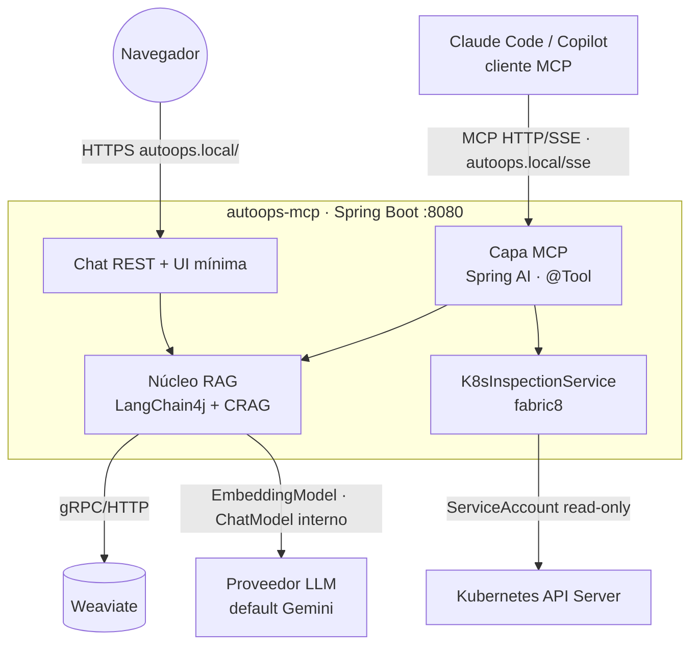

# 02 — Arquitectura del sistema

## 1. Componentes y responsabilidades

AutoOps es **una sola aplicación Spring Boot** (`autoops-mcp`) con dos *fronts* sobre un **núcleo RAG
compartido**, más el servicio de inspección de Kubernetes. No hay gateway, ni frontend de copiloto, ni base de
datos relacional de historial: todo eso era del diseño anterior y se elimina.

### Capa MCP (Spring AI MCP Server)

El front principal. Publica las **tools** que consume el cliente MCP (Claude Code, Copilot):

- Expone como tools MCP los beans Java anotados con `@Tool` (catálogo completo en [03-tools-mcp.md](03-tools-mcp.md)).
- **Transporte**: HTTP/SSE (o *streamable HTTP*) para la versión desplegada en el clúster; **stdio** para uso
  local del desarrollador.
- No contiene lógica de negocio: cada tool delega en el núcleo RAG o en el servicio K8s.

### Núcleo RAG (LangChain4j + Weaviate + CRAG)

El cerebro de recuperación, compartido por la tool `buscar_docs` y por el chat:

- **Ingesta**: documentación interna (markdown de `corpus/`) → chunks → embeddings → Weaviate.
- **Recuperación avanzada**: búsqueda **híbrida** (vector + keyword) + **reranking** + **bucle correctivo
  CRAG** (califica la relevancia; si es floja, reformula/expande la consulta y reintenta). El ciclo se modela
  con **LangGraph4j** (ver [03-tools-mcp.md](03-tools-mcp.md) §3).

### Servicio Kubernetes (read-only, fabric8)

Inspección del clúster para las tools de diagnóstico:

- Cliente fabric8 que, dentro del clúster, usa el **ServiceAccount read-only** del pod (RBAC de la guía de
  infraestructura `02`); en local usa el `kubeconfig`.
- Compone **dossiers deterministas** (estado + eventos + logs + reinicios). El LLM **no** decide qué llamadas
  hacer: la tool reúne datos fijos y es el **cliente MCP** quien razona.

### Chat de búsqueda (front secundario)

Una **UI mínima estática** + un endpoint REST `POST /search` que reutiliza el **mismo núcleo RAG** y añade un
paso de **redacción con LLM** para responder en lenguaje natural. Solo documentación (no K8s). **Sin** JWT,
historial ni auditoría: es deliberadamente fino para no recrear un copiloto.

### Weaviate

Base vectorial única para el RAG (embeddings + búsqueda híbrida + reranking). Sustituye a PostgreSQL/pgvector
del diseño anterior. DDL/esquema en [05-contratos-api-datos.md](05-contratos-api-datos.md) §3 y despliegue en la
guía de infraestructura `03-weaviate.md`.

## 2. Diagrama de componentes

Reglas de dependencia: `MCP/Chat → {RAG, K8s} → {Weaviate, LLM, API K8s}`. Nunca al revés.

## 3. Decisiones de arquitectura (ADRs)

### ADR-001 — El producto es un servidor MCP, no un copiloto

- **Contexto:** un diseño previo proponía un copiloto cerrado (frontend Angular + gateway con JWT/historial +
  un agente LangGraph4j con router y un ciclo de generar/validar YAML). El objetivo real es **usarlo desde
  Claude Code / GitHub Copilot** para depurar runtime.
- **Decisión:** construir un **servidor MCP** que expone tools; el razonamiento y la UI los aporta el cliente.
- **Consecuencias:** desaparecen el frontend de copiloto, el gateway, el router/grafo conversacional y el ciclo
  de YAML. El producto es reutilizable por cualquier cliente MCP y mucho más pequeño de operar.

### ADR-002 — Una sola app con dos fronts sobre un núcleo RAG compartido

- **Decisión:** un único Spring Boot expone el MCP (front principal) y un chat de búsqueda (front secundario),
  ambos sobre el mismo `RagService`. Las tools de K8s/logs son solo MCP.
- **Razones:** evita duplicar la lógica de RAG; el chat aporta una vía de uso sin cliente MCP (demos, usuarios
  sin Claude Code) a coste casi nulo.
- **Consecuencias:** el chat necesita un LLM de **redacción** server-side (la tool MCP no redacta). Disciplina:
  el chat se mantiene fino, sin JWT/historial/auditoría.

### ADR-003 — Proveedor LLM/embeddings abstraído; por defecto Gemini

- **Decisión:** el código depende de las interfaces `EmbeddingModel`/`ChatModel` de LangChain4j; el proveedor
  es configuración (`autoops.llm.provider`, default `gemini`). Detalle en [06-abstraccion-llm.md](06-abstraccion-llm.md).
- **Razones:** Gemini (AI Studio) tiene capa gratuita → coste cero; la abstracción desacopla del vendor.

### ADR-004 — Spring AI para el protocolo MCP; LangChain4j para el RAG

- **Contexto:** ni LangChain4j (Java) ni LangChain (Python) construyen *servidores* MCP: su módulo MCP es de
  cliente. El servidor se hace con un SDK de MCP dedicado.
- **Decisión:** **Spring AI MCP Server** (que envuelve el MCP Java SDK oficial) publica los `@Tool`; LangChain4j
  se usa **dentro** de las tools como motor de RAG (embeddings, `WeaviateEmbeddingStore`, retrieval).
- **Consecuencias:** dos librerías con roles claros y sin solape; ambas conviven en el mismo proyecto Spring.

### ADR-005 — Weaviate como vector store (no pgvector)

- **Decisión:** los embeddings y la búsqueda viven en **Weaviate**, no en PostgreSQL/pgvector.
- **Razones:** Weaviate ofrece **búsqueda híbrida (BM25 + vector)** y **reranking** de fábrica, justo lo que
  exige el "RAG avanzado"; LangChain4j trae `WeaviateEmbeddingStore`. Al no haber gateway, tampoco hay
  historial relacional que justifique PostgreSQL.
- **Consecuencias:** una pieza de infraestructura nueva (Weaviate) en lugar de PostgreSQL.

### ADR-006 — Acceso de solo lectura al clúster

- **Decisión:** RBAC estrictamente read-only (sin Secrets) y ninguna tool de escritura.
- **Razones:** gestión del riesgo: AutoOps puede equivocarse *describiendo*, pero no puede romper nada. Es el
  argumento de confianza del proyecto.

### ADR-007 — RAG correctivo (CRAG) con subgrafo LangGraph4j

- **Decisión:** `buscar_docs` no hace una sola búsqueda: corre un **bucle** recuperar → calificar → (si flojo)
  reformular/expandir → reintentar, acotado a N vueltas. Es un flujo **cíclico**, así que se implementa con
  **LangGraph4j** (la regla del repo aplica aquí, a diferencia del desaparecido ciclo de YAML).
- **Razones:** el usuario quiere un RAG que **valide si los resultados son buenos** y reaccione. La calificación
  por score es determinista; la reformulación usa el LLM interno.
- **Consecuencias:** el servidor incorpora un LLM pequeño de uso **interno** (calificar/reformular), distinto
  del razonamiento del cliente.

### ADR-008 — Transporte MCP HTTP/SSE in-cluster (+ stdio en local)

- **Decisión:** desplegado, AutoOps expone MCP por **HTTP/SSE** (necesita correr en el clúster para usar el
  ServiceAccount de lectura). En local, el desarrollador puede usar **stdio**.
- **Consecuencias:** el Ingress enruta el endpoint SSE; el cliente MCP se configura con la URL (ver
  [07-roadmap-implementacion.md](07-roadmap-implementacion.md) §F4).

## 4. Atributos de calidad y cómo se abordan

| Atributo | Mecanismo |
|---|---|
| Fiabilidad de la recuperación | Híbrido + reranking + bucle correctivo CRAG con tope de iteraciones |
| Seguridad | RBAC read-only sin Secrets; ninguna tool de escritura; el clúster no puede ser modificado |
| Evolución | Proveedor LLM/embeddings intercambiable (config); tools como beans `@Tool` enchufables |
| Reutilización | Es un MCP estándar: cualquier cliente MCP lo aprovecha sin UI propia |
| Trazabilidad | Logs por tool y por iteración del bucle CRAG |
| Coste | Gemini capa gratuita; Weaviate y K8s en local |
