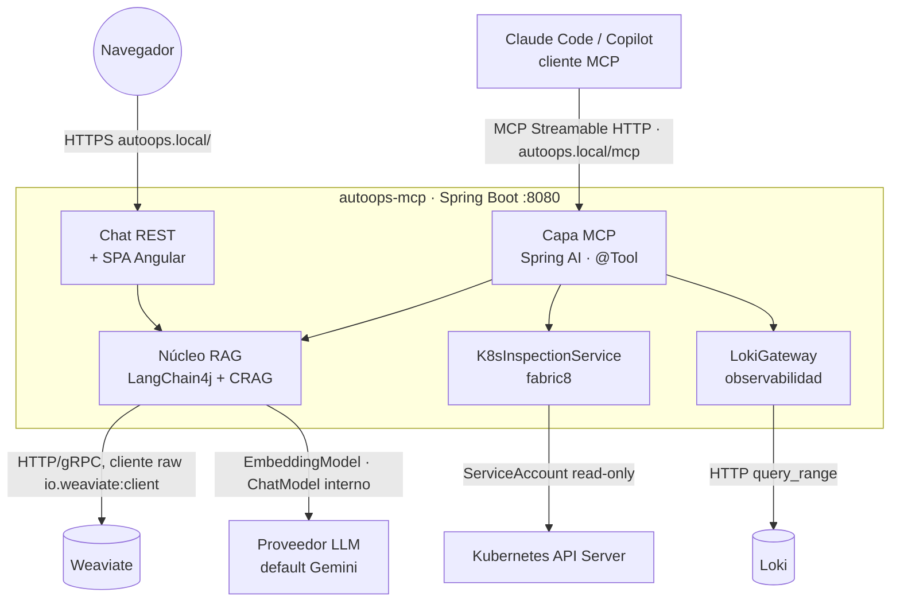

# 02 — Arquitectura del sistema

## 1. Componentes y responsabilidades

AutoOps es **una sola aplicación Spring Boot** (`autoops-mcp`) con dos *fronts* sobre un **núcleo RAG
compartido**, más el servicio de inspección de Kubernetes. No hay gateway, ni frontend de copiloto, ni base de
datos relacional de historial: todo eso era del diseño anterior y se elimina.

### Capa MCP (Spring AI MCP Server)

El front principal. Publica las **tools** que consume el cliente MCP (Claude Code, Copilot):

- Expone como tools MCP los beans Java anotados con `@Tool` (catálogo completo en [03-tools-mcp.md](03-tools-mcp.md)).
- **Transporte**: **Streamable HTTP** (Spring AI 2.0.0, con keep-alive) para la versión desplegada en el
  clúster; **stdio** para uso local del desarrollador.
- No contiene lógica de negocio: cada tool delega en el núcleo RAG o en el servicio K8s.

### Núcleo RAG (LangChain4j + Weaviate + CRAG)

El cerebro de recuperación, compartido por la tool `buscar_docs` y por el chat:

- **Ingesta multi-fuente**: cada `FuenteDocumental` (markdown local, repo Git, Confluence) aporta documentos →
  el `Chunker` los trocea (heading + recursivo, con ventana de vecinos) → embeddings → Weaviate (ver ADR-010).
- **Recuperación avanzada**: búsqueda **híbrida** (vector + keyword) + **reranking** + **bucle correctivo
  CRAG** (califica la relevancia; si es floja, reformula/expande la consulta y reintenta). El ciclo se modela
  con **LangGraph4j** (ver [03-tools-mcp.md](03-tools-mcp.md) §3).

### Servicio Kubernetes (read-only, fabric8)

Inspección del clúster para las tools de diagnóstico:

- Cliente fabric8 que, dentro del clúster, usa el **ServiceAccount read-only** del pod (RBAC de la guía de
  infraestructura `02`); en local usa el `kubeconfig`.
- Compone **dossiers deterministas** (estado + eventos + logs + reinicios). El LLM **no** decide qué llamadas
  hacer: la tool reúne datos fijos y es el **cliente MCP** quien razona.

### Servicio de observabilidad (Loki)

Logs agregados, complemento de `logs_pod` (que solo ve el pod actual):

- `LokiGateway` (`io.github.mikel0ne.autoops.observability`) habla por HTTP plano (`RestClient` de Spring, sin SDK
  dedicado) con la API `query_range` de **Loki**, compartido en el namespace `observability` (guía de
  infraestructura `07-setup-observability.sh`).
- Construye la query LogQL a partir de filtros estructurados (namespace/pod/contenedor/texto) y resuelve la
  ventana temporal (`ventanaMinutos` o `desde`/`hasta` ISO-8601 con milisegundos, para correlacionar instantes
  concretos entre servicios). Aplana y ordena cronológicamente la respuesta a `LogEntry`.

### Chat de búsqueda (front secundario)

Una **UI mínima estática** + un endpoint REST `POST /search` que reutiliza el **mismo núcleo RAG** y añade un
paso de **redacción con LLM** para responder en lenguaje natural. Solo documentación (no K8s). **Sin** JWT,
historial ni auditoría: es deliberadamente fino para no recrear un copiloto.

### Weaviate

Base vectorial única para el RAG (embeddings + búsqueda híbrida + reranking). Sustituye a PostgreSQL/pgvector
del diseño anterior. DDL/esquema en [05-contratos-api-datos.md](05-contratos-api-datos.md) §3 y despliegue en la
guía de infraestructura `03-weaviate.md`.

## 2. Diagrama de componentes

Reglas de dependencia: `MCP/Chat → {RAG, K8s, Observabilidad} → {Weaviate, LLM, API K8s, Loki}`. Nunca al revés.

## 3. Decisiones de arquitectura (ADRs)

### ADR-001 — El producto es un servidor MCP, no un copiloto

- **Contexto:** un diseño previo proponía un copiloto cerrado (frontend Angular + gateway con JWT/historial +
  un agente LangGraph4j con router y un ciclo de generar/validar YAML). El objetivo real es **usarlo desde
  Claude Code / GitHub Copilot** para depurar runtime.
- **Decisión:** construir un **servidor MCP** que expone tools; el razonamiento y la UI los aporta el cliente.
- **Consecuencias:** desaparecen el frontend de copiloto, el gateway, el router/grafo conversacional y el ciclo
  de YAML. El producto es reutilizable por cualquier cliente MCP y mucho más pequeño de operar.

### ADR-002 — Una sola app con dos fronts sobre un núcleo RAG compartido

- **Decisión:** un único Spring Boot expone el MCP (front principal) y un chat de búsqueda (front secundario),
  ambos sobre el mismo `RagService`. Las tools de K8s/logs son solo MCP.
- **Razones:** evita duplicar la lógica de RAG; el chat aporta una vía de uso sin cliente MCP (demos, usuarios
  sin Claude Code) a coste casi nulo.
- **Consecuencias:** el chat necesita un LLM de **redacción** server-side (la tool MCP no redacta). Disciplina:
  el chat se mantiene fino, sin JWT/historial/auditoría.

### ADR-003 — Proveedor LLM/embeddings abstraído; por defecto Gemini

- **Decisión:** el código depende de las interfaces `EmbeddingModel`/`ChatModel` de LangChain4j; el proveedor
  es configuración (`autoops.llm.provider`, default `gemini`). Detalle en [06-abstraccion-llm.md](06-abstraccion-llm.md).
- **Razones:** Gemini (AI Studio) tiene capa gratuita → coste cero; la abstracción desacopla del vendor.

### ADR-004 — Spring AI para el protocolo MCP; LangChain4j para el RAG

- **Contexto:** ni LangChain4j (Java) ni LangChain (Python) construyen *servidores* MCP: su módulo MCP es de
  cliente. El servidor se hace con un SDK de MCP dedicado.
- **Decisión:** **Spring AI MCP Server** (que envuelve el MCP Java SDK oficial) publica los `@Tool`; LangChain4j
  se usa **dentro** de las tools como motor de RAG (`EmbeddingModel`, `ChatModel`, retrieval).
- **Consecuencias:** dos librerías con roles claros y sin solape; ambas conviven en el mismo proyecto Spring.

### ADR-005 — Weaviate como vector store (no pgvector), con cliente raw en vez de `WeaviateEmbeddingStore`

- **Decisión:** los embeddings y la búsqueda viven en **Weaviate**, no en PostgreSQL/pgvector. El acceso
  (`WeaviateGateway`) usa el **cliente Java oficial `io.weaviate:client`** (traído transitivamente por la
  dependencia `langchain4j-weaviate`), no el `WeaviateEmbeddingStore` de LangChain4j.
- **Razones:** Weaviate ofrece **búsqueda híbrida (BM25 + vector)** y **reranking** de fábrica, justo lo que
  exige el "RAG avanzado" — pero `WeaviateEmbeddingStore` **no expone** ni híbrido ni reranking nativo, solo
  búsqueda vectorial simple. Para pedir `hybrid` + `rerank(...)` en la misma query GraphQL hace falta el
  cliente raw. Al no haber gateway, tampoco hay historial relacional que justifique PostgreSQL.
- **Consecuencias:** una pieza de infraestructura nueva (Weaviate) en lugar de PostgreSQL; el código de acceso
  (`WeaviateGateway`) es más manual (construye la query GraphQL a mano) a cambio de usar las capacidades
  avanzadas reales de Weaviate.

### ADR-006 — Acceso de solo lectura al clúster

- **Decisión:** RBAC estrictamente read-only (sin Secrets) y ninguna tool de escritura.
- **Razones:** gestión del riesgo: AutoOps puede equivocarse *describiendo*, pero no puede romper nada. Es el
  argumento de confianza del proyecto.

### ADR-007 — RAG correctivo (CRAG) con subgrafo LangGraph4j

- **Decisión:** `buscar_docs` no hace una sola búsqueda: corre un **bucle** recuperar → calificar → (si flojo)
  reformular/expandir → reintentar, acotado a N vueltas. Es un flujo **cíclico**, así que se implementa con
  **LangGraph4j** (la regla del repo aplica aquí, a diferencia del desaparecido ciclo de YAML).
- **Razones:** el usuario quiere un RAG que **valide si los resultados son buenos** y reaccione. La calificación
  la hace el LLM interno (juzga si los chunks responden a la pregunta; el score crudo del reranker/híbrido no
  es un proxy fiable, así que no decide por sí solo); la reformulación también usa el LLM interno, y cada
  reintento además **amplía `k`** (recupera más candidatos, no solo cambia las palabras de la consulta).
- **Consecuencias:** el servidor incorpora un LLM pequeño de uso **interno** (calificar/reformular), distinto
  del razonamiento del cliente.

### ADR-008 — Transporte MCP Streamable HTTP in-cluster (+ stdio en local)

- **Decisión:** desplegado, AutoOps expone MCP por **Streamable HTTP** (Spring AI 2.0.0 / Spring Boot 4.1.0;
  necesita correr en el clúster para usar el ServiceAccount de lectura). En local, el desarrollador puede usar
  **stdio**.
- **Historia:** la primera versión desplegada usaba el transporte **SSE legacy** (Spring AI 1.0.0). Sin
  keep-alive, los clientes basados en Node/undici (Claude Code, Copilot en VS Code/IntelliJ) cortaban la
  conexión a los ~5 min de inactividad (`-32001 Request timed out`) y había que reiniciar el cliente a mano.
  Se migró a Streamable HTTP (`streamable-http.keep-alive-interval: 20s`) como fix de la causa raíz, no como
  parche.
- **Consecuencias:** el Ingress enruta el endpoint `/mcp`; el cliente MCP se configura con la URL (ver
  [07-roadmap-implementacion.md](07-roadmap-implementacion.md) §F4).

### ADR-009 — Logs agregados vía Loki (`consultar_logs`), complemento de `logs_pod`

- **Contexto:** `logs_pod` (fabric8) solo ve el log en vivo del pod actual, equivalente a `kubectl logs`; no
  hay forma de correlacionar eventos entre varios pods/namespaces en una ventana de tiempo. Loki ya recibía los
  logs de todo el clúster (Promtail, ver guía de infraestructura `07-setup-observability.sh`), pero solo era
  útil para un humano mirando Grafana — el cliente MCP no podía consultarlo.
- **Decisión:** nueva tool `consultar_logs` (`io.github.mikel0ne.autoops.observability`: `LokiGateway` + `LokiProperties` +
  `ObservabilityTools`) que llama a `/loki/api/v1/query_range` con una query LogQL construida a partir de
  filtros estructurados. La ventana temporal admite `ventanaMinutos` (relativa) o `desde`/`hasta` en ISO-8601
  con milisegundos, para acotar a un instante muy concreto al correlacionar llamadas entre servicios.
- **Consecuencias:** primer cliente HTTP plano del proyecto (`RestClient` de Spring, sin SDK dedicado de Loki);
  el resto de integraciones (Weaviate, fabric8) usan su propio SDK. RBAC sin cambios: Loki no expone más que
  logs ya agregados por Promtail, ningún acceso nuevo al clúster.

### ADR-010 — Ingesta multi-fuente, chunking híbrido y ventana de vecinos (sentence-window)

- **Contexto:** la ingesta solo leía `corpus/*.md` local, con cuatro metadatos (`texto`, `fuente`, `seccion`,
  `orden`) y un único texto que a la vez se embebía y se almacenaba. No había forma de traer documentación
  desde un repositorio Git, ni de citar con título/URL, ni de dar al LLM redactor más contexto que el propio
  fragmento recuperado.
- **Decisión:**
  1. **Abstracción de origen** (`io.github.mikel0ne.autoops.rag.source.FuenteDocumental`): Spring inyecta `List<FuenteDocumental>`;
     cada una emite `Documento`. `LocalMarkdownSource` (carpeta local) y `GitMarkdownSource` (JGit, clona una
     rama y construye el permalink al **commit SHA**, no a la rama — para que la cita no se rompa cuando la
     rama avanza) están implementadas. `ConfluenceSource` es un **stub** deliberado (registrado, `leer()`
     vacío): no hay instancia de Confluence todavía, pero la abstracción ya está lista para enchufarla.
  2. **Chunking híbrido** (`Chunker`, estático y puro): parte por encabezado (mantiene el breadcrumb completo,
     p. ej. `Operación > Probes > Readiness`, como metadato `seccion`) y, dentro de cada sección, empaqueta
     párrafos hasta un tamaño objetivo; si un párrafo solo ya excede ese tamaño, lo subdivide con el splitter
     recursivo de LangChain4j en vez de emitir un chunk gigante.
  3. **Ventana de vecinos (sentence-window):** se separa el texto que se **embebe** (`nucleo`: el fragmento
     en sí, pequeño y limpio → afina el match) del que se **almacena y se cita** (`texto`: núcleo + el chunk
     anterior + el siguiente del mismo documento → más contexto para el LLM redactor). Es gratis aquí porque
     Weaviate tiene `vectorizer: none` (AutoOps calcula el vector a mano, ver ADR-005): basta con `embedAll`
     sobre `nucleo` e insertar `texto`.
  4. **Metadatos ampliados:** `titulo`, `url` (con ancla a la sección), `origen` (`markdown-local`|`git`|`confluence`),
     `docId` (documento padre) y `hash` (SHA-256 del núcleo, para una futura ingesta incremental) — esquema en
     [05-contratos-api-datos.md](05-contratos-api-datos.md) §4.
  5. **`taskType` distinto en indexar vs consultar:** `GeminiModelConfig` expone dos beans `EmbeddingModel`
     (`RETRIEVAL_DOCUMENT` al indexar, `RETRIEVAL_QUERY` al buscar — detalle en
     [06-abstraccion-llm.md](06-abstraccion-llm.md) §1/§3), porque Google AI Studio asimetriza el embedding
     según el uso.
- **Decisión explícita fuera de alcance:** leer el **código fuente** de un servicio (para diagnóstico cuando
  el error viene de "su" repo) **no** entra en esta ingesta. Prosa y código se trocean distinto, el embedding
  de prosa rinde peor sobre código, y sobre todo el diagnóstico quiere el código **tal y como está desplegado
  ahora** (el SHA en producción), no una copia pre-embebida que envejece. Si se necesita, será una tool MCP
  bajo demanda (mismo patrón que `K8sInspectionService`/`LokiGateway`: leer en vivo, no indexar), no parte del
  RAG de documentación.
- **Consecuencias:** cambio de esquema en Weaviate → cualquier despliegue de esto exige **reindexar desde
  cero** (`POST /admin/vectorstore/drop` + `POST /admin/ingest` + `POST /admin/ingest/git?url=...`, o
  directamente `infra/scripts/ingest-autoops.sh --reset`) con un `--tag` de imagen único.

## 4. Atributos de calidad y cómo se abordan

| Atributo | Mecanismo |
|---|---|
| Fiabilidad de la recuperación | Híbrido + reranking + bucle correctivo CRAG con tope de iteraciones |
| Seguridad | RBAC read-only sin Secrets; ninguna tool de escritura; el clúster no puede ser modificado |
| Evolución | Proveedor LLM/embeddings intercambiable (config); tools como beans `@Tool` enchufables |
| Reutilización | Es un MCP estándar: cualquier cliente MCP lo aprovecha sin UI propia |
| Trazabilidad | Logs por tool y por iteración del bucle CRAG |
| Coste | Gemini capa gratuita; Weaviate y K8s en local |
