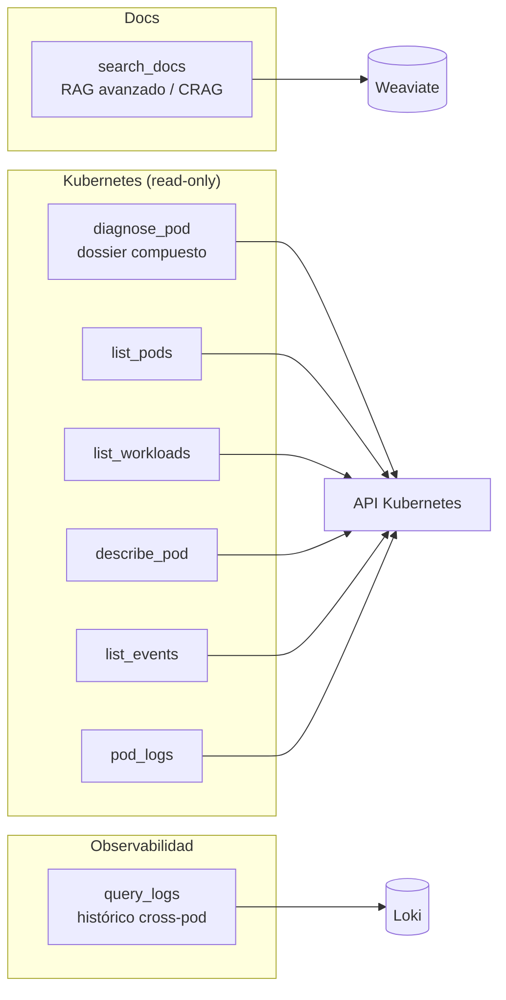
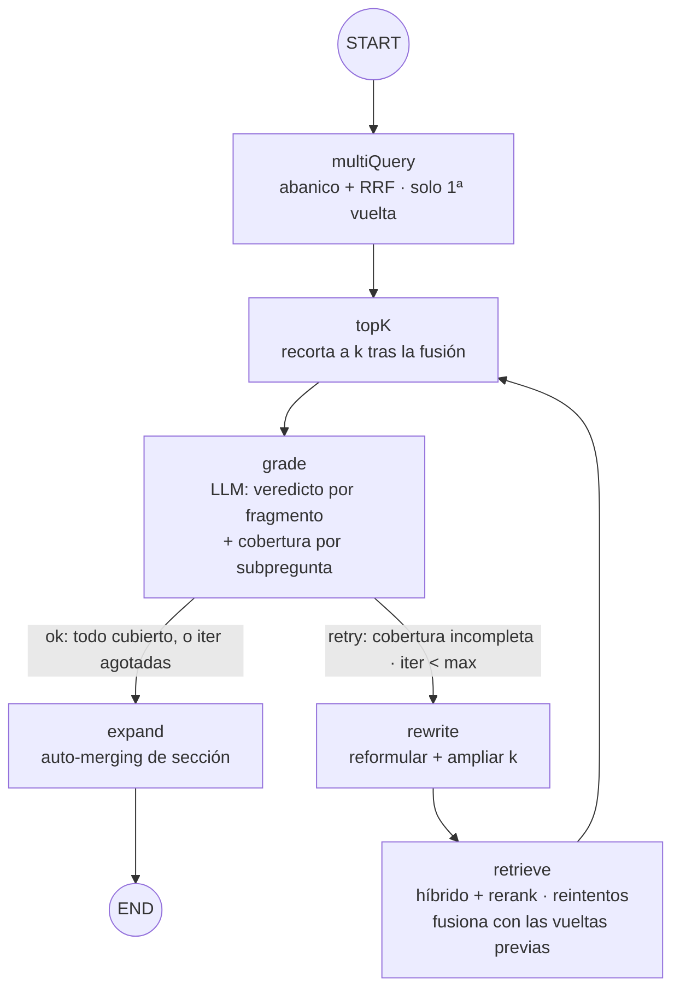

# 03 — Tools MCP y el bucle correctivo (corazón del sistema)

Catálogo de las herramientas que AutoOps publica por MCP y diseño del **núcleo RAG correctivo** (CRAG) que hay
detrás de `search_docs`. El protocolo MCP lo gestiona **Spring AI MCP Server**: basta anotar métodos con
`@Tool` y registrarlos. El razonamiento sobre las salidas lo hace el **cliente MCP** (Claude Code/Copilot); las
tools devuelven **datos estructurados y deterministas**.

## 1. Catálogo de tools



### 1.1 Documentación

| Tool | Parámetros | Devuelve |
|---|---|---|
| `search_docs` | `query: String`, `k: int = 5` (tope `autoops.crag.k-max`) | `RagResult`: fragmentos relevantes con su fuente, sección y score, las `iterations` del bucle y la `confidence` (`high \| medium \| low \| none`), tras híbrido + reranking + bucle CRAG. |

### 1.2 Kubernetes (todas de solo lectura)

| Tool | Parámetros | Devuelve |
|---|---|---|
| `diagnose_pod` | `namespace`, `name` | Dossier: fase, condiciones, motivo de no-Ready, eventos recientes, reinicios por contenedor y cola de logs. **Una llamada, todo el contexto.** |
| `list_pods` | `namespace`, `selector?` | Pods con fase, READY, reinicios y antigüedad. |
| `list_workloads` | `namespace?` | Deployments/StatefulSets/DaemonSets con réplicas deseadas vs disponibles. |
| `describe_pod` | `namespace`, `name` | Detalle tipo `kubectl describe` (contenedores, imágenes, requests/limits, condiciones). |
| `list_events` | `namespace`, `object?` | Hasta 50 eventos recientes del namespace u objeto. |
| `pod_logs` | `namespace`, `name`, `container?`, `lines=200` (máx. 1000), `previous=false` | Cola de logs (o del arranque anterior si `previous`). |

> **`diagnose_pod` es la tool estrella**: encapsula el "dossier" que antes era un nodo del grafo. El cliente
> suele empezar por ella y, si necesita más, pide piezas sueltas (`pod_logs`, `list_events`).

### 1.3 Observabilidad (Loki)

| Tool | Parámetros | Devuelve |
|---|---|---|
| `query_logs` | `namespace`, `pod?`, `container?`, `text?`, `from?`, `to?`, `windowMinutes=15` (máx. 1440), `lines=200` (máx. 1000) | Lista de líneas de log (Loki), aplanadas y ordenadas cronológicamente, de **varios pods/namespaces a la vez** en una ventana de tiempo. |

`pod_logs` solo ve el pod actual (equivalente a `kubectl logs`); `query_logs` complementa eso con histórico
agregado y correlación entre pods. Sin `from`/`to`, consulta los últimos `windowMinutes` hasta ahora. Para
acotar a un instante muy concreto (p. ej. correlacionar con un timestamp ya visto en otro log al encadenar
llamadas entre servicios), `from`/`to` aceptan ISO-8601 con milisegundos
(`2026-06-26T14:32:07.123Z`) — no hace falta una unidad distinta para precisión fina, basta con pasar el rango
exacto.

### 1.4 Conectividad y diferida

`ping(message)` (`DiagnosticsTools`) devuelve un eco con marca de tiempo: sirve para comprobar que el cliente
alcanza el servidor. `validar_manifiesto(yaml)` — validación sin estado (sintaxis + esquema + políticas) — es útil
pero **no** es depuración de runtime; se pospone.

## 2. Implementación de una tool (Spring AI)

Cada tool es un método `@Tool` en un bean de Spring. Spring AI genera el esquema MCP a partir de la firma y los
`@ToolParam`. Extracto real de `KubernetesTools`:

```java
@Component
@RequiredArgsConstructor
public class KubernetesTools {

    private final K8sInspectionService k8s;   // fabric8, read-only

    @Tool(name = "diagnose_pod",
          description = "Diagnostic dossier for a pod: phase, conditions, not-ready reason, containers with restarts, "
                  + "recent events and log tail. Start here to debug a failing pod.")
    public PodDiagnosis diagnosePod(
            @ToolParam(description = "Pod namespace") String namespace,
            @ToolParam(description = "Pod name") String name) {
        return k8s.diagnose(namespace, name);   // objeto estructurado → MCP lo serializa a JSON
    }
    // list_pods, list_workloads, describe_pod, list_events y pod_logs siguen el mismo patrón
}
```

Las descripciones de las tools van en inglés (es lo que lee el cliente MCP). Registro en el servidor MCP:

```java
@Configuration
public class McpConfig {

    @Bean
    public ToolCallbackProvider autoopsTools(DiagnosticsTools diagnostics, DocsTools docs,
                                             KubernetesTools kubernetes, ObservabilityTools observability) {
        return MethodToolCallbackProvider.builder()
                .toolObjects(diagnostics, docs, kubernetes, observability)
                .build();
    }
}
```

`application.yml` (transporte y metadatos del servidor):

```yaml
spring:
  ai:
    mcp:
      server:
        name: autoops-mcp
        type: SYNC
        protocol: STREAMABLE
        streamable-http:
          mcp-endpoint: /mcp
          keep-alive-interval: 20s   # los clientes basados en Node/undici cortan conexiones inactivas a los ~300 s
```

Con `autoops.mcp.token` (`AUTOOPS_MCP_TOKEN`) definido, un filtro exige la cabecera `X-MCP-Token` en `/mcp`; sin
token el endpoint queda abierto (solo ocurre en ejecuciones locales: el despliegue en el clúster lo hace obligatorio).

El `K8sInspectionService` y el cliente fabric8 read-only se detallan en [04-organizacion-codigo.md](04-organizacion-codigo.md)
y en la guía de infraestructura `02-topologia-kubernetes.md` (RBAC).

## 3. El núcleo: RAG correctivo (CRAG) con LangGraph4j

`search_docs` no es una búsqueda simple: corre un **bucle que valida la calidad y reacciona**. Es un flujo
**cíclico**, así que se implementa con **LangGraph4j** (regla del repo para grafos de estado).



La búsqueda híbrida y el reranking ocurren **dentro de la misma query de Weaviate** (el cross-encoder del módulo
`reranker-transformers` reordena los resultados); por eso no hay un nodo `rerank` aparte: `topK` solo recorta a
`k` tras la fusión.

Estrategias, por orden de retorno:

1. **Búsqueda híbrida** (vector + BM25) — nativa en Weaviate, con `alpha` configurable (`autoops.crag.alpha`).
2. **Reranking** — el módulo reranker de Weaviate reordena por relevancia; la mayor ganancia de precisión.
3. **Multi-query + RRF, solo en la primera vuelta** — `multiQuery` abre un abanico de hasta `multiQueryN`
   variantes de la consulta (la original + reformulaciones del LLM), recupera las variantes **en paralelo** y
   las fusiona con *Reciprocal Rank Fusion* antes de `topK`/`grade` (§3.2bis). No se reabre en los
   reintentos: el coste extra queda acotado a `multiQueryN - 1` recuperaciones de más, una sola vez por
   consulta de usuario.
4. **Calificador por fragmento y por subpregunta + bucle correctivo** — una sola llamada al LLM puntúa cada
   fragmento (`SUFFICIENT`/`AMBIGUOUS`/`INSUFFICIENT`) y la cobertura (`COVERED`/`PARTIAL`/`NOT_COVERED`) de cada
   subpregunta (las variantes de `multiQuery` hacen de subpreguntas). El resultado es *suficiente* solo si
   **todas** las subpreguntas están cubiertas, de modo que una pregunta compuesta no se da por respondida con la
   mitad. Si no lo es y quedan iteraciones, **reformula** la consulta de forma secuencial (una reformulación por
   reintento, sin abanico) **y sube el `k`** a la vez, y reintenta con `retrieve`, que **fusiona** (RRF) los
   candidatos nuevos con los de vueltas anteriores, deduplicados, para no perder un fragmento bueno que no vuelva
   a salir en el nuevo top-k.
5. **Auto-merging de sección** (`expand`) — los fragmentos confirmados se amplían a su sección completa o con sus
   vecinos dentro de la sección (§3.2), nunca al documento entero.
6. **Confianza explícita** — `RagService` deriva `high | medium | low | none` de la cobertura final y la
   devuelve junto a los fragmentos.

> **HyDE evaluado y descartado (2026-06-28):** generar una respuesta hipotética con el LLM y embeberla en vez
> de la consulta exigiría separar el texto que se embebe del texto que se usa para BM25/reranking, pero
> `DocRetriever.retrieve(query, k)` (y `WeaviateGateway` por debajo) usan la misma cadena `query` para
> ambos. Forzarlo habría significado tocar esa pieza central solo para esta exploración de coste/beneficio
> incierto sobre este corpus; se documenta el hallazgo y no se implementa.

### 3.1 El estado del subgrafo

```java
public class CragState extends AgentState {

    public String query();                   // consulta original
    public String currentQuery();            // la reformulada en los reintentos (por defecto, la original)
    public int k();                          // sube en cada reintento (kStep, tope kMax)
    public List<DocChunk> candidates();      // candidatos vigentes (tras grade, solo los no descartados)
    public List<DocChunk> rawCandidates();   // top-k antes de calificar; respaldo si nada es relevante
    public List<String> questions();         // subpreguntas a cubrir (la consulta y sus variantes)
    public List<Coverage> questionCoverage();// COVERED | PARTIAL | NOT_COVERED por subpregunta
    public double bestScore();               // solo para logs
    public boolean sufficient();
    public int iterations();
}
```

### 3.2 Los nodos (resumen)

- **`multiQuery`** — solo en la primera vuelta (entra desde `START`, nunca desde el camino de reintentos): ver
  §3.2bis.
- **`retrieve`** — búsqueda híbrida de Weaviate (vector+BM25+rerank nativo) sobre `currentQuery()` con `k`
  recuperaciones. Solo se usa en los reintentos (entra desde `rewrite`); la primera vuelta la hace
  `multiQuery`. **Fusiona** (RRF, deduplicando por fuente+sección+texto: `DocChunk` no tiene id propio) los
  resultados nuevos con los candidatos que ya hubiera en el estado en vez de sobreescribirlos.
- **`topK`** — el reranking ya ocurrió dentro de la query de Weaviate; este nodo recorta a `k` tras la fusión y
  guarda ese top-k también como `rawCandidates`.
- **`grade`** — el **LLM interno** evalúa en una sola llamada (prompt `crag_grade.txt`, salida estructurada vía
  `AiServices`: un `GradeResult` con un veredicto por fragmento y la cobertura de cada subpregunta; una respuesta
  no parseable cuenta como todo insuficiente). Un veredicto ausente se trata como `INSUFFICIENT`. La cobertura de
  una subpregunta sin valor explícito se deduce de los veredictos (`COVERED` si hay algún `SUFFICIENT`,
  `PARTIAL` si solo `AMBIGUOUS`). `sufficient` es verdadero cuando todas las subpreguntas están `COVERED`.
  **Solo la última vuelta filtra de verdad** `candidates` a los fragmentos `SUFFICIENT`/`AMBIGUOUS` (los demás nunca
  llegan a `AnswerComposer`): en las vueltas intermedias se conservan todos, para que un fragmento mal calificado
  una vez se reevalúe en el reintento. Deliberadamente sin atajo por `bestScore`: el score del reranker no es un
  proxy fiable de relevancia (en producción se vio un fragmento irrelevante con score muy alto y uno relevante con
  score muy bajo).
- **`expand`** — solo si `sufficient`. Aplica **auto-merging acotado a la sección** (patrón
  Parent-Document/Auto-Merging): agrupa los fragmentos por `(docId, section)` y decide por grupo de forma
  **determinista y sin consultar**, usando `sectionChars` (el tamaño de la sección, que ya viaja con cada
  `DocChunk` desde la ingesta). Casos: **(A)** si ≥2 núcleos de la misma sección son relevantes, se fusiona la
  sección; **(B)** si hay un único hit pero su sección es pequeña (`SMALL_SECTION_CHARS` = 3000), también;
  **(techo)** si la sección supera `MAX_MERGED_CHARS` (8000) no se fusiona, para no diluir el contexto; **(C)**
  un hit suelto en sección grande se devuelve con sus vecinos ±`NEIGHBOUR_RADIUS` (=1) **acotados a la sección**
  (`DocRetriever.neighboursInSection`, fetch dirigido por rango de `order`, sin cruzar a otra sección). Solo se
  consulta Weaviate (lookups filtrados por índice, no búsquedas semánticas) cuando hay que fusionar o traer
  vecinos. No actúa si `grade` no dio el visto bueno.
- **`rewrite`** — usa el **LLM interno** (prompt `crag_rewrite.txt`) para reformular/expandir la consulta, una
  sola reformulación secuencial (incorpora sinónimos del dominio, separa preguntas compuestas) **y aumenta `k`**
  (`kStep` por vuelta, tope `kMax`): cada reintento mira más lejos en el ranking, no solo cambia las palabras. No
  abre un abanico de variantes — eso solo ocurre una vez, en `multiQuery`.

### 3.2bis Multi-query + RRF en la primera vuelta

`multiQuery` (`MultiQueryNode`) sustituye al `retrieve` clásico **solo en la primera vuelta**:

1. Si `multiQueryN <= 1`, hace una única recuperación con la consulta tal cual, sin llamar al LLM.
2. Si `multiQueryN > 1`, pide al LLM interno (prompt `crag_multiquery.txt`) `multiQueryN - 1` reformulaciones
   alternativas de la consulta en **una sola llamada** (no una llamada por variante), las junta con la consulta
   original (descartando vacías y duplicadas) y recupera cada variante con `DocRetriever.retrieve(variante, k)`.
   Una salida no parseable degrada a buscar solo con la consulta original.
3. Las recuperaciones se lanzan **en paralelo** en un pool de hilos acotado
   (`autoops.crag.retrieval-parallelism`, 4 por defecto: cada una calcula el embedding de su variante y la API
   de embeddings tiene cuota por minuto). Los resultados se recogen **en el orden de las variantes**, así que la
   fusión ve la misma entrada que vería un bucle secuencial; el contexto de OpenTelemetry se propaga a los
   hilos para que las llamadas cuelguen del span correcto, y si una variante falla se cancelan las demás y sale
   la primera excepción por orden de variante.
4. Fusiona las listas con **Reciprocal Rank Fusion** (constante `k=60` del paper de Cormack et al.): suma
   `1 / (60 + rango)` por cada lista en la que aparece cada candidato (deduplicado por contenido, no hay id),
   ordena por esa puntuación y recorta a `k` — la misma forma que habría tenido una única recuperación, así
   que `topK`/`grade` no necesitan saber que hubo un abanico. Además, las variantes pasan a `questions` del
   estado: son las subpreguntas cuya cobertura evalúa `grade`.

**Por qué solo en la primera vuelta, no en cada reintento:** si se reabriera el abanico en cada reintento, el
coste en llamadas se multiplicaría por `maxIterations`. Limitarlo a la primera vuelta acota el coste extra a
`multiQueryN - 1` recuperaciones/embeddings de más, **una sola vez** por consulta de usuario; los reintentos
siguen el camino antiguo (`rewrite` con una reformulación + `retrieve` con una sola consulta, secuenciales).

**Coste en el peor caso** (con `multiQueryN=3`, `maxIterations=2`, valores por defecto): 1 llamada al LLM
para generar variantes + 3 recuperaciones (en paralelo) en la primera vuelta, más hasta 2 reintentos (`grade` +
`rewrite` + `retrieve` cada uno) = 6 llamadas al LLM y 5 recuperaciones en total. El embedding de una consulta es
una sola cadena por llamada (no un lote de ingesta): el límite de cuota del free tier de Gemini documentado en
`WeaviateGateway` es por la ingesta masiva, no por este uso interactivo, y el paralelismo acotado evita
ráfagas.

### 3.3 Construcción del grafo

```java
return new StateGraph<>(CragState::new)
        .addNode("multiQuery", node_async(multiQuery))
        .addNode("retrieve",   node_async(new RetrieveNode(retriever)))
        .addNode("topK",       node_async(new TopKNode()))
        .addNode("grade",      node_async(grade))
        .addNode("expand",     node_async(new ExpandNode(retriever)))
        .addNode("rewrite",    node_async(rewrite))

        .addEdge(START, "multiQuery")
        .addEdge("multiQuery", "topK")
        .addEdge("retrieve", "topK")
        .addEdge("topK", "grade")

        // El tope de iteraciones vive en la arista: el grafo termina diga lo que diga el calificador.
        .addConditionalEdges("grade",
                edge_async(s -> {
                    if (s.sufficient()) return "ok";
                    if (s.iterations() >= props.maxIterations()) return "ok";
                    return "retry";
                }),
                EdgeMappings.builder().to("expand", "ok").to("rewrite", "retry").build())

        .addEdge("expand", END)
        .addEdge("rewrite", "retrieve")
        .compile();
```

El grafo se compila de forma perezosa (la primera búsqueda), para no exigir la clave del modelo al arrancar.

Puntos finos:

- **El tope de iteraciones vive en el edge**, no en los nodos: el grafo garantiza la terminación.
- La decisión del edge es **pura** (solo lee `sufficient`/`iterations` del estado) → trivial de testear con
  un `ChatModel` falso.
- Si la cobertura no llega a ser completa al agotar las iteraciones, se devuelve **lo que haya**: los fragmentos
  confirmados o, si ninguno lo es, los mejores candidatos descartados (`RagResult.evidence()`); la respuesta
  marca `confidence` `medium`/`low`/`none` para que el cliente lo tenga en cuenta. En ese caso `expand` no
  actúa: no hay fragmentos confirmados que ampliar.

## 4. El chat reutiliza el mismo núcleo

El endpoint `POST /search` (front secundario) llama al **mismo** `RagService` y añade un paso de redacción con
el LLM interno (instrucción anti-alucinación: "si los documentos no contienen la respuesta, dilo"). La tool MCP
`search_docs`, en cambio, **no redacta**: devuelve los chunks y deja que el cliente MCP redacte.

## 5. Testing

| Nivel | Qué se prueba | Cómo |
|---|---|---|
| Unitario (mapeo K8s) | `K8sInspectionService.toDiagnosis`/`toPodStatus`/`toDescription` (estáticos, puros) | Objetos `Pod` de fixture construidos a mano con el builder de fabric8 (`PodBuilder`); sin cliente ni clúster real (`K8sInspectionMappingTest`). |
| Unitario (`query_logs`) | Construcción de LogQL, resolución de la ventana de tiempo, aplanado de la respuesta de Loki, escapado/variables de la URI | Métodos `static` puros de `LokiGateway` + `MockRestServiceServer` (`LokiGatewayTest`). |
| Unitario (nodos CRAG) | `multiQuery` (incluida la recuperación en paralelo y el orden de los resultados), `grade` y el resto de nodos aislados | `DocRetriever` y `ChatModel` falsos; aserciones sobre el delta de estado (`MultiQueryNodeTest`, `MultiQueryNodeParallelTest`, `GradeNodeTest`). |
| Integración (CRAG) | El bucle converge, escala `k` y termina; los fragmentos buenos sobreviven a los reintentos; auto-merging de sección en `expand`; el abanico `multiQuery` fusiona con RRF y no se reabre en reintentos; trazas por nodo | Retrievers programados con lotes de relevancia mixta (`CragLoopTest`, `CragTracingTest`). |
| Unitario (ingesta y fuentes) | `Chunker` (heading+recursivo, núcleo + `sectionChars`), `GitHubMarkdownSource` (permalink sin red), `GitHubGateway`, `IngestionService`, esquema de Weaviate | Fixtures en memoria y servidores simulados (`IngestionChunkingTest`, `IngestionServiceTest`, `GitHubMarkdownSourceTest`, `GitHubGatewayTest`, `WeaviateGatewayTest`). |
| Chat y seguridad | `/search` (validación, límite global de peticiones, 429/503), `AnswerComposer`, filtro de token de `/admin` y `/mcp`, carga de prompts, `CharsetGuard` | `SearchControllerTest`, `SearchEndpointTest` (429 sin llamar al LLM, 503 si el modelo falla o agota la cuota), `SearchRateLimiterTest`, `AnswerComposerTest`, `AdminTokenFilterTest`, `PromptLoaderTest`, `CharsetGuardTest`. |
| Contexto Spring | El contexto arranca y registra las nueve tools MCP | `ApplicationContextTest` (`@SpringBootTest`: solo corre en Linux en este entorno, vía `scripts/verify-in-docker.sh`). |
| Evaluación (opt-in) | hit@k, MRR, abstención y seguridad del RAG contra el modelo y un Weaviate reales | `RagEvalTest` (`RAG_EVAL=true`); `RagGoldenSetTest` valida el set sin red en cada build. |

El build no necesita un LLM real, un clúster real ni Weaviate/Loki reales: todo se prueba con dobles de prueba.
