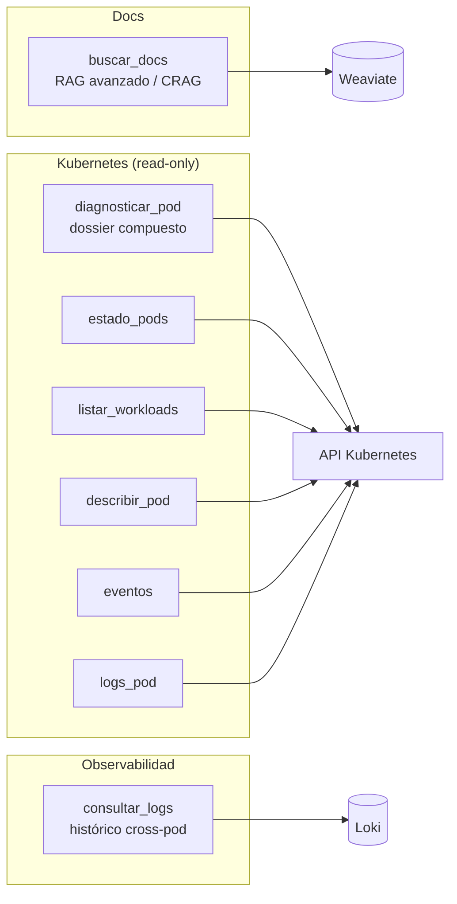
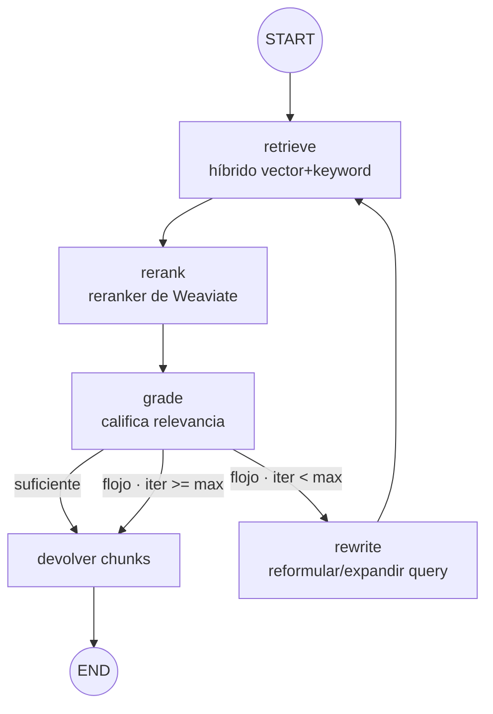

# 03 — Tools MCP y el bucle correctivo (corazón del sistema)

Catálogo de las herramientas que AutoOps publica por MCP y diseño del **núcleo RAG correctivo** (CRAG) que hay
detrás de `buscar_docs`. El protocolo MCP lo gestiona **Spring AI MCP Server**: basta anotar métodos con
`@Tool` y registrarlos. El razonamiento sobre las salidas lo hace el **cliente MCP** (Claude Code/Copilot); las
tools devuelven **datos estructurados y deterministas**.

## 1. Catálogo de tools



### 1.1 Documentación

| Tool | Parámetros | Devuelve |
|---|---|---|
| `buscar_docs` | `consulta: String`, `k: int = 5` | Lista de fragmentos relevantes con su fuente y score, tras híbrido + reranking + bucle CRAG. |

### 1.2 Kubernetes (todas de solo lectura)

| Tool | Parámetros | Devuelve |
|---|---|---|
| `diagnosticar_pod` | `namespace`, `nombre` | Dossier: fase, condiciones, motivo de no-Ready, eventos recientes, reinicios por contenedor y cola de logs. **Una llamada, todo el contexto.** |
| `estado_pods` | `namespace`, `selector? ` | Pods con fase, READY, reinicios y antigüedad. |
| `listar_workloads` | `namespace?` | Deployments/StatefulSets/DaemonSets con réplicas deseadas vs disponibles. |
| `describir_pod` | `namespace`, `nombre` | Detalle tipo `kubectl describe` (contenedores, imágenes, requests/limits, condiciones). |
| `eventos` | `namespace`, `objeto?` | Eventos recientes del namespace u objeto. |
| `logs_pod` | `namespace`, `nombre`, `contenedor?`, `lineas=200`, `previous=false` | Cola de logs (o del arranque anterior si `previous`). |

> **`diagnosticar_pod` es la tool estrella**: encapsula el "dossier" que antes era un nodo del grafo. El cliente
> suele empezar por ella y, si necesita más, pide piezas sueltas (`logs_pod`, `eventos`).

### 1.3 Observabilidad (Loki)

| Tool | Parámetros | Devuelve |
|---|---|---|
| `consultar_logs` | `namespace`, `pod?`, `contenedor?`, `texto?`, `desde?`, `hasta?`, `ventanaMinutos=15`, `lineas=200` | Lista de líneas de log (Loki), aplanadas y ordenadas cronológicamente, de **varios pods/namespaces a la vez** en una ventana de tiempo. |

`logs_pod` solo ve el pod actual (equivalente a `kubectl logs`); `consultar_logs` complementa eso con histórico
agregado y correlación entre pods. Sin `desde`/`hasta`, consulta los últimos `ventanaMinutos` hasta ahora. Para
acotar a un instante muy concreto (p. ej. correlacionar con un timestamp ya visto en otro log al encadenar
llamadas entre servicios), `desde`/`hasta` aceptan ISO-8601 con milisegundos
(`2026-06-26T14:32:07.123Z`) — no hace falta una unidad distinta para precisión fina, basta con pasar el rango
exacto.

### 1.4 Diferida (no MVP)

`validar_manifiesto(yaml)` — validación sin estado (sintaxis + esquema + políticas). Útil pero **no** es
depuración de runtime; se pospone.

## 2. Implementación de una tool (Spring AI)

Cada tool es un método `@Tool` en un bean de Spring. Spring AI genera el esquema MCP a partir de la firma y los
`@ToolParam`. Ejemplo de la tool de diagnóstico:

```java
package io.github.mikel0ne.autoops.tools;

import org.springframework.ai.tool.annotation.Tool;
import org.springframework.ai.tool.annotation.ToolParam;
import org.springframework.stereotype.Component;

@Component
public class KubernetesTools {

    private final K8sInspectionService k8s;   // fabric8, read-only

    public KubernetesTools(K8sInspectionService k8s) { this.k8s = k8s; }

    @Tool(name = "diagnosticar_pod",
          description = "Dossier de diagnóstico de un pod: fase, condiciones, eventos, reinicios y cola de logs.")
    public PodDiagnosis diagnosticarPod(
            @ToolParam(description = "Namespace del pod") String namespace,
            @ToolParam(description = "Nombre del pod") String nombre) {
        return k8s.diagnose(namespace, nombre);   // objeto estructurado → MCP lo serializa a JSON
    }

    @Tool(name = "logs_pod", description = "Cola de logs de un pod (read-only).")
    public String logsPod(String namespace, String nombre,
                          @ToolParam(required = false) String contenedor,
                          @ToolParam(required = false) Integer lineas,
                          @ToolParam(required = false) Boolean previous) {
        return k8s.logs(namespace, nombre, contenedor,
                        lineas == null ? 200 : lineas,
                        Boolean.TRUE.equals(previous));
    }
}
```

Registro de las tools en el servidor MCP (Spring AI):

```java
@Configuration
public class McpConfig {

    @Bean
    public ToolCallbackProvider autoopsTools(KubernetesTools k8s, DocsTools docs) {
        return MethodToolCallbackProvider.builder()
                .toolObjects(k8s, docs)
                .build();
    }
}
```

`application.yml` (transporte y metadatos del servidor):

```yaml
spring:
  ai:
    mcp:
      server:
        name: autoops-mcp
        version: 0.1.0
        # Streamable HTTP (con keep-alive) para la versión desplegada; stdio para uso local del desarrollador
        type: SYNC
```

El `K8sInspectionService` y el cliente fabric8 read-only se detallan en [04-organizacion-codigo.md](04-organizacion-codigo.md)
y en la guía de infraestructura `02-topologia-kubernetes.md` (RBAC).

## 3. El núcleo: RAG correctivo (CRAG) con LangGraph4j

`buscar_docs` no es una búsqueda simple: corre un **bucle que valida la calidad y reacciona**. Es un flujo
**cíclico**, así que se implementa con **LangGraph4j** (regla del repo para grafos de estado).



Estrategias, por orden de retorno:

1. **Búsqueda híbrida** (vector + BM25) — nativa en Weaviate.
2. **Reranking** — el módulo reranker de Weaviate reordena por relevancia; la mayor ganancia de precisión.
3. **Calificador + bucle correctivo** — el LLM interno evalúa si los fragmentos responden a la consulta; si no,
   **reformula/expande** la consulta (multi-query / HyDE) **y sube el `k`** a la vez, y reintenta.
4. **Filtros por metadatos** (fuente, sección) cuando la consulta los sugiere.

### 3.1 El estado del subgrafo

```java
package io.github.mikel0ne.autoops.rag.crag;

import org.bsc.langgraph4j.state.AgentState;
import java.util.*;

public class CragState extends AgentState {

    public CragState(Map<String, Object> initData) { super(initData); }

    public String consulta()            { return this.<String>value("consulta").orElseThrow(); }
    public String consultaActual()      { return this.<String>value("consultaActual").orElse(consulta()); }
    public int k()                      { return this.<Integer>value("k").orElse(5); }
    public List<DocChunk> candidatos()  { return this.<List<DocChunk>>value("candidatos").orElseGet(List::of); }
    public double mejorScore()          { return this.<Double>value("mejorScore").orElse(0.0); }
    public boolean suficiente()         { return this.<Boolean>value("suficiente").orElse(false); }
    public int iteraciones()            { return this.<Integer>value("iteraciones").orElse(0); }
}
```

### 3.2 Los nodos (resumen)

- **`retrieve`** — búsqueda híbrida de Weaviate (vector+BM25+rerank nativo) sobre `consultaActual()` con `k`
  recuperaciones; deja candidatos.
- **`rerank`** — reordena por el score que ya trae cada candidato y recorta a `k`.
- **`grade`** — el **LLM interno evalúa** si los candidatos bastan para responder la consulta (prompt
  `crag_grade.txt`, veredicto SUFICIENTE/INSUFICIENTE). Deliberadamente sin atajo por `mejorScore`: ese score
  no es un proxy fiable de relevancia (en producción se vio un fragmento irrelevante con score muy alto y uno
  relevante con score muy bajo). Marca `suficiente` con el veredicto del LLM; ante ambigüedad, prudente: no
  basta. `mejorScore` queda en el estado solo para logs.
- **`rewrite`** — usa el **LLM interno** para reformular/expandir la consulta (incorpora sinónimos del dominio,
  separa preguntas compuestas) **y aumenta `k`** (`kStep` por vuelta, tope `kMax`): cada reintento mira más
  lejos en el ranking, no solo cambia las palabras.

### 3.3 Construcción del grafo

```java
public CompiledGraph<CragState> build() throws GraphStateException {
    return new StateGraph<>(CragState::new)
            .addNode("retrieve", node_async(retrieve))
            .addNode("rerank",   node_async(rerank))
            .addNode("grade",    node_async(grade))
            .addNode("rewrite",  node_async(rewrite))

            .addEdge(START, "retrieve")
            .addEdge("retrieve", "rerank")
            .addEdge("rerank", "grade")

            .addConditionalEdges("grade",
                    edge_async(s -> {
                        if (s.suficiente())                      return "ok"; // el LLM ve los chunks suficientes
                        if (s.iteraciones() >= MAX_ITERACIONES)  return "ok"; // se devuelve lo mejor que haya
                        return "retry";
                    }),
                    EdgeMappings.builder()
                            .to(END,       "ok")
                            .to("rewrite", "retry")
                            .build())

            .addEdge("rewrite", "retrieve")
            .compile();
}
```

Puntos finos:

- **El tope de iteraciones vive en el edge**, no en los nodos: el grafo garantiza la terminación.
- La decisión del edge es **pura** (solo lee `suficiente`/`iteraciones` del estado) → trivial de testear con
  un `ChatModel` falso.
- Si el LLM nunca evalúa los resultados como suficientes, se devuelve **el mejor conjunto** obtenido (nunca se
  deja al cliente sin nada); la respuesta marca `confianza: baja` para que el cliente lo tenga en cuenta.

## 4. El chat reutiliza el mismo núcleo

El endpoint `POST /search` (front secundario) llama al **mismo** `RagService` y añade un paso de redacción con
el LLM interno (instrucción anti-alucinación: "si los documentos no contienen la respuesta, dilo"). La tool MCP
`buscar_docs`, en cambio, **no redacta**: devuelve los chunks y deja que el cliente MCP redacte.

## 5. Testing

| Nivel | Qué se prueba | Cómo |
|---|---|---|
| Unitario (mapeo K8s) | `K8sInspectionService.toDiagnosis`/`toPodStatus`/`toDescription`/`hace` (estáticos, puros) | Objetos `Pod` de fixture construidos a mano con el builder de fabric8 (`PodBuilder`); sin cliente ni clúster real (`K8sInspectionMappingTest`). |
| Unitario (`consultar_logs`) | Construcción de LogQL, resolución de la ventana de tiempo, aplanado de la respuesta de Loki, escapado/variables de la URI | Métodos `static` puros de `LokiGateway` + `MockRestServiceServer` para el caso de regresión de la URI (sin Loki real, `LokiGatewayTest`). |
| Unitario (nodos CRAG) | `retrieve`/`rerank`/`grade`/`rewrite` aislados | `DocRetriever` y `ChatModel` falsos (`TestSupport.ScriptedChatModel`/`FakeRetriever`); aserciones sobre el delta de estado. |
| Integración (CRAG) | El bucle converge, escala `k` y termina | `FakeRetriever` programado para devolver resultados flojos N veces y luego buenos; aserciones: iteró N veces, escaló `k`, terminó (`CragLoopTest`, incluye el test de regresión "score alto pero irrelevante no evita la evaluación del LLM"). |
| Unitario (ingesta) | `Chunker` (heading+recursivo, ventana de vecinos), `GitMarkdownSource` (permalink/webBase sin red) | Fixtures de markdown en memoria; sin Git real ni Weaviate (`IngestionChunkingTest`, `GitMarkdownSourceTest`). |

Ningún test necesita un LLM real, un clúster real ni Weaviate/Loki reales. No hay tests de integración con
contexto Spring (`@SpringBootTest`): en este entorno el loopback bloquea la creación de los `ChatModel`/
`EmbeddingModel` reales al arrancar el contexto, así que toda la cobertura es unitaria sobre POJOs/métodos
estáticos con dobles de prueba.
