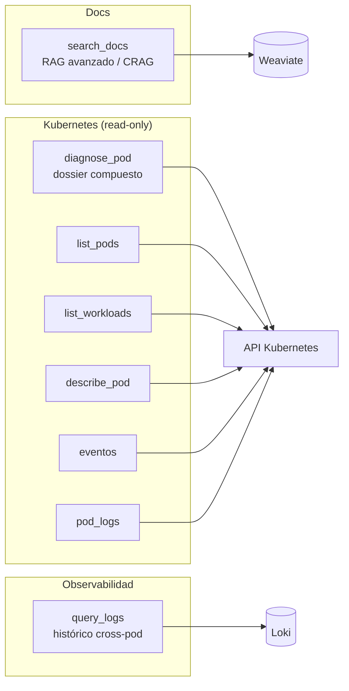
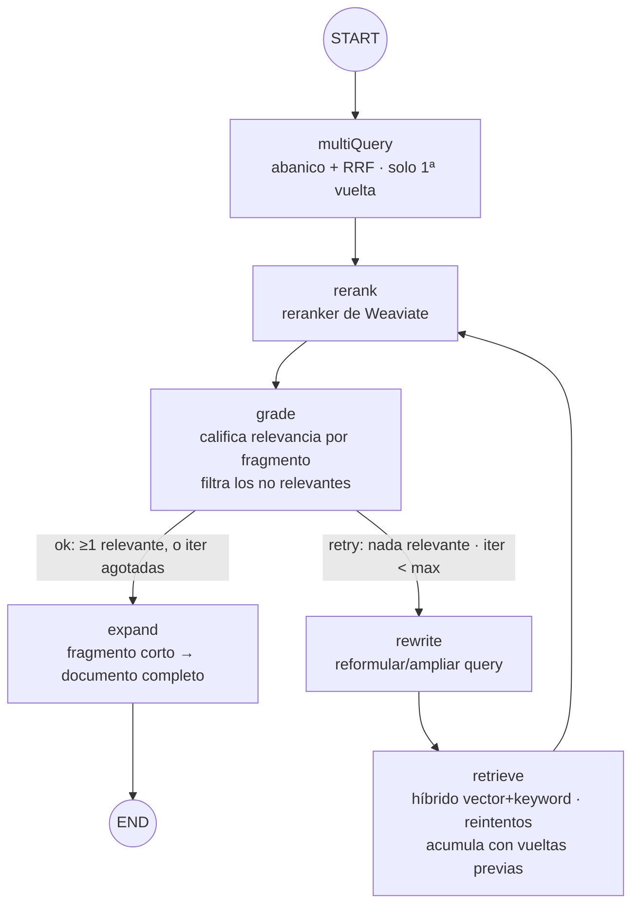

# 03 — Tools MCP y el bucle correctivo (corazón del sistema)

Catálogo de las herramientas que AutoOps publica por MCP y diseño del **núcleo RAG correctivo** (CRAG) que hay
detrás de `search_docs`. El protocolo MCP lo gestiona **Spring AI MCP Server**: basta anotar métodos con
`@Tool` y registrarlos. El razonamiento sobre las salidas lo hace el **cliente MCP** (Claude Code/Copilot); las
tools devuelven **datos estructurados y deterministas**.

## 1. Catálogo de tools



### 1.1 Documentación

| Tool | Parámetros | Devuelve |
|---|---|---|
| `search_docs` | `consulta: String`, `k: int = 5` | Lista de fragmentos relevantes con su fuente y score, tras híbrido + reranking + bucle CRAG. |

### 1.2 Kubernetes (todas de solo lectura)

| Tool | Parámetros | Devuelve |
|---|---|---|
| `diagnose_pod` | `namespace`, `nombre` | Dossier: fase, condiciones, motivo de no-Ready, eventos recientes, reinicios por contenedor y cola de logs. **Una llamada, todo el contexto.** |
| `list_pods` | `namespace`, `selector? ` | Pods con fase, READY, reinicios y antigüedad. |
| `list_workloads` | `namespace?` | Deployments/StatefulSets/DaemonSets con réplicas deseadas vs disponibles. |
| `describe_pod` | `namespace`, `nombre` | Detalle tipo `kubectl describe` (contenedores, imágenes, requests/limits, condiciones). |
| `list_events` | `namespace`, `objeto?` | Eventos recientes del namespace u objeto. |
| `pod_logs` | `namespace`, `nombre`, `contenedor?`, `lineas=200`, `previous=false` | Cola de logs (o del arranque anterior si `previous`). |

> **`diagnose_pod` es la tool estrella**: encapsula el "dossier" que antes era un nodo del grafo. El cliente
> suele empezar por ella y, si necesita más, pide piezas sueltas (`pod_logs`, `list_events`).

### 1.3 Observabilidad (Loki)

| Tool | Parámetros | Devuelve |
|---|---|---|
| `query_logs` | `namespace`, `pod?`, `contenedor?`, `texto?`, `desde?`, `hasta?`, `ventanaMinutos=15`, `lineas=200` | Lista de líneas de log (Loki), aplanadas y ordenadas cronológicamente, de **varios pods/namespaces a la vez** en una ventana de tiempo. |

`pod_logs` solo ve el pod actual (equivalente a `kubectl logs`); `query_logs` complementa eso con histórico
agregado y correlación entre pods. Sin `desde`/`hasta`, consulta los últimos `ventanaMinutos` hasta ahora. Para
acotar a un instante muy concreto (p. ej. correlacionar con un timestamp ya visto en otro log al encadenar
llamadas entre servicios), `desde`/`hasta` aceptan ISO-8601 con milisegundos
(`2026-06-26T14:32:07.123Z`) — no hace falta una unidad distinta para precisión fina, basta con pasar el rango
exacto.

### 1.4 Diferida (no MVP)

`validar_manifiesto(yaml)` — validación sin estado (sintaxis + esquema + políticas). Útil pero **no** es
depuración de runtime; se pospone.

## 2. Implementación de una tool (Spring AI)

Cada tool es un método `@Tool` en un bean de Spring. Spring AI genera el esquema MCP a partir de la firma y los
`@ToolParam`. Ejemplo de la tool de diagnóstico:

```java
package io.github.mikel0ne.autoops.tools;

import org.springframework.ai.tool.annotation.Tool;
import org.springframework.ai.tool.annotation.ToolParam;
import org.springframework.stereotype.Component;

@Component
public class KubernetesTools {

    private final K8sInspectionService k8s;   // fabric8, read-only

    public KubernetesTools(K8sInspectionService k8s) { this.k8s = k8s; }

    @Tool(name = "diagnose_pod",
          description = "Dossier de diagnóstico de un pod: fase, condiciones, eventos, reinicios y cola de logs.")
    public PodDiagnosis diagnosticarPod(
            @ToolParam(description = "Namespace del pod") String namespace,
            @ToolParam(description = "Nombre del pod") String nombre) {
        return k8s.diagnose(namespace, nombre);   // objeto estructurado → MCP lo serializa a JSON
    }

    @Tool(name = "pod_logs", description = "Cola de logs de un pod (read-only).")
    public String logsPod(String namespace, String nombre,
                          @ToolParam(required = false) String contenedor,
                          @ToolParam(required = false) Integer lineas,
                          @ToolParam(required = false) Boolean previous) {
        return k8s.logs(namespace, nombre, contenedor,
                        lineas == null ? 200 : lineas,
                        Boolean.TRUE.equals(previous));
    }
}
```

Registro de las tools en el servidor MCP (Spring AI):

```java
@Configuration
public class McpConfig {

    @Bean
    public ToolCallbackProvider autoopsTools(KubernetesTools k8s, DocsTools docs) {
        return MethodToolCallbackProvider.builder()
                .toolObjects(k8s, docs)
                .build();
    }
}
```

`application.yml` (transporte y metadatos del servidor):

```yaml
spring:
  ai:
    mcp:
      server:
        name: autoops-mcp
        version: 0.1.0
        # Streamable HTTP (con keep-alive) para la versión desplegada; stdio para uso local del desarrollador
        type: SYNC
```

El `K8sInspectionService` y el cliente fabric8 read-only se detallan en [04-organizacion-codigo.md](04-organizacion-codigo.md)
y en la guía de infraestructura `02-topologia-kubernetes.md` (RBAC).

## 3. El núcleo: RAG correctivo (CRAG) con LangGraph4j

`search_docs` no es una búsqueda simple: corre un **bucle que valida la calidad y reacciona**. Es un flujo
**cíclico**, así que se implementa con **LangGraph4j** (regla del repo para grafos de estado).



Estrategias, por orden de retorno:

1. **Búsqueda híbrida** (vector + BM25) — nativa en Weaviate.
2. **Reranking** — el módulo reranker de Weaviate reordena por relevancia; la mayor ganancia de precisión.
3. **Multi-query + RRF, solo en la primera vuelta** — `multiQuery` abre un abanico de hasta `multiQueryN`
   variantes de la consulta (la original + reformulaciones del LLM), recupera cada una por separado y las
   fusiona con *Reciprocal Rank Fusion* antes de `rerank`/`grade` (doc 03 §3.2bis). No se reabre en los
   reintentos: el coste extra queda acotado a `multiQueryN - 1` recuperaciones de más, una sola vez por
   consulta de usuario.
4. **Calificador por fragmento + bucle correctivo** — una sola llamada al LLM evalúa, fragmento por
   fragmento, cuáles responden a la consulta y **filtra los que no** (nunca llegan al redactor); basta con
   que haya al menos uno relevante para considerar la recuperación buena. Si ninguno lo es, **reformula** la
   consulta de forma secuencial (una reformulación por reintento, sin abanico) **y sube el `k`** a la vez, y
   reintenta con `retrieve`, que **acumula** los candidatos con los de vueltas anteriores (deduplicados) en
   vez de descartarlos, para no perder un fragmento bueno que no vuelva a salir en el nuevo top-k.
5. **Expansión a documento completo** — un fragmento ya confirmado relevante pero demasiado corto (p. ej. el
   final de una sección breve) se amplía con el resto de su documento antes de devolver la respuesta.
6. **Filtros por metadatos** (fuente, sección) cuando la consulta los sugiere.

> **HyDE evaluado y descartado (2026-06-28):** generar una respuesta hipotética con el LLM y embeberla en vez
> de la consulta exigiría separar el texto que se embebe del texto que se usa para BM25/reranking, pero
> `DocRetriever.retrieve(consulta, k)` (y `WeaviateGateway` por debajo) usan la misma cadena `consulta` para
> ambos. Forzarlo habría significado tocar esa pieza central solo para esta exploración de coste/beneficio
> incierto sobre este corpus; se documenta el hallazgo y no se implementa.

### 3.1 El estado del subgrafo

```java
package io.github.mikel0ne.autoops.rag.crag;

import org.bsc.langgraph4j.state.AgentState;
import java.util.*;

public class CragState extends AgentState {

    public CragState(Map<String, Object> initData) { super(initData); }

    public String consulta()            { return this.<String>value("consulta").orElseThrow(); }
    public String consultaActual()      { return this.<String>value("consultaActual").orElse(consulta()); }
    public int k()                      { return this.<Integer>value("k").orElse(5); }
    public List<DocChunk> candidatos()  { return this.<List<DocChunk>>value("candidatos").orElseGet(List::of); }
    public double mejorScore()          { return this.<Double>value("mejorScore").orElse(0.0); }
    public boolean suficiente()         { return this.<Boolean>value("suficiente").orElse(false); }
    public int iteraciones()            { return this.<Integer>value("iteraciones").orElse(0); }
}
```

### 3.2 Los nodos (resumen)

- **`multiQuery`** — solo en la primera vuelta (entra desde `START`, nunca desde el camino de reintentos): ver
  doc 03 §3.2bis.
- **`retrieve`** — búsqueda híbrida de Weaviate (vector+BM25+rerank nativo) sobre `consultaActual()` con `k`
  recuperaciones. Solo se usa en los reintentos (entra desde `rewrite`); la primera vuelta la hace
  `multiQuery`. **Acumula** los candidatos con los que ya hubiera en el estado (en vez de sobreescribirlos) y
  deduplica por fuente+sección+texto (`DocChunk` no tiene id propio): un fragmento bueno encontrado en una
  vuelta no se pierde si la siguiente reformulación no vuelve a traerlo en el nuevo top-k.
- **`rerank`** — reordena por el score que ya trae cada candidato y recorta a `k`.
- **`grade`** — el **LLM interno evalúa, fragmento por fragmento, en una sola llamada** si cada candidato
  aporta algo a la consulta (prompt `crag_grade.txt`, salida estructurada vía `AiServices`: un record
  `GradeResult` con un veredicto `SUFFICIENT/AMBIGUOUS/INSUFFICIENT` por fragmento y la cobertura de cada
  pregunta; una respuesta no parseable cuenta como todo insuficiente). **Filtra `candidatos`** a los marcados relevantes — los demás nunca llegan a `AnswerComposer` —
  y deriva `suficiente` de esos veredictos: basta con que haya al menos uno relevante (el resto del bucle ya
  amplía la búsqueda si la cobertura es pobre). Ante un veredicto ambiguo o ausente para un fragmento, se
  trata como NO relevante. Deliberadamente sin atajo por `mejorScore`: ese score no es un proxy fiable de
  relevancia (en producción se vio un fragmento irrelevante con score muy alto y uno relevante con score muy
  bajo); `mejorScore` queda en el estado solo para logs. Si ningún fragmento es relevante, `candidatos` se
  deja sin filtrar (para que `retrieve` pueda acumular sobre ellos en el siguiente reintento, o para no dejar
  al cliente sin nada si se agotan las iteraciones).
- **`expand`** — solo en el camino "ok" de `grade`. Aplica **auto-merging acotado a la sección** (patrón
  Parent-Document/Auto-Merging): agrupa los fragmentos relevantes por `(docId, seccion)` y decide por grupo de
  forma **determinista y sin consultar**, usando `seccionChars` (el tamaño de la sección, que ya viaja con cada
  `DocChunk` desde la ingesta). Casos: **(A)** si ≥2 núcleos de la misma sección son relevantes (co-recuperación),
  se fusiona la sección; **(B)** si hay un único hit pero su sección es pequeña (`<= UMBRAL_PEQUENA`), también;
  **(techo)** si la sección supera `TOPE_FUSION` no se fusiona, para no diluir el contexto; **(C)** un hit suelto
  en sección grande se devuelve con sus vecinos ±`RADIO_VECINOS` (=1) **acotados a la sección**
  (`DocRetriever.vecinosEnSeccion`, fetch dirigido por rango de `orden`, sin cruzar a otra sección). Solo se
  consulta Weaviate (lookups filtrados por índice, no búsquedas semánticas) cuando hay que fusionar o traer
  vecinos, uniendo los núcleos —ordenados por `orden`— en una sola cita. No actúa si `grade` no dio el visto
  bueno: en ese caso `candidatos` no son fragmentos confirmados como relevantes.
- **`rewrite`** — usa el **LLM interno** para reformular/expandir la consulta, una sola reformulación
  secuencial (incorpora sinónimos del dominio, separa preguntas compuestas) **y aumenta `k`** (`kStep` por
  vuelta, tope `kMax`): cada reintento mira más lejos en el ranking, no solo cambia las palabras. No abre un
  abanico de variantes — eso solo ocurre una vez, en `multiQuery`.

### 3.2bis Multi-query + RRF en la primera vuelta

`multiQuery` (`MultiQueryNode`) sustituye al `retrieve` clásico **solo en la primera vuelta**:

1. Si `multiQueryN <= 1`, hace exactamente lo que hacía el `retrieve` de toda la vida: una recuperación con la
   consulta tal cual, sin llamar al LLM. Es el equivalente exacto del comportamiento anterior a este nodo.
2. Si `multiQueryN > 1`, pide al LLM interno (prompt `crag_multiquery.txt`) `multiQueryN - 1` reformulaciones
   alternativas de la consulta en **una sola llamada** (no una llamada por variante), las junta con la consulta
   original y recupera cada variante por separado con `DocRetriever.retrieve(variante, k)`.
3. Fusiona las listas con **Reciprocal Rank Fusion** (constante `k=60` del paper de Cormack et al.): suma
   `1 / (60 + rango)` por cada lista en la que aparece cada candidato (deduplicado por contenido, no hay id),
   ordena por esa puntuación y recorta a `k` — la misma forma que habría tenido una única recuperación, así
   que `rerank`/`grade` no necesitan saber que hubo un abanico.

**Por qué solo en la primera vuelta, no en cada reintento:** si se reabriera el abanico en cada reintento, el
coste en llamadas se multiplicaría por `maxIteraciones`. Limitarlo a la primera vuelta acota el coste extra a
`multiQueryN - 1` recuperaciones/embeddings de más, **una sola vez** por consulta de usuario; los reintentos
siguen el camino antiguo (`rewrite` con una reformulación + `retrieve` con una sola consulta).

**Coste en el peor caso** (con `multiQueryN=3`, `maxIteraciones=2`, valores por defecto): 1 llamada al LLM
para generar variantes + 3 recuperaciones en la primera vuelta, más hasta 2 reintentos (`grade` + `rewrite` +
`retrieve` cada uno) = 6 llamadas al LLM y 5 recuperaciones en total, frente a 5 llamadas al LLM y 3
recuperaciones sin este nodo. El embedding de una consulta es una sola cadena por llamada (no un lote de
ingesta): el límite de cuota del free tier de Gemini documentado en `WeaviateGateway` (100 RPM/1000 RPD) es
por la ingesta masiva, no por este uso interactivo, así que el margen es amplio.

### 3.3 Construcción del grafo

```java
public CompiledGraph<CragState> build() throws GraphStateException {
    return new StateGraph<>(CragState::new)
            .addNode("multiQuery", node_async(multiQuery))
            .addNode("retrieve",   node_async(retrieve))
            .addNode("rerank",     node_async(rerank))
            .addNode("grade",      node_async(grade))
            .addNode("expand",     node_async(expand))
            .addNode("rewrite",    node_async(rewrite))

            .addEdge(START, "multiQuery")
            .addEdge("multiQuery", "rerank")
            .addEdge("retrieve", "rerank")
            .addEdge("rerank", "grade")

            .addConditionalEdges("grade",
                    edge_async(s -> {
                        if (s.suficiente())                      return "ok"; // ≥1 fragmento relevante
                        if (s.iteraciones() >= MAX_ITERACIONES)  return "ok"; // se devuelve lo mejor que haya
                        return "retry";
                    }),
                    EdgeMappings.builder()
                            .to("expand",  "ok")
                            .to("rewrite", "retry")
                            .build())

            .addEdge("expand", END)
            .addEdge("rewrite", "retrieve")
            .compile();
}
```

Puntos finos:

- **El tope de iteraciones vive en el edge**, no en los nodos: el grafo garantiza la terminación.
- La decisión del edge es **pura** (solo lee `suficiente`/`iteraciones` del estado) → trivial de testear con
  un `ChatModel` falso.
- Si ningún fragmento llega a ser relevante, se devuelve **el mejor conjunto sin filtrar** obtenido (nunca se
  deja al cliente sin nada); la respuesta marca `confianza: baja` para que el cliente lo tenga en cuenta. En
  ese caso `expand` no actúa: no hay fragmentos confirmados como relevantes que ampliar.

## 4. El chat reutiliza el mismo núcleo

El endpoint `POST /search` (front secundario) llama al **mismo** `RagService` y añade un paso de redacción con
el LLM interno (instrucción anti-alucinación: "si los documentos no contienen la respuesta, dilo"). La tool MCP
`search_docs`, en cambio, **no redacta**: devuelve los chunks y deja que el cliente MCP redacte.

## 5. Testing

| Nivel | Qué se prueba | Cómo |
|---|---|---|
| Unitario (mapeo K8s) | `K8sInspectionService.toDiagnosis`/`toPodStatus`/`toDescription`/`hace` (estáticos, puros) | Objetos `Pod` de fixture construidos a mano con el builder de fabric8 (`PodBuilder`); sin cliente ni clúster real (`K8sInspectionMappingTest`). |
| Unitario (`query_logs`) | Construcción de LogQL, resolución de la ventana de tiempo, aplanado de la respuesta de Loki, escapado/variables de la URI | Métodos `static` puros de `LokiGateway` + `MockRestServiceServer` para el caso de regresión de la URI (sin Loki real, `LokiGatewayTest`). |
| Unitario (nodos CRAG) | `multiQuery`/`retrieve`/`rerank`/`grade`/`expand`/`rewrite` aislados | `DocRetriever` y `ChatModel` falsos (`TestSupport.ScriptedChatModel`/`FakeRetriever`/`MultiChunkRetriever`, con cola de respuestas propia para el prompt de `multiQuery`); aserciones sobre el delta de estado. |
| Integración (CRAG) | El bucle converge, escala `k` y termina; filtra por fragmento sin perder los buenos entre reintentos; auto-merging de sección en `expand`; el abanico `multiQuery` fusiona con RRF y no se reabre en reintentos | `FakeRetriever`/`MultiChunkRetriever` programados con lotes de relevancia mixta; aserciones: filtra los no relevantes del lote, un fragmento bueno de la 1ª iteración sobrevive al retry aunque la 2ª no lo recupere de nuevo, auto-merging por sección (Caso A ≥2 hits, Caso B sección pequeña, Caso C hit suelto con vecinos ±1 acotados a la sección, techo de sección grande sin consultar); con `multiQueryN>1`, recuperó una vez por variante y recortó a `k` tras la fusión; con `multiQueryN<=1`, una sola recuperación sin llamar al LLM de variantes (`CragLoopTest`, incluye el test de regresión "score alto pero irrelevante no evita la evaluación del LLM"). |
| Unitario (ingesta) | `Chunker` (heading+recursivo; almacena el núcleo + `seccionChars`), `GitMarkdownSource` (permalink/webBase sin red) | Fixtures de markdown en memoria; sin Git real ni Weaviate (`IngestionChunkingTest`, `GitMarkdownSourceTest`). |

Ningún test necesita un LLM real, un clúster real ni Weaviate/Loki reales. No hay tests de integración con
contexto Spring (`@SpringBootTest`): en este entorno el loopback bloquea la creación de los `ChatModel`/
`EmbeddingModel` reales al arrancar el contexto, así que toda la cobertura es unitaria sobre POJOs/métodos
estáticos con dobles de prueba.
