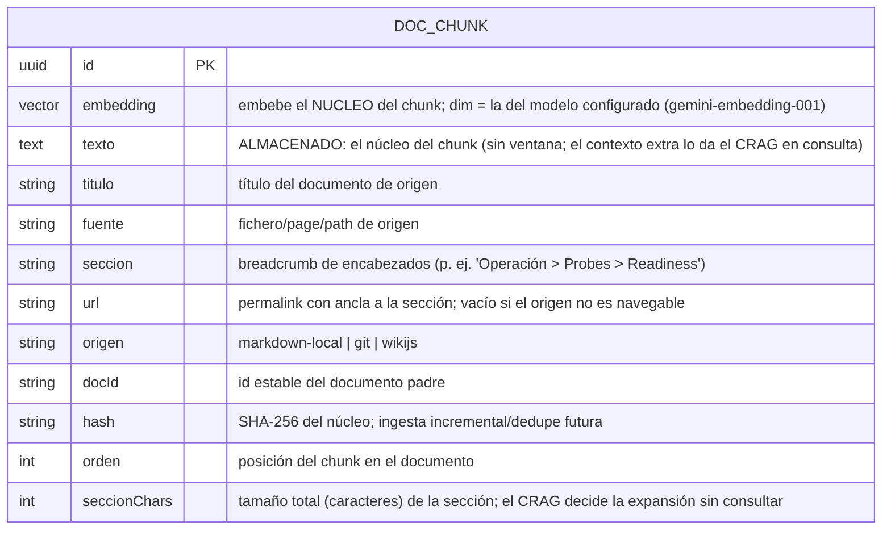

# 05 — Contratos de tools, API del chat y esquema de datos

Contratos estables de AutoOps: las **tools MCP** (lo que ve el cliente), el **endpoint del chat** y el
**esquema de Weaviate**. Cambiarlos afecta a los consumidores: pensarlo dos veces.

## 1. Contrato de las tools MCP

El cliente MCP descubre las tools por *introspección* (Spring AI publica nombre, descripción y esquema de
parámetros). Forma canónica de cada una:

### `buscar_docs`

```jsonc
// entrada
{ "consulta": "estándar de probes para microservicios Java", "k": 5 }
// salida
{
  "chunks": [
    { "texto": "Las probes readiness deben…", "titulo": "Estándar de microservicios",
      "fuente": "estandar-microservicios.md", "seccion": "Estándar de microservicios > Probes",
      "url": "", "origen": "markdown-local", "score": 0.83 }
  ],
  "iteraciones": 1,          // vueltas del bucle CRAG consumidas
  "confianza": "alta"        // alta | baja (baja = el LLM evaluador no consideró los chunks suficientes)
}
```

### `diagnosticar_pod`

```jsonc
// entrada
{ "namespace": "default", "nombre": "payments-api-7d9f-abc" }
// salida (PodDiagnosis)
{
  "fase": "Pending",
  "ready": false,
  "motivo": "ErrImagePull",
  "condiciones": [ { "tipo": "Ready", "estado": "False", "motivo": "ContainersNotReady" } ],
  "contenedores": [ { "nombre": "app", "imagen": "registry/payments:9.9.9",
                      "reinicios": 0, "estado": "Waiting", "motivoEstado": "ErrImagePull" } ],
  "eventos": [ { "tipo": "Warning", "motivo": "Failed", "mensaje": "Failed to pull image…", "hace": "30s" } ],
  "logs": "(sin logs: el contenedor no ha arrancado)"
}
```

### Resto de tools K8s

| Tool | Entrada | Salida (resumen) |
|---|---|---|
| `estado_pods` | `{ namespace, selector? }` | `[{ nombre, fase, ready, reinicios, edad }]` |
| `listar_workloads` | `{ namespace? }` | `[{ tipo, nombre, deseadas, disponibles }]` |
| `describir_pod` | `{ namespace, nombre }` | Objeto tipo `describe` (contenedores, imágenes, requests/limits, condiciones) |
| `eventos` | `{ namespace, objeto? }` | `[{ tipo, motivo, mensaje, hace }]` |
| `logs_pod` | `{ namespace, nombre, contenedor?, lineas=200, previous=false }` | `String` (cola de logs) |

### `consultar_logs`

```jsonc
// entrada — sin desde/hasta: últimos ventanaMinutos hasta ahora
{ "namespace": "autoops", "pod": "autoops-backend-7d9f", "texto": "ERROR", "ventanaMinutos": 15 }
// entrada — instante concreto (p. ej. correlacionar con un timestamp ya visto en otro log)
{ "namespace": "autoops", "desde": "2026-06-26T14:32:07.100Z", "hasta": "2026-06-26T14:32:07.900Z" }
// salida (List<LogEntry>)
[
  { "timestamp": "2026-06-26T14:32:07.123Z", "namespace": "autoops", "pod": "autoops-backend-7d9f",
    "contenedor": "app", "linea": "ERROR no se pudo conectar a weaviate.infra.svc.cluster.local:8080" }
]
```

`desde`/`hasta` son ISO-8601 y admiten milisegundos; si se omiten, la ventana es `[ahora - ventanaMinutos, ahora]`.

**Invariante de seguridad:** ninguna tool acepta operaciones de escritura ni expone Secrets. El RBAC del
ServiceAccount lo garantiza a nivel de clúster (guía de infraestructura `02`).

## 2. API del chat de búsqueda (front secundario)

Sin autenticación en el MVP (solo lectura de documentación pública interna). Reutiliza el núcleo RAG.

### POST `/search`

```jsonc
// request
{ "consulta": "¿Cuál es nuestra política de recursos para un microservicio Java?" }
// response 200
{
  "respuesta": "Según la guía interna, todo contenedor declara requests y límite de memoria…",  // redactado
  "citas": [ { "fuente": "politica-recursos.md", "titulo": "Política de recursos",
               "seccion": "Política de recursos > Límites", "url": "", "origen": "markdown-local", "score": 0.81 } ],
  "confianza": "alta"
}
```

La SPA Angular (`frontend/`, sección `search/`) consume este endpoint. Es el **único** componente con LLM de
redacción server-side; la tool MCP equivalente (`buscar_docs`) no redacta.

### GET `/actuator/health`

Readiness incluye: reachability de Weaviate y del proveedor LLM (check ligero, cacheado, para no quemar cuota).
El endpoint MCP (`/mcp`, Streamable HTTP) está disponible cuando readiness pasa.

## 3. DTOs (forma canónica en Java)

```java
public record DocChunk(String texto, String titulo, String fuente, String seccion, String url, String origen,
                       double score) {}

public record SearchRequest(String consulta) {}
public record SearchResponse(String respuesta, List<DocChunk> citas, String confianza) {}

public record PodDiagnosis(
        String fase, boolean ready, String motivo,
        List<Condicion> condiciones, List<Contenedor> contenedores,
        List<Evento> eventos, String logs) {
    public record Condicion(String tipo, String estado, String motivo) {}
    public record Contenedor(String nombre, String imagen, int reinicios, String estado, String motivoEstado) {}
    public record Evento(String tipo, String motivo, String mensaje, String hace) {}
}

public record LogEntry(Instant timestamp, String namespace, String pod, String contenedor, String linea) {}
```

## 4. Esquema de datos (Weaviate)

Una sola clase/colección guarda los chunks de documentación con su vector y metadatos. No hay base de datos
relacional (sin gateway, no hay historial que persistir).



Definición de la clase Weaviate (esquema lógico; el manifiesto y el bootstrap están en la guía de
infraestructura `03-weaviate.md`):

```jsonc
{
  "class": "AutoopsDocChunk",           // el nombre real es prefijado: Weaviate es compartido (ver doc 03 de infra)
  "vectorizer": "none",                 // los embeddings los calcula AutoOps (LangChain4j), no Weaviate
  "properties": [
    { "name": "texto",   "dataType": ["text"] },
    { "name": "titulo",  "dataType": ["text"] },
    { "name": "fuente",  "dataType": ["text"], "tokenization": "field" },
    { "name": "seccion", "dataType": ["text"] },
    { "name": "url",     "dataType": ["text"], "tokenization": "field" },
    { "name": "origen",  "dataType": ["text"], "tokenization": "field" },
    { "name": "docId",   "dataType": ["text"], "tokenization": "field" },
    { "name": "hash",    "dataType": ["text"], "tokenization": "field" },
    { "name": "orden",   "dataType": ["int"] },
    { "name": "seccionChars", "dataType": ["int"] }
  ],
  "moduleConfig": { "reranker-transformers": {} }   // reranking nativo
}
```

- La **dimensión del vector** la fija el modelo de embeddings configurado (`gemini-embedding-001`, el free
  tier real — `text-embedding-004` no está disponible). Si se cambia de modelo de embeddings, hay que recrear
  la clase con la nueva dimensión y **re-ingestar** el corpus (ver doc 06).
- La **búsqueda híbrida** (vector + BM25 sobre `texto`) y el **reranking** se piden en la query, no cambian el
  esquema.
- **Se embebe y se almacena el mismo texto (el núcleo)**: ya no se hornea la ventana de vecinos (ADR-010 quedó
  superseded por ADR-011, doc 02). El contexto extra lo resuelve el bucle CRAG en consulta vía auto-merging de
  sección (`expand`, doc 03 §3.2), usando `seccionChars` para decidir sin consultar.

## 5. Versionado del contrato

MVP sin versionado de URL. Disciplina mínima: cambios **aditivos** (añadir un campo a una salida no rompe;
renombrar/eliminar sí). Los **nombres y descripciones de las tools** son contrato de cara al cliente MCP:
cambiarlos puede alterar cuándo el asistente decide invocarlas.
