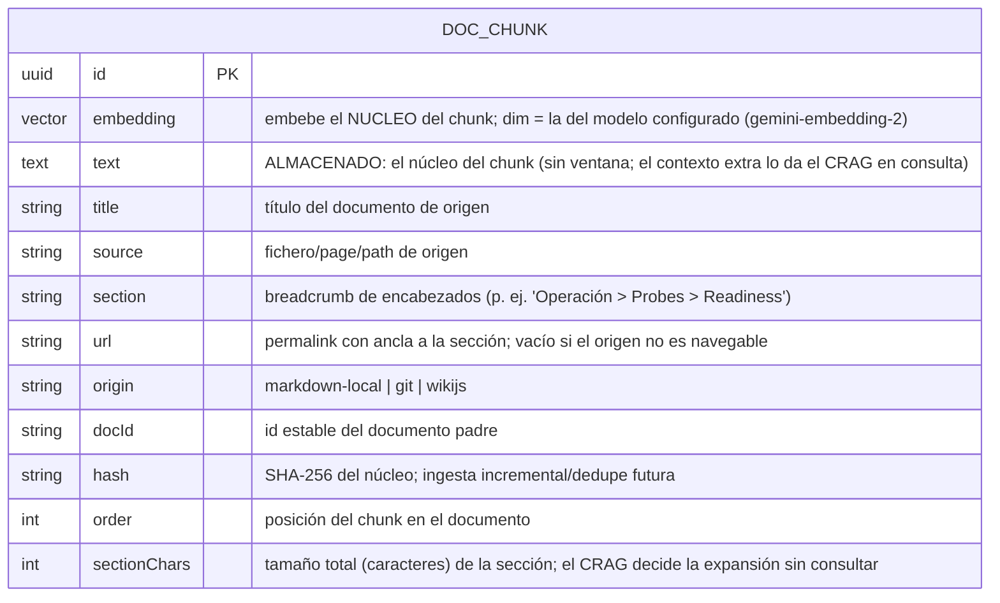

# 05 — Contratos de tools, API del chat y esquema de datos

Contratos estables de AutoOps: las **tools MCP** (lo que ve el cliente), el **endpoint del chat** y el
**esquema de Weaviate**. Cambiarlos afecta a los consumidores: pensarlo dos veces.

## 1. Contrato de las tools MCP

El cliente MCP descubre las tools por *introspección* (Spring AI publica nombre, descripción y esquema de
parámetros). Forma canónica de cada una:

### `search_docs`

```jsonc
// entrada
{ "query": "estándar de probes para microservicios Java", "k": 5 }
// salida
{
  "chunks": [
    { "text": "Las probes readiness deben…", "title": "Estándar de microservicios",
      "source": "estandar-microservicios.md", "section": "Estándar de microservicios > Probes",
      "url": "", "origin": "markdown-local", "score": 0.83 }
  ],
  "iterations": 1,          // vueltas del bucle CRAG consumidas
  "confidence": "high",       // high | medium | low | none (cobertura de las subpreguntas según el LLM evaluador)
  "discardedCandidates": []   // solo con confidence none: hasta 3 candidatos descartados, como único material
}
```

### `diagnose_pod`

```jsonc
// entrada
{ "namespace": "default", "name": "payments-api-7d9f-abc" }
// salida (PodDiagnosis)
{
  "phase": "Pending",
  "ready": false,
  "reason": "ErrImagePull",
  "conditions": [ { "type": "Ready", "state": "False", "reason": "ContainersNotReady" } ],
  "containers": [ { "name": "app", "image": "registry/payments:9.9.9",
                    "restarts": 0, "state": "Waiting", "stateReason": "ErrImagePull" } ],
  "events": [ { "type": "Warning", "reason": "Failed", "message": "Failed to pull image…", "ago": "30s" } ],
  "logs": "(sin logs: el contenedor no ha arrancado)"
}
```

### Resto de tools K8s

| Tool | Entrada | Salida (resumen) |
|---|---|---|
| `list_pods` | `{ namespace, selector? }` | `[{ name, phase, ready, restarts, age }]` |
| `list_workloads` | `{ namespace? }` | `[{ type, name, desired, available }]` |
| `describe_pod` | `{ namespace, name }` | Objeto tipo `describe` (`name`, `namespace`, `phase`, `node`, `containers` con imagen y requests/limits, `conditions`) |
| `list_events` | `{ namespace, object? }` | `[{ type, reason, message, ago }]` (hasta 50) |
| `pod_logs` | `{ namespace, name, container?, lines=200, previous=false }` | `String` (cola de logs) |
| `ping` | `{ message }` | `String`: eco con marca de tiempo |

### `query_logs`

```jsonc
// entrada — sin from/to: últimos windowMinutes hasta ahora
{ "namespace": "autoops", "pod": "autoops-backend-7d9f", "text": "ERROR", "windowMinutes": 15 }
// entrada — instante concreto (p. ej. correlacionar con un timestamp ya visto en otro log)
{ "namespace": "autoops", "from": "2026-06-26T14:32:07.100Z", "to": "2026-06-26T14:32:07.900Z" }
// salida (List<LogEntry>)
[
  { "timestamp": "2026-06-26T14:32:07.123Z", "namespace": "autoops", "pod": "autoops-backend-7d9f",
    "container": "app", "line": "ERROR no se pudo conectar a weaviate.infra.svc.cluster.local:8080" }
]
```

`from`/`to` son ISO-8601 y admiten milisegundos; si se omiten, la ventana es `[ahora - windowMinutes, ahora]`.

**Invariante de seguridad:** ninguna tool acepta operaciones de escritura ni expone Secrets. El RBAC del
ServiceAccount lo garantiza a nivel de clúster (guía de infraestructura `02`).

**Autenticación del endpoint:** `/mcp` exige la cabecera `X-MCP-Token` cuando `autoops.mcp.token`
(`AUTOOPS_MCP_TOKEN`) está definido; el despliegue en el clúster lo hace obligatorio (Secret `autoops-mcp-token`).
Sin cabecera o con un valor distinto responde `401`.

## 2. API del chat de búsqueda (front secundario)

Sin autenticación en el MVP (solo lectura de documentación pública interna). Reutiliza el núcleo RAG. Está limitado
por un contador **global** en memoria (`autoops.search.max-requests-per-minute`, 30 por defecto): al superarlo
responde `429` sin llamar al LLM, y solo vale con una réplica. Si el modelo falla o agota su cuota responde `503`
(`application/problem+json`) y no `500`.

### POST `/search`

```jsonc
// request
{ "query": "¿Cuál es nuestra política de recursos para un microservicio Java?" }
// response 200
{
  "answer": "Según la guía interna, todo contenedor declara requests y límite de memoria…",  // redactado
  "citations": [ { "text": "…", "source": "politica-recursos.md", "title": "Política de recursos",
               "section": "Política de recursos > Límites", "url": "", "origin": "markdown-local", "score": 0.81,
               "docId": "…", "sectionChars": 1450, "order": 3 } ],
  "confidence": "high"
}
```

La SPA Angular (`frontend/`, sección `search/`) consume este endpoint. Es el **único** componente con LLM de
redacción server-side; la tool MCP equivalente (`search_docs`) no redacta.

### Endpoints de administración

`POST /admin/ingest[?reset=true]`, `POST /admin/ingest/git?url=…[&branch=&subdir=&webBase=]` y
`POST /admin/vectorstore/drop` exigen la cabecera `X-Admin-Token` (`AUTOOPS_ADMIN_TOKEN`; sin token configurado
quedan cerrados) y el Ingress no los enruta.

### GET `/actuator/health`

Readiness incluye: reachability de Weaviate y del proveedor LLM (check ligero, cacheado, para no quemar cuota).
El endpoint MCP (`/mcp`, Streamable HTTP) está disponible cuando readiness pasa.

## 3. DTOs (forma canónica en Java)

```java
public record DocChunk(String text, String title, String source, String section, String url, String origin,
                       double score, String docId, int sectionChars, int order) {}

public record SearchRequest(@NotBlank @Size(max = 2000) String query) {}
public record SearchResponse(String answer, List<DocChunk> citations, Confidence confidence) {}

public record RagResult(List<DocChunk> chunks, int iterations, Confidence confidence,
                        List<DocChunk> discardedCandidates) {}

public record PodDiagnosis(
        String phase, boolean ready, String reason,
        List<ConditionInfo> conditions, List<ContainerInfo> containers,
        List<EventInfo> events, String logs) {
    public record ConditionInfo(String type, String state, String reason) {}
    public record ContainerInfo(String name, String image, int restarts, String state, String stateReason) {}
    public record EventInfo(String type, String reason, String message, String ago) {}
}

public record LogEntry(Instant timestamp, String namespace, String pod, String container, String line) {}
```

## 4. Esquema de datos (Weaviate)

Una sola clase/colección guarda los chunks de documentación con su vector y metadatos. No hay base de datos
relacional (sin gateway, no hay historial que persistir).



Definición de la clase Weaviate (esquema lógico; el manifiesto y el bootstrap están en la guía de
infraestructura `03-weaviate.md`):

```jsonc
{
  "class": "AutoopsDocChunk",           // en el clúster el nombre va prefijado porque Weaviate es compartido (`autoops.weaviate.class-name`; en local, `DocChunk`)
  "vectorizer": "none",                 // los embeddings los calcula AutoOps (LangChain4j), no Weaviate
  "properties": [
    { "name": "text",   "dataType": ["text"] },
    { "name": "title",  "dataType": ["text"] },
    { "name": "source",  "dataType": ["text"], "tokenization": "field" },
    { "name": "section", "dataType": ["text"] },
    { "name": "url",     "dataType": ["text"], "tokenization": "field" },
    { "name": "origin",  "dataType": ["text"], "tokenization": "field" },
    { "name": "docId",   "dataType": ["text"], "tokenization": "field" },
    { "name": "hash",    "dataType": ["text"], "tokenization": "field" },
    { "name": "order",   "dataType": ["int"] },
    { "name": "sectionChars", "dataType": ["int"] }
  ],
  "moduleConfig": { "reranker-transformers": {} }   // reranking nativo
}
```

- La **dimensión del vector** la fija el modelo de embeddings configurado (`gemini-embedding-2`, el free
  tier real — `text-embedding-004` no está disponible). Si se cambia de modelo de embeddings, hay que recrear
  la clase con la nueva dimensión y **re-ingestar** el corpus (ver doc 06).
- La **búsqueda híbrida** (vector + BM25 sobre `text`) y el **reranking** se piden en la query, no cambian el
  esquema.
- **Se embebe y se almacena el mismo texto (el núcleo)**: ya no se hornea la ventana de vecinos (ADR-010 quedó
  superseded por ADR-011, doc 02). El contexto extra lo resuelve el bucle CRAG en consulta vía auto-merging de
  sección (`expand`, doc 03 §3.2), usando `sectionChars` para decidir sin consultar.

## 5. Versionado del contrato

MVP sin versionado de URL. Disciplina mínima: cambios **aditivos** (añadir un campo a una salida no rompe;
renombrar/eliminar sí). Los **nombres y descripciones de las tools** son contrato de cara al cliente MCP:
cambiarlos puede alterar cuándo el asistente decide invocarlas.
