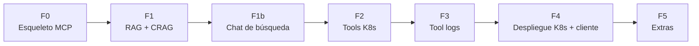

# 07 — Roadmap de implementación

Plan por fases pensado para ejecutarse en **conversaciones de desarrollo separadas**: cada fase cabe en una o
dos sesiones, tiene entregable verificable y deja el sistema en un estado demostrable. El orden saca valor
pronto: primero un MCP que ya se puede enchufar a Claude Code, luego el RAG, luego el diagnóstico.

---

## F0 — Esqueleto del servidor MCP

**Objetivo:** un servidor MCP mínimo que un cliente real ya descubre.

- [ ] Proyecto Spring Boot `io.github.mikel0ne:autoops-mcp` con `spring-ai-starter-mcp-server-webmvc`.
- [ ] Reubicar la semilla de Gemini bajo `io.github.mikel0ne.autoops.llm` (abstracción del doc 06).
- [ ] Una tool trivial de prueba (`ping`) anotada con `@Tool` y registrada en `McpConfig`.
- [ ] Perfil `local` con transporte **stdio**; perfil `k8s` con **HTTP/SSE**.

**Verificación:** registrar el servidor en Claude Code (`.mcp.json`, stdio) y comprobar que **lista la tool**
`ping` y la invoca.

## F1 — Núcleo RAG con bucle correctivo (CRAG)

**Objetivo:** la tool `buscar_docs` completa (doc 03 §3).

- [ ] Weaviate local (docker compose o el manifiesto de la guía de infra + port-forward).
- [ ] `WeaviateConfig` (`WeaviateEmbeddingStore`, clase `DocChunk`, reranker) + `IngestionService`
      (markdown → chunks ~500 tokens con solape → embeddings) + comando/endpoint de ingesta.
- [ ] Redactar 4-6 documentos de `corpus/` (estándares ficticios pero realistas: convención de microservicios,
      política de recursos, guía de probes…).
- [ ] `CragGraph` (LangGraph4j): nodos `retrieve`/`rerank`/`grade`/`rewrite`, edge con `MAX_ITERACIONES` y
      umbral de score. Prompt `crag_rewrite.txt`.
- [ ] `RagService.buscar(consulta, k)` + tool `buscar_docs`.
- [ ] Tests del bucle con store y `ChatModel` falsos (converge, reformula, termina).

**Verificación:** desde Claude Code, `buscar_docs("estándar de probes")` devuelve chunks del corpus; con una
consulta mal formulada se observa que **el bucle reformula y mejora** (`iteraciones >= 1`).

## F1b — Chat de búsqueda (front secundario)

**Objetivo:** consultar la documentación sin cliente MCP.

- [ ] `SearchController` (`POST /search`) + `AnswerComposer` (redacción con LLM interno, anti-alucinación) sobre
      el **mismo** `RagService`.
- [ ] UI mínima en `resources/static/` (HTML + JS): caja de búsqueda, respuesta y citas.

**Verificación:** abrir `/` en el navegador, preguntar por un estándar y recibir respuesta redactada con citas.

## F2 — Tools de Kubernetes (read-only)

**Objetivo:** el diagnóstico de runtime.

- [ ] `K8sClientConfig` (fabric8: kubeconfig en local, ServiceAccount in-cluster).
- [ ] `K8sInspectionService` (dossiers) + tools `estado_pods`, `listar_workloads`, `describir_pod`, `eventos` y
      la compuesta `diagnosticar_pod`.
- [ ] Tests con `KubernetesServer` mock de fabric8 (fixtures de pod sano / `ErrImagePull` / `CrashLoopBackOff`).

**Verificación:** con un pod roto a propósito (imagen inexistente), desde Claude Code "¿por qué falla el pod X?"
hace que el cliente llame a `diagnosticar_pod` y razone citando el `ErrImagePull` real.

## F3 — Tool de logs

**Objetivo:** logs de aplicaciones en ejecución.

- [ ] `logs_pod` (cola de logs, `previous`, selección de contenedor) sobre `pods/log`.
- [ ] (Opcional, documentado) backend **Loki** como fuente de logs agregados, vía una tool `consultar_logs`
      con LogQL — alternativa avanzada al `kubectl logs` directo.

**Verificación:** `logs_pod` devuelve la cola real de un pod; con `previous=true`, los del arranque anterior.

## F4 — Despliegue en Kubernetes + integración con el cliente

**Objetivo:** AutoOps corriendo en el clúster y enchufado por HTTP/SSE. **Guías ya escritas**: seguir
`docs/infraestructura/` 01→07.

- [ ] Extraer manifiestos a `k8s/` (`01-secrets.yaml` a `.gitignore`).
- [ ] Dockerfile (guía infra 04) + perfil `k8s` (transporte SSE).
- [ ] Desplegar Weaviate + `autoops-mcp` + Ingress; ejecutar la ingesta del corpus.
- [ ] Registrar el endpoint SSE en Claude Code (`.mcp.json` apuntando a `http://autoops.local/sse`).
- [ ] Probar el diagnóstico **contra el propio clúster**: AutoOps diagnosticándose a sí mismo (buen momento de demo).

**Verificación:** checklist de la guía infra `07` completa; Claude Code lista las tools vía la URL del Ingress y
diagnostica un pod roto del clúster.

## F5 — Extras (opcionales, en orden de retorno)

1. **Reranking afinado / evaluación del RAG**: métricas de calidad de recuperación (hit-rate, MRR) sobre un set
   de preguntas de prueba.
2. **Tool `consultar_logs` con Loki** (si no se hizo en F3).
3. **Tool secundaria `validar_manifiesto`** (sin estado): la única reminiscencia útil del diseño anterior.
4. **CI con GitHub Actions**: build + tests + imagen.
5. **Observabilidad**: histograma de iteraciones del bucle CRAG, latencia por tool (Micrometer).

---

## Riesgos y mitigaciones

| Riesgo | Impacto | Mitigación |
|---|---|---|
| Cuota gratuita de Gemini (429) | Ingesta/CRAG lentos | Modelo `flash-lite`; uso de LLM acotado; embeddings en lotes |
| El bucle CRAG no converge en consultas raras | Respuestas de baja confianza | Devolver siempre lo mejor obtenido + marcar `confianza: baja`; subir `MAX_ITERACIONES` es un parámetro |
| Versiones Spring AI / LangChain4j / LangGraph4j se mueven | Fricción al empezar fases | Fijar versiones en el `pom.xml` y no actualizarlas a mitad de fase |
| Scope creep hacia un copiloto | No se termina; se traiciona el objetivo | El "fuera de alcance" del doc 01 es contractual; el chat se mantiene fino |
| Permisos de K8s insuficientes/excesivos | Tool falla, o riesgo de seguridad | RBAC read-only exacto de la guía infra `02`; verificar con `kubectl auth can-i` |
