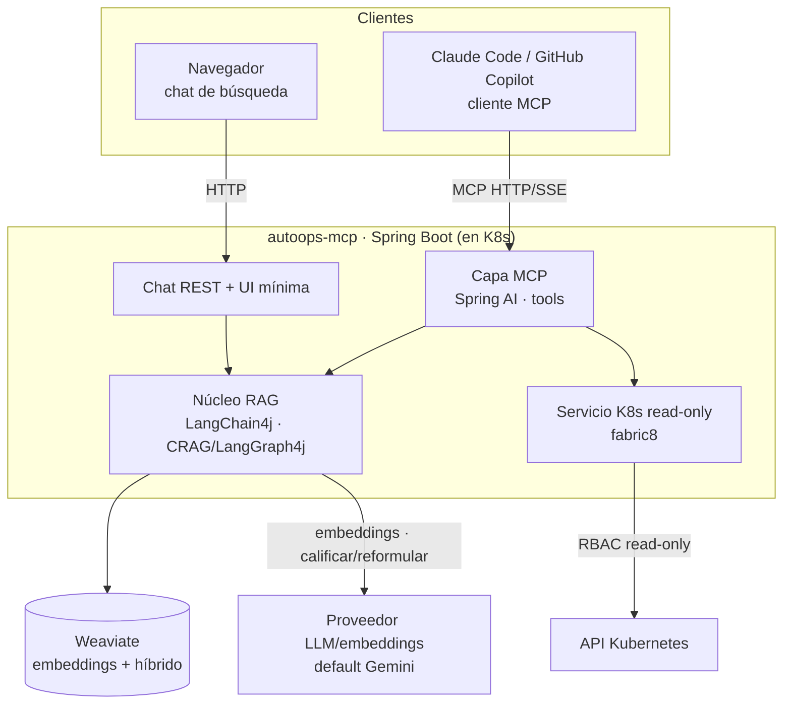

# AutoOps MCP — Documentación de Arquitectura

**AutoOps** es un **servidor MCP** que expone, a cualquier cliente MCP (Claude Code, GitHub Copilot…),
herramientas para **depurar errores de aplicaciones en ejecución** sobre Kubernetes y para consultar la
**documentación interna con RAG avanzado**. El cliente MCP aporta el LLM y el razonamiento; AutoOps aporta el
**acceso seguro a los servicios** y la **recuperación de conocimiento**.

Esta documentación define **todo lo necesario a nivel de código** para construirlo: arquitectura, catálogo de
tools MCP, motor de RAG correctivo, organización del código, contratos y plan de implementación. Cada documento
es autocontenido y referencia a los demás cuando hace falta.

> La documentación de **infraestructura** (despliegue en Kubernetes local) vive en `docs/infraestructura/`.

## Decisiones marco (fijadas)

| Decisión | Valor | Por qué |
|---|---|---|
| Tipo de producto | **Servidor MCP**, no copiloto | El razonamiento y la UI los pone el cliente (Claude Code/Copilot); AutoOps es reutilizable y componible. |
| Protocolo MCP | **Spring AI MCP Server** (sobre el MCP Java SDK oficial) | Publica beans `@Tool` como tools MCP con transporte HTTP/SSE o stdio. |
| Motor RAG | **LangChain4j 1.x + Weaviate** | RAG avanzado: búsqueda híbrida + reranking nativos de Weaviate; `WeaviateEmbeddingStore` de LangChain4j. |
| Bucle correctivo RAG | **LangGraph4j** (subgrafo CRAG) | El RAG valida sus resultados y reintenta (reformular/expandir): es un flujo cíclico → LangGraph4j. |
| Acceso a Kubernetes | **Cliente fabric8, RBAC read-only** | Diagnóstico de runtime sin poder romper nada (sin escritura, sin Secrets). |
| Proveedor LLM/embeddings | **Abstraído; por defecto Gemini** (AI Studio, capa gratuita) | Coste cero en desarrollo; cambiar de proveedor = 1 bean + configuración. |
| Vector DB | **Weaviate** | Híbrido + reranking de fábrica; una sola pieza para el RAG. |
| Despliegue | **Kubernetes local** (Docker Desktop / Minikube) | Sin coste de nube; el propio clúster es el sujeto a diagnosticar. |

## Vista de pájaro

El MCP y el chat son **dos fronts sobre el mismo núcleo RAG**. Las tools de Kubernetes/logs son **solo MCP**
(el diagnóstico de runtime es agéntico: lo orquesta el cliente combinando tools).

## Índice

1. [01-vision-alcance.md](01-vision-alcance.md) — Qué hace AutoOps, casos de uso y qué queda fuera.
2. [02-arquitectura-sistema.md](02-arquitectura-sistema.md) — Componentes, responsabilidades y ADRs.
3. [03-tools-mcp.md](03-tools-mcp.md) — **El corazón:** catálogo de tools MCP y el subgrafo CRAG de `buscar_docs`.
4. [04-organizacion-codigo.md](04-organizacion-codigo.md) — Estructura del proyecto, paquetes Java y convenciones.
5. [05-contratos-api-datos.md](05-contratos-api-datos.md) — Contratos de las tools MCP, endpoint del chat y esquema Weaviate.
6. [06-abstraccion-llm.md](06-abstraccion-llm.md) — Abstracción de embeddings y LLM interno; cómo añadir proveedor.
7. [07-roadmap-implementacion.md](07-roadmap-implementacion.md) — Plan por fases con entregables verificables.

## Cómo usar esta documentación

- Para **empezar a implementar**: ir a [07-roadmap-implementacion.md](07-roadmap-implementacion.md).
- Para **entender el sistema**: leer 01 → 02 → 03.
- Regla de oro del repo: el protocolo MCP lo gestiona Spring AI; LangChain4j es el **motor RAG**; los flujos
  **cíclicos** (el bucle CRAG) se implementan con **LangGraph4j** (sintaxis de `llms-lgraph.txt`); el wiring
  Spring/LangChain4j sigue `llms-lc4j.txt`.
