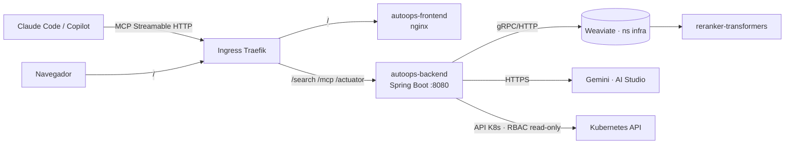

# AutoOps MCP — Infraestructura (despliegue real)

Despliegue del servidor **AutoOps MCP** sobre el **clúster local compartido** del portfolio
(Rancher Desktop / k3s, ingress **Traefik**). Coste cero, sin nube. El propio clúster es,
además, el sujeto que AutoOps diagnostica.

> **Fuente de verdad operativa:** [`infra/INFRA.md`](../../../infra/INFRA.md) (en la raíz del
> monorepo). Aquí va el diseño específico de AutoOps; los comandos del día a día y la plataforma
> compartida (Postgres, Weaviate, observabilidad, scripts genéricos) viven en ese documento.

## Componentes

| Componente | Tecnología | Namespace | Exposición |
|---|---|---|---|
| `autoops-backend` | Spring Boot 4 · Spring AI MCP (Streamable HTTP) · LangChain4j · LangGraph4j · fabric8 | `autoops` | Ingress Traefik (`/search`, `/mcp`, `/actuator`, `/swagger-ui`) |
| `autoops-frontend` | Angular 17 + nginx (chat de búsqueda) | `autoops` | Ingress Traefik (`/`) |
| `weaviate` (+ `weaviate-reranker`) | Weaviate 1.27 · reranker-transformers | **`infra`** (compartido) | Solo interno (ClusterIP) |
| Logs | Loki + Promtail + Grafana | `observability` | `grafana.local` |

Backend y frontend son **dos imágenes/servicios** (no una UI dentro del jar). Weaviate es
**compartido** en el namespace `infra` (criterio Postgres): una instancia, AutoOps usa su clase
`AutoopsDocChunk`. La RAG calcula embeddings con **Gemini `gemini-embedding-2`** (free tier).

## Topología



AutoOps lee la API de Kubernetes con un **ServiceAccount de solo lectura** (sin escritura, sin
Secrets) — es la pieza de seguridad central del proyecto.

## Despliegue (resumen)

Todo se orquesta con los scripts **genéricos** de `infra/` (ver `infra/INFRA.md` para el detalle):

```bash
# 1. Plataforma compartida (una vez)
bash infra/scripts/06-setup-weaviate.sh         # Weaviate + reranker (ns infra)
bash infra/scripts/07-setup-observability.sh    # Loki + Grafana (ns observability)

# 2. Credencial (una vez): infra/.env.local con GEMINI_API_KEY (compartida por el portfolio)

# 3. AutoOps
bash infra/scripts/deploy.sh --project autoops --component all --tag 0.1.0
bash infra/scripts/setup-app-ingress.sh --project autoops    # http://autoops.local
bash infra/scripts/ingest-autoops.sh                         # ingesta del corpus

# Hosts (Admin, una vez):
#   infra/scripts/add-host.ps1 -Hostname autoops.local
#   infra/scripts/add-host.ps1 -Hostname grafana.local
```

URLs: `http://autoops.local/` (chat) · `http://autoops.local/mcp` (MCP) · `http://grafana.local`.

## Índice de guías (diseño conceptual)

1. [01-prerrequisitos.md](01-prerrequisitos.md) — herramientas y clúster local.
2. [02-topologia-kubernetes.md](02-topologia-kubernetes.md) — namespace, secret y **RBAC read-only**.
3. [03-weaviate.md](03-weaviate.md) — base vectorial compartida (híbrido + reranking).
4. [04-dockerizacion.md](04-dockerizacion.md) — imágenes backend y frontend.
5. [05-despliegue-servicios.md](05-despliegue-servicios.md) — Deployment, Service y probes.
6. [06-ingress-acceso.md](06-ingress-acceso.md) — Traefik (sin buffering, streaming) y registro del MCP.
7. [07-operacion-troubleshooting.md](07-operacion-troubleshooting.md) — logs, fallos típicos, ingesta.

> Las guías 02, 05 y 07 conservan el detalle conceptual (RBAC, probes, troubleshooting); para los
> comandos exactos sigue `infra/INFRA.md`, que es lo que se ejecuta de verdad.
