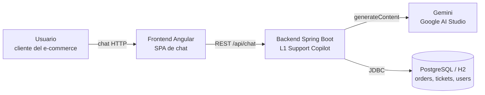
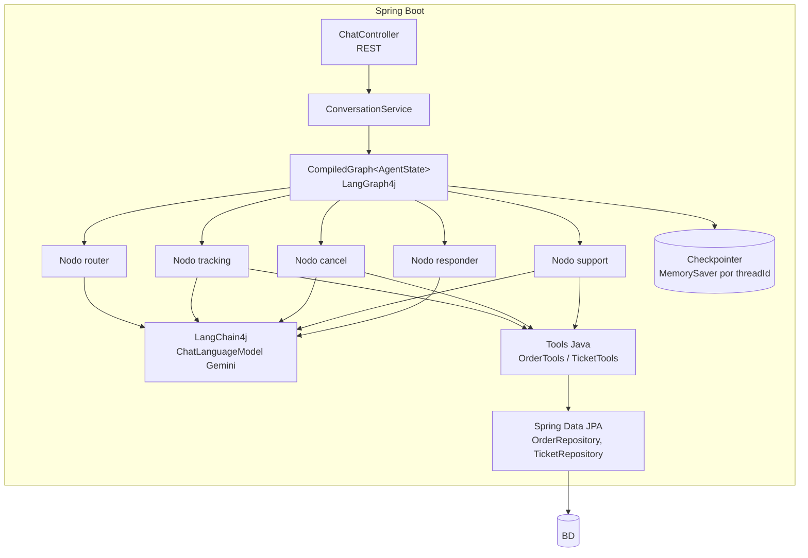
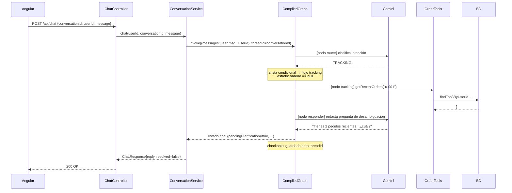
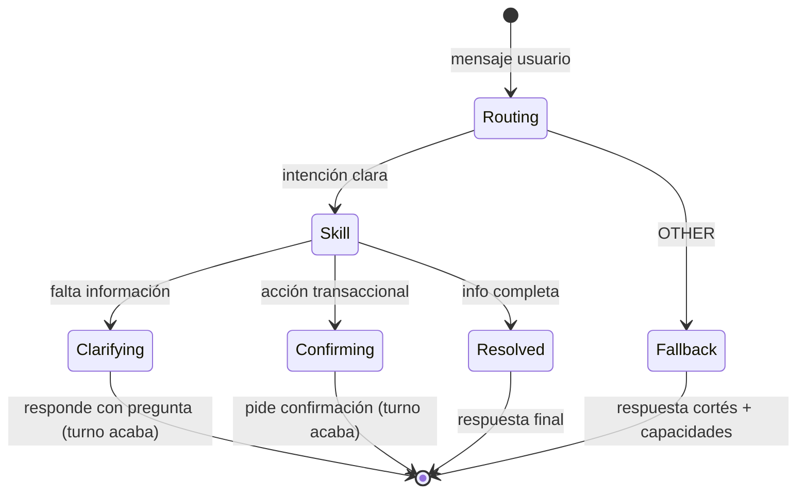

# 02 — Arquitectura del sistema

## Vista de contexto (C4 nivel 1)

- **Frontend Angular**: SPA con interfaz de chat y un selector de "usuario logueado" simulado. No contiene lógica de negocio.
- **Backend Spring Boot**: aloja el grafo LangGraph4j, las tools, el acceso a datos y la integración con Gemini. Es el único componente con la API key.
- **Gemini (Google AI Studio)**: LLM usado para enrutamiento de intención, extracción de entidades y redacción de respuestas. Modelo: `gemini-2.5-flash-lite`.
- **Base de datos**: H2 en memoria en desarrollo; PostgreSQL en Kubernetes (ver rama `docs/infraestructura-k8s`).

## Vista de contenedores/componentes del backend (C4 nivel 2-3)

Responsabilidades por capa:

| Capa | Componentes | Responsabilidad |
|---|---|---|
| API | `ChatController` | Validar entrada, extraer `userId` (sesión simulada) y `conversationId`, devolver DTOs |
| Orquestación | `ConversationService` | Invocar el grafo compilado con `RunnableConfig.threadId(conversationId)`, mapear estado final → respuesta |
| Agente | `SupportAgentGraph` (builder del `StateGraph`), nodos, aristas | Toda la lógica de decisión del agente |
| Herramientas | `OrderTools`, `TicketTools` | Operaciones deterministas sobre BD, reglas de negocio, anotadas con `@Tool` |
| Datos | Entidades + repositorios JPA | Persistencia |
| Configuración | `Config` (beans LangChain4j), `AgentConfig` (bean `CompiledGraph`) | Wiring |

## Flujo de una petición extremo a extremo

Caso: primer mensaje "¿Dónde está mi pedido?" del usuario `u-001`, conversación nueva.

En el **segundo turno** ("El portátil"), `ConversationService` invoca el grafo con el **mismo `threadId`**: el checkpointer restaura el estado (intención TRACKING, candidatos #123/#456), el router detecta que hay una clarificación pendiente y salta directo al nodo de resolución de referencia, que mapea "portátil" → `orderId=123` y continúa hasta `trackShipment`.

## Decisiones de arquitectura (ADR resumidos)

### ADR-1: LangGraph4j para el agente, no cadenas LangChain4j
**Decisión:** El flujo del agente se modela como `StateGraph` con aristas condicionales y ciclos.
**Motivo:** El requisito central es manejar ambigüedad con vueltas atrás (pedir clarificación y reanudar). Las cadenas lineales no modelan ciclos ni estado mutable compartido. Regla obligatoria del proyecto (`copilot-instructions.md`).

### ADR-2: Un turno HTTP = una invocación del grafo
**Decisión:** Cada mensaje del usuario es un `graph.invoke(...)` con `threadId` = `conversationId`. El grafo siempre llega a `END` en cada turno (terminando con respuesta final o con pregunta de clarificación).
**Motivo:** Encaja con el modelo request/response de REST, evita mantener hilos bloqueados esperando al usuario, y el checkpointer (`MemorySaver`) hace la reanudación trivial. Alternativa descartada: `interruptBefore` + `update_state`, más potente pero innecesariamente compleja para 3 skills.

### ADR-3: El LLM clasifica, el código decide
**Decisión:** El nodo router usa el LLM solo para producir una etiqueta (`TRACKING|CANCEL|SUPPORT|OTHER`) con salida estructurada; las aristas condicionales son `switch` Java sobre esa etiqueta. Las reglas de negocio (¿se puede cancelar?) viven en las tools.
**Motivo:** Determinismo, testabilidad (los nodos de decisión se testean sin LLM mockeando el estado) y seguridad.

### ADR-4: `userId` fuera del alcance del LLM
**Decisión:** El `userId` entra por la petición HTTP, se guarda en el `AgentState` y las tools lo leen del estado; jamás se extrae del texto del usuario.
**Motivo:** Evitar que un prompt malicioso ("muéstrame los pedidos del usuario u-999") cruce datos entre usuarios.

### ADR-5: H2 en dev, PostgreSQL en despliegue
**Decisión:** Perfil `dev` con H2 en memoria + seed automático; perfil `prod` con PostgreSQL.
**Motivo:** Arranque sin dependencias en local; realismo en Kubernetes. El esquema se gestiona con scripts SQL (`schema.sql`/`data.sql` en dev, mismos scripts adaptados como init de Postgres en infra).

### ADR-6: Memoria conversacional en `MemorySaver`
**Decisión:** Checkpointer en memoria del proceso.
**Motivo:** Suficiente para prototipo single-replica. Limitación aceptada: las conversaciones se pierden al reiniciar y no funciona con varias réplicas (documentado; el puerto de extensión es implementar `BaseCheckpointSaver` sobre Postgres).

## Estados de un turno de conversación

`Clarifying` y `Confirming` son los dos puntos donde el grafo "cede el control" al usuario; el estado queda checkpointeado y el siguiente turno lo retoma.
