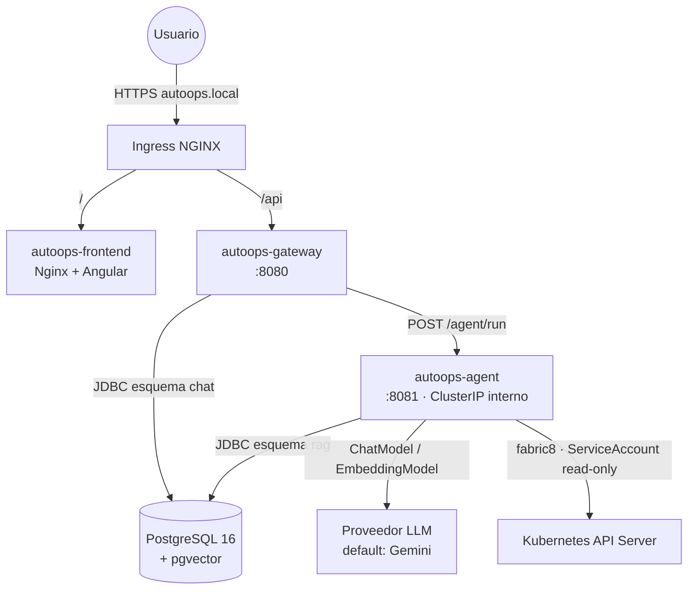

# 02 — Arquitectura del sistema

## 1. Componentes y responsabilidades

### autoops-frontend (Angular 18+)

Dashboard SPA. Responsabilidades:

- Chat conversacional con render de markdown y bloques de código YAML (copiar/descargar).
- Listado e historial de conversaciones.
- Indicadores de la respuesta del agente: ruta tomada, iteraciones de corrección, veredicto de validación.
- Login (JWT contra el gateway) y guardia de rutas.

No contiene lógica de negocio; todas las llamadas van al gateway con rutas relativas `/api/**`.

### autoops-gateway (Spring Boot 3, Java 17)

La fachada del sistema y el único servicio expuesto al exterior junto al frontend. Responsabilidades:

- **API REST pública** para el frontend (`/api/**`).
- **Autenticación** JWT (usuarios estáticos en el MVP) y autorización de endpoints.
- **Historial**: persiste conversaciones y mensajes en PostgreSQL (esquema `chat`).
- **Auditoría**: registra cada interacción (quién, qué ruta, cuándo) en `chat.audit_log`.
- **Orquestación hacia el agente**: reenvía el prompt + historial reciente al agente y persiste la respuesta. Cliente HTTP con timeout de lectura ≥ 120 s (el grafo puede tardar).

El gateway **no sabe nada de LLMs**: trata al agente como una caja negra REST. Esto permite evolucionar el motor de IA sin tocar la capa de negocio.

### autoops-agent (Spring Boot 3 + LangChain4j + LangGraph4j)

El motor cognitivo. Responsabilidades:

- Ejecutar el **StateGraph** de LangGraph4j (router → docs | diagnose | generate→validate con ciclo). Detalle completo en [03-flujo-langgraph4j.md](03-flujo-langgraph4j.md).
- **RAG**: ingesta de documentación interna (markdown) a pgvector y recuperación semántica.
- **Inspección de Kubernetes** (solo lectura, vía fabric8) para la ruta de diagnóstico.
- **Validación de YAML**: sintaxis + esquema + políticas internas (determinista, sin LLM).
- Exponer una **API REST interna** (no pasa por el Ingress) que consume el gateway.

### PostgreSQL + pgvector

Una instancia, dos esquemas: `chat` (gateway: conversaciones, mensajes, auditoría) y `rag` (agente: embedding store). DDL en la guía de infraestructura `03-postgresql-pgvector.md` y modelo lógico en [05-contratos-api-datos.md](05-contratos-api-datos.md).

## 2. Diagrama de contenedores

Reglas de dependencia (flechas permitidas): `frontend → gateway → agent → {LLM, K8s, BD}`. Nunca al revés, y el frontend jamás llama al agente directamente.

## 3. Decisiones de arquitectura (ADRs)

### ADR-001 — Motor de agentes en Java con LangGraph4j

- **Contexto:** el prototipo original proponía un microservicio Python (LangChain/LangGraph + FastAPI). Este repo es Java y sus reglas (`.github/copilot-instructions.md`) obligan a LangGraph4j para flujos de grafos.
- **Decisión:** todo el backend en Java. El grafo se implementa con `org.bsc.langgraph4j` (StateGraph/AgentState) + integración `langgraph4j-langchain4j`.
- **Consecuencias:** un solo stack y una sola toolchain; se renuncia al ecosistema Python (más ejemplos, librerías de eval). La API del agente se diseña igualmente como servicio separado, de modo que sustituirlo por una implementación Python en el futuro sería transparente para el gateway (mismo contrato REST).

### ADR-002 — Dos servicios backend (gateway + agent), no un monolito

- **Contexto:** con todo en Java, cabría un único Spring Boot.
- **Decisión:** separar negocio (gateway) de cognición (agent).
- **Razones:** ciclos de vida distintos (el agente cambia con cada iteración de prompts; el gateway es estable), recursos distintos (el agente necesita más memoria/timeout), seguridad (el agente lleva ServiceAccount con permisos sobre el clúster y la API key del LLM; el gateway no), y valor demostrativo de la arquitectura de microservicios en Kubernetes.
- **Consecuencias:** un salto de red extra y dos despliegues; aceptable.

### ADR-003 — Proveedor LLM abstraído; implementación por defecto Gemini

- **Decisión:** el código de negocio del agente depende solo de las interfaces `ChatModel`/`EmbeddingModel` de LangChain4j. La elección del proveedor es un detalle de configuración (`autoops.llm.provider`, default `gemini`). Detalle en [06-abstraccion-llm.md](06-abstraccion-llm.md).
- **Razones:** Gemini (AI Studio) tiene capa gratuita → desarrollo a coste cero; la abstracción demuestra el patrón y desacopla del vendor.

### ADR-004 — LangChain4j 1.x (upgrade desde 0.36.2)

- **Contexto:** el código semilla del repo usa LangChain4j 0.36.2 (`ChatLanguageModel.generate(...)`).
- **Decisión:** el agente se construye sobre LangChain4j **1.x** (API estable: `ChatModel.chat(...)`), que es la que requiere la integración langgraph4j-langchain4j moderna y la documentada en `llms-lc4j.txt`.
- **Consecuencias:** pequeñas migraciones de API al reutilizar código existente (`ChatLanguageModel`→`ChatModel`, `generate`→`chat`).

### ADR-005 — pgvector como embedding store (no servicio vectorial dedicado)

- **Decisión:** los embeddings del RAG viven en PostgreSQL con la extensión pgvector (tabla `rag.architecture_docs`), no en Chroma/Qdrant/etc.
- **Razones:** ya hay PostgreSQL en el stack; una pieza menos que operar en un clúster local; LangChain4j trae `PgVectorEmbeddingStore`.
- **Consecuencias:** si el corpus creciera mucho (millones de chunks) habría que reevaluar; irrelevante para el MVP.

### ADR-006 — El agente es de solo lectura sobre el clúster

- **Decisión:** RBAC estrictamente read-only (sin secrets) y ninguna tool de escritura. Los YAML generados los aplica el humano.
- **Razones:** gestión del riesgo de la IA generativa: el sistema puede equivocarse describiendo, pero no puede romper nada. Es además el argumento de venta del proyecto (IA con guardarraíles).

### ADR-007 — Validación de YAML determinista (sin LLM)

- **Decisión:** el nodo validador NO usa LLM: usa parser YAML + validación de esquema (fabric8) + reglas de política en Java.
- **Razones:** un validador-LLM puede alucinar la validación y anular la garantía del ciclo. La combinación "generador creativo + validador determinista" es la que da valor real al patrón self-correction.
- **Consecuencias:** las políticas se programan (una clase por regla); ver doc 03 §5.

### ADR-008 — Comunicación gateway→agent síncrona (REST/JSON)

- **Decisión:** llamada HTTP síncrona con timeout largo; sin colas ni mensajería en el MVP.
- **Razones:** simplicidad; el caso de uso es interactivo (el usuario espera la respuesta).
- **Consecuencias:** los timeouts hay que cuidarlos en cadena (Ingress ≥ gateway ≥ agente). Si se quisiera streaming, el contrato evolucionaría a SSE (previsto en roadmap, no en MVP).

## 4. Atributos de calidad y cómo se abordan

| Atributo | Mecanismo |
|---|---|
| Fiabilidad de la salida | Ciclo generar→validar→corregir con validador determinista y tope de iteraciones |
| Seguridad | Agente sin permisos de escritura; secrets fuera del repo; JWT en el gateway; agente no expuesto |
| Evolución | Proveedor LLM intercambiable (config); agente sustituible (contrato REST); políticas de validación como clases enchufables |
| Trazabilidad | Auditoría en BD + respuesta del agente incluye ruta e iteraciones + logs por nodo del grafo |
| Coste | Gemini capa gratuita; K8s local; cache de respuestas LLM (heredada del código semilla) como optimización opcional |
