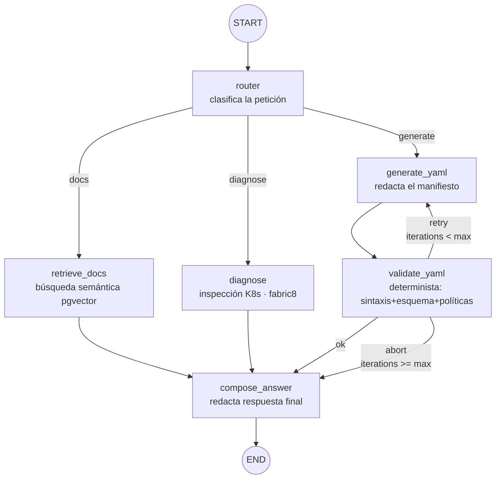

# 03 — El flujo LangGraph4j (corazón del sistema)

Diseño completo del `StateGraph` del agente AutoOps: estado, nodos, aristas condicionales y el ciclo de auto-corrección. Toda la sintaxis sigue la documentación de referencia del repo (`llms-lgraph.txt`); los flujos cíclicos **no** se implementan con cadenas LangChain4j tradicionales (regla del proyecto).

## 1. El grafo



Propiedades clave:

- **Enrutamiento condicional** a la salida de `router` (las tres rutas del producto).
- **Ciclo** `generate_yaml ⇄ validate_yaml`: es la razón de usar LangGraph4j: un framework de cadenas lineales no expresa esto.
- **Convergencia** en `compose_answer`: un único nodo da formato a la respuesta final sea cual sea la ruta, lo que garantiza un contrato de salida homogéneo.
- `validate_yaml` es **determinista** (sin LLM): la garantía del ciclo no puede depender de un juez que alucina (ADR-007).

## 2. Dependencias Maven (módulo `agent`)

```xml
<dependencyManagement>
  <dependencies>
    <dependency>
      <groupId>org.bsc.langgraph4j</groupId>
      <artifactId>langgraph4j-bom</artifactId>
      <version>${langgraph4j.version}</version> <!-- última estable 1.x -->
      <type>pom</type>
      <scope>import</scope>
    </dependency>
  </dependencies>
</dependencyManagement>

<dependencies>
  <dependency>
    <groupId>org.bsc.langgraph4j</groupId>
    <artifactId>langgraph4j-core</artifactId>
  </dependency>
  <!-- Integración con LangChain4j: serializadores de mensajes, ToolNode, etc. -->
  <dependency>
    <groupId>org.bsc.langgraph4j</groupId>
    <artifactId>langgraph4j-langchain4j</artifactId>
  </dependency>
</dependencies>
```

## 3. El estado: `AutoOpsState`

Extiende `AgentState`. El **schema** declara los canales con semántica especial: `yamlAttempts` es un *appender* (cada pasada del generador añade un intento, conservando el historial para el prompt de corrección y para la trazabilidad).

```java
package io.github.mikel0ne.autoops.agent.graph;

import org.bsc.langgraph4j.state.AgentState;
import org.bsc.langgraph4j.state.Channel;
import org.bsc.langgraph4j.state.Channels;

import java.util.*;

public class AutoOpsState extends AgentState {

    public static final Map<String, Channel<?>> SCHEMA = Map.of(
            // cada intento de YAML se acumula, no se sobreescribe
            "yamlAttempts", Channels.appender(ArrayList::new)
    );

    public AutoOpsState(Map<String, Object> initData) {
        super(initData);
    }

    // --- entrada ---
    public String userRequest()              { return this.<String>value("userRequest").orElseThrow(); }
    public List<String> history()            { return this.<List<String>>value("history").orElseGet(List::of); }

    // --- enrutamiento ---
    public Optional<String> route()          { return value("route"); }          // docs | diagnose | generate

    // --- ruta docs (RAG) ---
    public List<String> documents()          { return this.<List<String>>value("documents").orElseGet(List::of); }

    // --- ruta diagnose ---
    public Optional<String> clusterReport()  { return value("clusterReport"); }

    // --- ruta generate + ciclo de corrección ---
    public List<String> yamlAttempts()       { return this.<List<String>>value("yamlAttempts").orElseGet(List::of); }
    public Optional<String> lastYaml()       { return yamlAttempts().isEmpty()
                                                    ? Optional.empty()
                                                    : Optional.of(yamlAttempts().get(yamlAttempts().size() - 1)); }
    public Optional<String> validationError(){ return value("validationError"); }
    public int iterations()                  { return this.<Integer>value("iterations").orElse(0); }

    // --- salida ---
    public Optional<String> finalAnswer()    { return value("finalAnswer"); }
}
```

Convenciones:

- Los nodos **devuelven solo el delta** del estado (`Map<String,Object>`); LangGraph4j hace el merge según el schema.
- Para limpiar una clave se usa `AgentState.MARK_FOR_REMOVAL` (p. ej. `validationError` cuando un intento pasa a válido).

## 4. Los nodos

Cada nodo es una clase con una única responsabilidad que implementa `NodeAction<AutoOpsState>` (se registra con `node_async(...)`). Los prompts viven como plantillas en `src/main/resources/prompts/` (no hardcodeados), cargadas con `PromptTemplate`.

### 4.1 `router` — clasificación de la petición

```java
package io.github.mikel0ne.autoops.agent.graph.nodes;

import dev.langchain4j.model.chat.ChatModel;
import org.bsc.langgraph4j.action.NodeAction;

import java.util.Map;

public class RouterNode implements NodeAction<AutoOpsState> {

    static final String PROMPT = """
        Eres el router de un copiloto DevOps. Clasifica la petición del usuario en UNA categoría:
        - docs: pregunta sobre documentación, estándares o arquitectura interna
        - diagnose: pregunta sobre el estado o fallos de workloads del clúster
        - generate: petición de crear/modificar manifiestos YAML de Kubernetes
        Responde únicamente con la palabra de la categoría.

        Petición: {{request}}
        """;

    private final ChatModel model;

    public RouterNode(ChatModel model) { this.model = model; }

    @Override
    public Map<String, Object> apply(AutoOpsState state) {
        var answer = model.chat(PROMPT.replace("{{request}}", state.userRequest()))
                          .aiMessage().text().trim().toLowerCase();
        var route = switch (answer) {
            case "docs", "diagnose", "generate" -> answer;
            default -> "docs"; // fallback conservador: la ruta RAG no tiene efectos secundarios
        };
        return Map.of("route", route);
    }
}
```

### 4.2 `retrieve_docs` — recuperación RAG

Busca en el `PgVectorEmbeddingStore` (esquema `rag`, tabla `architecture_docs`) los chunks más afines y los deja en `documents`. No redacta: redactar es de `compose_answer`.

```java
public class RetrieveDocsNode implements NodeAction<AutoOpsState> {

    private final EmbeddingModel embeddingModel;       // mismo proveedor abstraído (doc 06)
    private final EmbeddingStore<TextSegment> store;   // PgVectorEmbeddingStore

    @Override
    public Map<String, Object> apply(AutoOpsState state) {
        var queryEmbedding = embeddingModel.embed(state.userRequest()).content();
        var matches = store.search(EmbeddingSearchRequest.builder()
                        .queryEmbedding(queryEmbedding)
                        .maxResults(5)
                        .minScore(0.6)
                        .build())
                .matches();
        var docs = matches.stream().map(m -> m.embedded().text()).toList();
        return Map.of("documents", docs);
    }
}
```

### 4.3 `diagnose` — inspección del clúster

Usa el cliente fabric8 (con el ServiceAccount read-only del pod) a través de `K8sInspectionService`, que reúne un informe de texto: estado del pod, últimos eventos, último fragmento de log y restart count. El LLM **no** decide qué comandos ejecutar en el MVP (sin tool-calling libre): el servicio recopila un dossier fijo y `compose_answer` lo interpreta. Menos espectacular, mucho más predecible y seguro.

```java
public class DiagnoseNode implements NodeAction<AutoOpsState> {

    private final K8sInspectionService k8s;
    private final ChatModel model;

    @Override
    public Map<String, Object> apply(AutoOpsState state) {
        // 1. Extraer la referencia al workload de la petición (LLM, salida JSON: {name, namespace?})
        var target = extractTarget(state.userRequest());
        // 2. Dossier determinista del clúster
        String report = k8s.inspect(target.namespace(), target.name());
        return Map.of("clusterReport", report);
    }
    // ...
}
```

### 4.4 `generate_yaml` — generación (y regeneración) del manifiesto

El mismo nodo sirve para el primer intento y para las correcciones: si el estado trae `validationError` + intento anterior, el prompt cambia a modo corrección.

```java
public class GenerateYamlNode implements NodeAction<AutoOpsState> {

    private final ChatModel model;
    private final PromptTemplate generate;  // prompts/generate_yaml.txt
    private final PromptTemplate correct;   // prompts/correct_yaml.txt

    @Override
    public Map<String, Object> apply(AutoOpsState state) {
        String prompt = state.validationError()
                .map(err -> correct.apply(Map.of(
                        "request",  state.userRequest(),
                        "previous", state.lastYaml().orElse(""),
                        "error",    err)).text())
                .orElseGet(() -> generate.apply(Map.of(
                        "request", state.userRequest())).text());

        String yaml = stripMarkdownFences(model.chat(prompt).aiMessage().text());

        return Map.of(
                "yamlAttempts", yaml,                      // appender: se acumula
                "iterations",   state.iterations() + 1
        );
    }
}
```

El prompt de corrección incluye **el YAML anterior y el error literal del validador**: es lo que hace que el ciclo converja en vez de regenerar a ciegas.

### 4.5 `validate_yaml` — validación determinista

```java
public class ValidateYamlNode implements NodeAction<AutoOpsState> {

    private final YamlValidationService validator;

    @Override
    public Map<String, Object> apply(AutoOpsState state) {
        var result = validator.validate(state.lastYaml().orElseThrow());
        if (result.valid()) {
            return Map.of("validationError", AgentState.MARK_FOR_REMOVAL);
        }
        return Map.of("validationError", result.errorSummary());
    }
}
```

`YamlValidationService` encadena tres niveles (para por el primero que falla):

1. **Sintaxis**: parseo con SnakeYAML.
2. **Esquema**: deserialización con fabric8 (`Serialization.unmarshal`) al tipo de recurso declarado en `kind`; campos desconocidos o tipos imposibles fallan aquí.
3. **Políticas internas** (lista de `PolicyRule`, una clase por regla, enchufables):
   - `RequireResourceLimitsRule` — todo contenedor declara `resources.requests` y límite de memoria.
   - `ForbidLatestTagRule` — prohibido `:latest` o imagen sin etiqueta.
   - `RequireProbesRule` — Deployments declaran readiness y liveness.
   - `ForbidPrivilegedRule` — sin `privileged: true` ni `hostNetwork`.
   - `RequirePartOfLabelRule` — etiqueta `app.kubernetes.io/part-of` presente.

El resultado de cada regla incluye un mensaje accionable (se inyecta tal cual en el prompt de corrección).

### 4.6 `compose_answer` — respuesta final

Único nodo de salida. Según la ruta, redacta con el LLM:

- `docs`: respuesta fundamentada **solo** en `documents` (instrucción anti-alucinación: "si los documentos no contienen la respuesta, dilo").
- `diagnose`: interpretación del `clusterReport` con hipótesis y siguiente paso sugerido.
- `generate`: presenta `lastYaml()` con el veredicto; si se abortó por max iteraciones, lo dice explícitamente y entrega el último intento con sus errores pendientes.

Devuelve `Map.of("finalAnswer", texto)`.

## 5. Construcción del grafo

```java
package io.github.mikel0ne.autoops.agent.graph;

import org.bsc.langgraph4j.StateGraph;
import org.bsc.langgraph4j.GraphStateException;
import org.bsc.langgraph4j.utils.EdgeMappings;

import static org.bsc.langgraph4j.StateGraph.END;
import static org.bsc.langgraph4j.StateGraph.START;
import static org.bsc.langgraph4j.action.AsyncNodeAction.node_async;
import static org.bsc.langgraph4j.action.AsyncEdgeAction.edge_async;

public class AutoOpsGraphBuilder {

    public static final int MAX_ITERATIONS = 3;

    private final RouterNode router;
    private final RetrieveDocsNode retrieveDocs;
    private final DiagnoseNode diagnose;
    private final GenerateYamlNode generateYaml;
    private final ValidateYamlNode validateYaml;
    private final ComposeAnswerNode composeAnswer;

    // constructor con inyección de los nodos (beans de Spring)...

    public StateGraph<AutoOpsState> build() throws GraphStateException {
        return new StateGraph<>(AutoOpsState.SCHEMA, AutoOpsState::new)

                .addNode("router",         node_async(router))
                .addNode("retrieve_docs",  node_async(retrieveDocs))
                .addNode("diagnose",       node_async(diagnose))
                .addNode("generate_yaml",  node_async(generateYaml))
                .addNode("validate_yaml",  node_async(validateYaml))
                .addNode("compose_answer", node_async(composeAnswer))

                .addEdge(START, "router")

                // enrutamiento por la decisión del router
                .addConditionalEdges("router",
                        edge_async(state -> state.route().orElse("docs")),
                        EdgeMappings.builder()
                                .to("retrieve_docs", "docs")
                                .to("diagnose",      "diagnose")
                                .to("generate_yaml", "generate")
                                .build())

                .addEdge("retrieve_docs", "compose_answer")
                .addEdge("diagnose",      "compose_answer")

                .addEdge("generate_yaml", "validate_yaml")

                // el ciclo de auto-corrección
                .addConditionalEdges("validate_yaml",
                        edge_async(state -> {
                            if (state.validationError().isEmpty())          return "ok";
                            if (state.iterations() >= MAX_ITERATIONS)       return "abort";
                            return "retry";
                        }),
                        EdgeMappings.builder()
                                .to("compose_answer", "ok")
                                .to("generate_yaml",  "retry")
                                .to("compose_answer", "abort")
                                .build())

                .addEdge("compose_answer", END);
    }
}
```

Puntos finos:

- **El tope de iteraciones vive en el edge, no en el nodo**: el grafo es quien garantiza la terminación; los nodos no necesitan saber del ciclo.
- La decisión del edge es **pura** (solo lee estado), lo que lo hace trivial de testear.
- `compose_answer` recibe tanto `ok` como `abort`; distingue el caso porque en `abort` sigue habiendo `validationError` en el estado.

## 6. Ejecución desde el servicio REST

```java
@Service
public class AgentRunService {

    private final CompiledGraph<AutoOpsState> graph; // compilado una vez en la config

    public AgentRunService(AutoOpsGraphBuilder builder) throws GraphStateException {
        this.graph = builder.build().compile();
    }

    public AgentResponse run(AgentRequest request) {
        var input = Map.<String, Object>of(
                "userRequest", request.prompt(),
                "history",     request.history() == null ? List.of() : request.history()
        );

        // Trazabilidad: stream() emite la salida de cada nodo según se ejecuta
        AutoOpsState last = null;
        for (var out : graph.stream(input)) {
            log.info("nodo [{}] completado", out.node());
            last = out.state();
        }

        return AgentResponse.from(last); // finalAnswer, route, lastYaml, iterations, validationError
    }
}
```

Se usa `stream()` (y no `invoke()`) por los logs por nodo, y porque deja preparado el terreno para SSE hacia la UI en el futuro (cada `NodeOutput` puede convertirse en un evento de progreso).

## 7. Testing del grafo

| Nivel | Qué se prueba | Cómo |
|---|---|---|
| Unitario (nodos) | Cada `NodeAction` aislado | `ChatModel` falso que devuelve respuestas fijas; aserciones sobre el `Map` devuelto |
| Unitario (edges) | La función de decisión del ciclo | Construir `AutoOpsState` con `validationError`/`iterations` y verificar `ok/retry/abort` |
| Unitario (validador) | Cada `PolicyRule` | YAMLs de fixture válidos/ inválidos por cada regla |
| Integración (grafo) | El ciclo converge y termina | Grafo real con `ChatModel` falso programado para fallar N veces y luego acertar; aserciones: iteraciones = N+1, `finalAnswer` presente. Caso "nunca acierta": termina en `abort` con `iterations == MAX_ITERATIONS` |
| E2E (servicio) | Contrato REST | `@SpringBootTest` + Testcontainers (PostgreSQL+pgvector) con proveedor LLM falso |

La clave: **ningún test del grafo necesita un LLM real**, gracias a la abstracción `ChatModel` (doc 06).

## 8. Evoluciones previstas (no MVP)

- **Checkpointing** (`MemorySaver` / `CompileConfig`): pausar/reanudar ejecuciones y memoria por hilo de conversación.
- **Subgrafos**: extraer el ciclo generar→validar como subgrafo compilado reutilizable (patrón documentado en `llms-lgraph.txt`).
- **Tool-calling libre en `diagnose`**: dar al LLM un catálogo de tools fabric8 (vía `langgraph4j-langchain4j` ToolNode) en lugar del dossier fijo.
- **Human-in-the-loop**: interrupción del grafo antes de `compose_answer` para aprobación humana del YAML.
