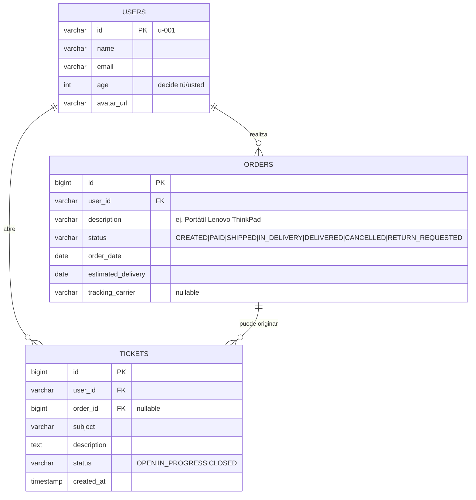

# 03 — Modelo de datos

## Diagrama entidad-relación



Notas de diseño:

- **`USERS` es deliberadamente mínima**: solo existe para simular el login y dar realismo al seed. No hay contraseñas.
- **El envío se modela dentro de `ORDERS`** (`status` + `estimated_delivery` + `tracking_carrier`) en vez de una tabla `SHIPMENTS` aparte: el prototipo no necesita histórico de eventos de envío y simplifica las tools.
- **`TICKETS.order_id` es nullable**: una incidencia puede no estar ligada a un pedido ("no puedo entrar en mi cuenta").

## Ciclo de vida del pedido y reglas de negocio

```
CREATED ──> PAID ──> SHIPPED ──> IN_DELIVERY ──> DELIVERED ──> RETURN_REQUESTED
   │          │
   └──────────┴────> CANCELLED
```

| Regla | Implementación |
|---|---|
| Solo se puede cancelar en `CREATED` o `PAID` | `OrderTools.cancelOrder` — validación Java, devuelve resultado tipado con motivo del rechazo |
| Solo se puede devolver un pedido `DELIVERED` | `OrderTools.requestReturn` — validación Java (`isReturnable()`); pasa el pedido a `RETURN_REQUESTED` |
| Cancelar y devolver son excluyentes | se cancela antes del envío y se devuelve tras la entrega; "cancelar" un pedido entregado se reconduce a devolución |
| Un pedido `CANCELLED` no se puede volver a cancelar | misma validación |
| El seguimiento de un pedido `CANCELLED` informa de la cancelación, no de envío | `OrderTools.trackShipment` |
| Un usuario solo ve/opera sus propios pedidos | todas las queries filtran por `user_id` tomado del `AgentState`, ver [05 — Tools](05-tools-java.md) |

La enumeración Java:

```java
public enum OrderStatus {
    CREATED, PAID, SHIPPED, IN_DELIVERY, DELIVERED, CANCELLED, RETURN_REQUESTED;

    public boolean isCancellable() {
        return this == CREATED || this == PAID;
    }

    public boolean isReturnable() {
        return this == DELIVERED;
    }
}
```

## Entidades JPA

```java
@Entity
@Table(name = "orders")
@Getter @Setter @NoArgsConstructor
public class Order {
    @Id
    @GeneratedValue(strategy = GenerationType.IDENTITY)
    private Long id;

    @Column(name = "user_id", nullable = false)
    private String userId;

    @Column(nullable = false)
    private String description;

    @Enumerated(EnumType.STRING)
    @Column(nullable = false)
    private OrderStatus status;

    @Column(name = "order_date", nullable = false)
    private LocalDate orderDate;

    @Column(name = "estimated_delivery")
    private LocalDate estimatedDelivery;

    @Column(name = "tracking_carrier")
    private String trackingCarrier;
}
```

```java
@Entity
@Table(name = "tickets")
@Getter @Setter @NoArgsConstructor
public class Ticket {
    @Id
    @GeneratedValue(strategy = GenerationType.IDENTITY)
    private Long id;

    @Column(name = "user_id", nullable = false)
    private String userId;

    @Column(name = "order_id")
    private Long orderId;

    @Column(nullable = false)
    private String subject;

    @Column(nullable = false, length = 2000)
    private String description;

    @Enumerated(EnumType.STRING)
    @Column(nullable = false)
    private TicketStatus status; // OPEN, IN_PROGRESS, CLOSED

    @Column(name = "created_at", nullable = false)
    private Instant createdAt;
}
```

`User` es análoga (`id`, `name`, `email`, `age`, `avatarUrl`). La `age` decide el **tratamiento** (tú/usted) con el que el asistente se dirige al usuario (ver [04-grafo-langgraph.md](04-grafo-langgraph.md), sección de registro). Convención: **no usar Lombok `@Data` en entidades** (equals/hashCode peligrosos en JPA); usar `@Getter/@Setter`.

## Repositorios

```java
public interface OrderRepository extends JpaRepository<Order, Long> {
    List<Order> findTop3ByUserIdOrderByOrderDateDesc(String userId);
    Optional<Order> findByIdAndUserId(Long id, String userId); // siempre con userId: seguridad
}

public interface TicketRepository extends JpaRepository<Ticket, Long> {
    List<Ticket> findByUserIdOrderByCreatedAtDesc(String userId);
}
```

> **Regla:** ningún repositorio expone `findById` "a secas" hacia las tools; siempre variantes `...AndUserId` para que sea imposible saltarse el filtro de propiedad.

## DTOs de salida de las tools

Las tools no devuelven entidades JPA al LLM (evita lazy-loading, recursión y filtrado accidental de campos). Devuelven records compactos pensados para que el LLM los lea:

```java
public record OrderSummary(Long id, String description, String status, LocalDate orderDate) {}

public record ShipmentStatus(Long orderId, String description, String status,
                             LocalDate estimatedDelivery, String carrier) {}

public record CancellationResult(Long orderId, boolean cancelled, String reason) {}

public record TicketCreated(Long ticketId, String subject, String status) {}
```

## Esquema y datos de prueba

> **Separación por dialecto.** El esquema y el seed están duplicados por motor:
> `schema-h2.sql` + `data-h2.sql` (perfil `dev`, con `spring.sql.init.platform=h2`)
> y `schema-postgresql.sql` + `data-postgresql.sql` (perfiles `local`/`prod`, con
> `platform=postgresql`). Es necesario porque la aritmética de fechas del seed no
> es portable (`DATEADD` en H2 vs `INTERVAL` en PostgreSQL). Spring carga SOLO los
> scripts del dialecto activo, así que el seed de un motor nunca contamina al otro.
> Mantener ambas versiones en sincronía.

### `schema-h2.sql` (estructura; espejo de `schema-postgresql.sql`)

```sql
CREATE TABLE IF NOT EXISTS users (
    id         VARCHAR(20)  PRIMARY KEY,
    name       VARCHAR(100) NOT NULL,
    email      VARCHAR(150) NOT NULL,
    age        INTEGER      NOT NULL,  -- decide el tratamiento tú/usted del asistente
    avatar_url VARCHAR(500)
);

CREATE TABLE IF NOT EXISTS orders (
    id                 BIGINT GENERATED BY DEFAULT AS IDENTITY PRIMARY KEY,
    user_id            VARCHAR(20)  NOT NULL REFERENCES users(id),
    description        VARCHAR(255) NOT NULL,
    status             VARCHAR(20)  NOT NULL,
    order_date         DATE         NOT NULL,
    estimated_delivery DATE,
    tracking_carrier   VARCHAR(50)
);

CREATE TABLE IF NOT EXISTS tickets (
    id          BIGINT GENERATED BY DEFAULT AS IDENTITY PRIMARY KEY,
    user_id     VARCHAR(20)   NOT NULL REFERENCES users(id),
    order_id    BIGINT        REFERENCES orders(id),
    subject     VARCHAR(200)  NOT NULL,
    description VARCHAR(2000) NOT NULL,
    status      VARCHAR(20)   NOT NULL,
    created_at  TIMESTAMP     NOT NULL
);
```

### `data-h2.sql` (seed de demo; espejo de `data-postgresql.sql`)

```sql
-- Ana (28) → tuteo simpático; Luis (70) → trato de usted, amable.
INSERT INTO users (id, name, email, age, avatar_url) VALUES
  ('u-001', 'Ana García',   'ana@example.com', 28, '/assets/avatars/ana.jpg'),
  ('u-002', 'Luis Pérez',   'luis@example.com', 70, '/assets/avatars/luis.jpg');

-- u-001: el escenario de referencia (dos pedidos recientes, uno en reparto)
INSERT INTO orders (id, user_id, description, status, order_date, estimated_delivery, tracking_carrier) VALUES
  (123, 'u-001', 'Portátil Lenovo ThinkPad X1', 'IN_DELIVERY', CURRENT_DATE - 4, CURRENT_DATE + 1, 'SEUR'),
  (456, 'u-001', 'Ratón inalámbrico Logitech',  'PAID',        CURRENT_DATE - 1, CURRENT_DATE + 3, NULL),
  (789, 'u-001', 'Monitor 27" Dell',            'DELIVERED',   CURRENT_DATE - 30, CURRENT_DATE - 25, 'MRW');

-- u-002: para probar cancelaciones permitida y rechazada
INSERT INTO orders (id, user_id, description, status, order_date, estimated_delivery, tracking_carrier) VALUES
  (200, 'u-002', 'Teclado mecánico Keychron', 'CREATED', CURRENT_DATE,     CURRENT_DATE + 5, NULL),
  (201, 'u-002', 'Auriculares Sony WH-1000',  'SHIPPED', CURRENT_DATE - 2, CURRENT_DATE + 2, 'Correos');
```

> El seed usa fechas **relativas a `CURRENT_DATE`** para que la demo de "llegará mañana" funcione cualquier día.

### Configuración por perfil

| Perfil | BD | Inicialización |
|---|---|---|
| `dev` | H2 en memoria (`jdbc:h2:mem:copilot`) | `spring.sql.init.mode=always`, consola H2 activada en `/h2-console` |
| `prod` | PostgreSQL (`SPRING_DATASOURCE_URL` por entorno) | esquema/seed aplicados por initContainer/ConfigMap (ver rama de infraestructura) o `spring.sql.init.mode=always` con `ON CONFLICT DO NOTHING` |

Dependencias Maven asociadas: `spring-boot-starter-data-jpa`, `com.h2database:h2` (runtime), `org.postgresql:postgresql` (runtime). Detalle completo en [07 — Organización del código](07-organizacion-codigo.md).
