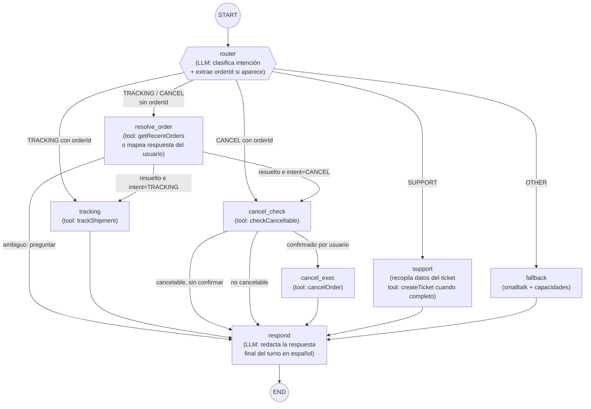

# 04 — El grafo LangGraph4j

Documento central del agente. Define el estado, los nodos, las aristas y el ciclo conversacional, usando estrictamente la API de **LangGraph4j** (`org.bsc.langgraph4j`): `StateGraph`, `AgentState`, `Channels`, `node_async`/`edge_async`, `CompiledGraph`, checkpointers. Referencia local: `llms-lgraph.txt`.

## Topología del grafo



Puntos clave:

- **Cada turno HTTP recorre el grafo de `START` a `END`** (ADR-2). El "ciclo" conversacional se materializa entre turnos: el grafo termina con una pregunta, el checkpointer conserva el estado y el siguiente mensaje del usuario reentra por `router`, que ahora ve en el estado que hay una clarificación pendiente.
- `resolve_order` es el **subflujo reutilizable de desambiguación**: lo comparten TRACKING y CANCEL.
- `respond` es el único nodo que redacta texto para el usuario: centraliza tono, idioma y formato.

## El estado: `SupportState`

Extiende `org.bsc.langgraph4j.state.AgentState`. El esquema define cómo se fusionan las actualizaciones parciales que devuelve cada nodo (`Channels.base` = reemplazo, `Channels.appender` = acumulación en lista).

```java
public class SupportState extends AgentState {

    public static final Map<String, Channel<?>> SCHEMA = Map.of(
        "messages",        Channels.appender(ArrayList::new), // historial ChatMessage serializado
        "userId",          Channels.base(() -> ""),
        "intent",          Channels.base(() -> Intent.NONE.name()), // TRACKING|CANCEL|SUPPORT|OTHER|NONE
        "orderId",         Channels.base(() -> (Long) null),
        "candidateOrders", Channels.base(List::of),           // List<OrderSummary> ofrecidos al usuario
        "awaiting",        Channels.base(() -> Awaiting.NOTHING.name()), // NOTHING|ORDER_CHOICE|CANCEL_CONFIRM|TICKET_INFO
        "ticketDraft",     Channels.base(() -> (String) null),
        "toolResult",      Channels.base(() -> (String) null), // resultado serializado de la última tool
        "resolved",        Channels.base(() -> false)
    );

    public SupportState(Map<String, Object> initData) { super(initData); }

    public String userId()            { return this.<String>value("userId").orElseThrow(); }
    public Intent intent()            { return Intent.valueOf(this.<String>value("intent").orElse("NONE")); }
    public Optional<Long> orderId()   { return this.value("orderId"); }
    public Awaiting awaiting()        { return Awaiting.valueOf(this.<String>value("awaiting").orElse("NOTHING")); }
    public List<OrderSummary> candidateOrders() { return this.<List<OrderSummary>>value("candidateOrders").orElse(List.of()); }
    public boolean resolved()         { return this.<Boolean>value("resolved").orElse(false); }
    public Optional<String> toolResult() { return this.value("toolResult"); }
    public List<ChatMessage> messages()  { return this.<List<ChatMessage>>value("messages").orElse(List.of()); }
}
```

Enums de control (decisiones de flujo **en Java**, no en prompts):

```java
public enum Intent  { TRACKING, CANCEL, SUPPORT, OTHER, NONE }
public enum Awaiting { NOTHING, ORDER_CHOICE, CANCEL_CONFIRM, TICKET_INFO }
```

`awaiting` es la pieza que implementa el ciclo: indica **qué pregunta dejó pendiente el turno anterior**, para que el router del turno siguiente interprete el mensaje del usuario como respuesta a esa pregunta y no como una petición nueva (aunque también debe detectar cambios de tema: "déjalo, mejor cancela el otro").

> **Serialización:** el checkpointer serializa el estado. Mantener en el estado solo tipos serializables sencillos (String, Long, Boolean, records). Los `ChatMessage` de LangChain4j se guardan vía el `StateSerializer` correspondiente (LangGraph4j trae serializers para mensajes LC4j; ver ejemplos de `llms-lgraph.txt`).

## Construcción del grafo

```java
@Component
@RequiredArgsConstructor
public class SupportAgentGraph {

    private final RouterNode routerNode;
    private final ResolveOrderNode resolveOrderNode;
    private final TrackingNode trackingNode;
    private final CancelCheckNode cancelCheckNode;
    private final CancelExecNode cancelExecNode;
    private final SupportNode supportNode;
    private final FallbackNode fallbackNode;
    private final RespondNode respondNode;

    public StateGraph<SupportState> build() throws GraphStateException {
        return new StateGraph<>(SupportState.SCHEMA, stateSerializer())
            .addNode("router",        node_async(routerNode))
            .addNode("resolve_order", node_async(resolveOrderNode))
            .addNode("tracking",      node_async(trackingNode))
            .addNode("cancel_check",  node_async(cancelCheckNode))
            .addNode("cancel_exec",   node_async(cancelExecNode))
            .addNode("support",       node_async(supportNode))
            .addNode("fallback",      node_async(fallbackNode))
            .addNode("respond",       node_async(respondNode))

            .addEdge(START, "router")

            .addConditionalEdges("router",
                edge_async(this::routeFromRouter),
                Map.of(
                    "resolve_order", "resolve_order",
                    "tracking",      "tracking",
                    "cancel_check",  "cancel_check",
                    "support",       "support",
                    "fallback",      "fallback"))

            .addConditionalEdges("resolve_order",
                edge_async(this::routeFromResolveOrder),
                Map.of(
                    "tracking",     "tracking",
                    "cancel_check", "cancel_check",
                    "ask_user",     "respond"))

            .addEdge("tracking", "respond")

            .addConditionalEdges("cancel_check",
                edge_async(this::routeFromCancelCheck),
                Map.of(
                    "execute",  "cancel_exec",
                    "ask_user", "respond"))

            .addEdge("cancel_exec", "respond")
            .addEdge("support",  "respond")
            .addEdge("fallback", "respond")
            .addEdge("respond", END);
    }

    // ---- Aristas condicionales: Java puro sobre el estado ----

    private String routeFromRouter(SupportState s) {
        return switch (s.intent()) {
            case TRACKING -> s.orderId().isPresent() ? "tracking" : "resolve_order";
            case CANCEL   -> s.orderId().isPresent() ? "cancel_check" : "resolve_order";
            case SUPPORT  -> "support";
            default       -> "fallback";
        };
    }

    private String routeFromResolveOrder(SupportState s) {
        if (s.orderId().isEmpty()) return "ask_user";          // sigue ambiguo → preguntar
        return s.intent() == Intent.CANCEL ? "cancel_check" : "tracking";
    }

    private String routeFromCancelCheck(SupportState s) {
        // cancel_check deja en el estado si el pedido es cancelable y si el usuario ya confirmó
        boolean confirmed = s.awaiting() == Awaiting.NOTHING; // el nodo limpia awaiting al recibir confirmación
        boolean cancellable = s.<Boolean>value("cancellable").orElse(false);
        return (cancellable && confirmed) ? "execute" : "ask_user";
    }
}
```

Imports estáticos relevantes: `org.bsc.langgraph4j.StateGraph.START`, `...END`, `org.bsc.langgraph4j.action.AsyncNodeAction.node_async`, `org.bsc.langgraph4j.action.AsyncEdgeAction.edge_async`.

## Contrato de los nodos

Cada nodo es una clase Spring (`@Component`) que implementa `NodeAction<SupportState>`: recibe el estado y devuelve **solo las claves que actualiza** (LangGraph4j las fusiona según el `SCHEMA`).

### `router` — clasificación de intención + extracción

```java
@Component
@RequiredArgsConstructor
@Slf4j
public class RouterNode implements NodeAction<SupportState> {

    private final IntentClassifier classifier; // AiService de LangChain4j

    @Override
    public Map<String, Object> apply(SupportState state) {
        log.debug("---ROUTER---");
        String lastUserMessage = lastUserText(state);

        // Si el turno anterior dejó una pregunta pendiente, el router decide:
        // ¿el mensaje responde a la pregunta o cambia de tema?
        RouterDecision d = classifier.classify(
            lastUserMessage,
            state.awaiting().name(),
            state.candidateOrders().toString());

        Map<String, Object> updates = new HashMap<>();
        if (d.intent() != Intent.NONE)  updates.put("intent", d.intent().name());
        if (d.orderId() != null)        updates.put("orderId", d.orderId());
        return updates;
    }
}
```

El clasificador es un **AiService de LangChain4j con salida estructurada** (patrón de `llms-lc4j.txt`):

```java
public interface IntentClassifier {

    @SystemMessage("""
        Eres el router de un agente de soporte de e-commerce.
        Clasifica el mensaje del usuario en una intención: TRACKING, CANCEL, SUPPORT u OTHER.
        Contexto: el agente está esperando '{{awaiting}}'. Pedidos candidatos ya ofrecidos: {{candidates}}.
        Si el usuario está respondiendo a una pregunta pendiente eligiendo un pedido
        (por id o por descripción, p.ej. "el portátil"), mantén la intención previa y
        devuelve el orderId elegido. Si menciona explícitamente un número de pedido, extráelo.
        """)
    @UserMessage("{{message}}")
    RouterDecision classify(@V("message") String message,
                            @V("awaiting") String awaiting,
                            @V("candidates") String candidates);

    record RouterDecision(Intent intent, Long orderId) {}
}
```

> La **resolución de referencia** ("el portátil" → 123) se hace aquí porque el LLM ve los candidatos del estado. `resolve_order` solo se ocupa de buscar candidatos cuando aún no los hay.

### `resolve_order` — desambiguación proactiva

```java
@Override
public Map<String, Object> apply(SupportState state) {
    log.debug("---RESOLVE ORDER---");
    List<OrderSummary> recent = orderTools.getRecentOrders(state.userId());

    if (recent.isEmpty())
        return Map.of("toolResult", "El usuario no tiene pedidos.",
                      "awaiting", Awaiting.NOTHING.name());

    if (recent.size() == 1)                     // único candidato → autoselección
        return Map.of("orderId", recent.get(0).id(),
                      "awaiting", Awaiting.NOTHING.name());

    return Map.of("candidateOrders", recent,    // varios → preguntar (el turno acabará en respond)
                  "awaiting", Awaiting.ORDER_CHOICE.name(),
                  "toolResult", toJson(recent));
}
```

### `tracking`, `cancel_check`, `cancel_exec`, `support`

Mismo patrón: invocan la tool Java correspondiente, vuelcan el resultado tipado en `toolResult` (y flags como `cancellable`, `resolved`), y actualizan `awaiting`:

- `cancel_check`: si el pedido es cancelable y `awaiting != CANCEL_CONFIRM`, deja `awaiting=CANCEL_CONFIRM` (pedirá confirmación). Si el usuario ya confirmó (el router detectó un "sí" con `awaiting=CANCEL_CONFIRM`), limpia `awaiting` y la arista manda a `cancel_exec`.
- `support`: mientras falte la descripción del problema, acumula en `ticketDraft` y deja `awaiting=TICKET_INFO`; cuando está completa llama a `createTicket` y marca `resolved=true`.

### `respond` — redacción única de la respuesta

```java
@Override
public Map<String, Object> apply(SupportState state) {
    log.debug("---RESPOND---");
    String reply = responder.write(           // AiService: redacta en español, tono cercano,
        state.intent().name(),                // sin inventar datos: SOLO puede usar toolResult
        state.awaiting().name(),
        state.toolResult().orElse("(sin datos)"),
        lastUserText(state));
    return Map.of("messages", List.of(AiMessage.from(reply)));
}
```

Regla del prompt de `respond`: *"Responde únicamente con la información de TOOL_RESULT. Si AWAITING es ORDER_CHOICE, formula la pregunta de elección listando los pedidos. Si es CANCEL_CONFIRM, pide confirmación explícita sí/no. Nunca inventes estados de pedido."*

## Compilación, checkpointer y memoria conversacional

```java
@Configuration
public class AgentConfig {

    @Bean
    public BaseCheckpointSaver checkpointSaver() {
        return new MemorySaver(); // prototipo: en memoria (ADR-6)
    }

    @Bean
    public CompiledGraph<SupportState> supportAgent(SupportAgentGraph builder,
                                                    BaseCheckpointSaver saver) throws GraphStateException {
        return builder.build().compile(
            CompileConfig.builder()
                .checkpointSaver(saver)
                .build());
    }
}
```

Invocación por turno (en `ConversationService`):

```java
public ChatResult chat(String userId, String conversationId, String message) {
    var config = RunnableConfig.builder()
            .threadId(conversationId)          // ← la clave de la memoria entre turnos
            .build();

    var state = supportAgent.invoke(
            Map.of("messages", List.of(UserMessage.from(message)),
                   "userId", userId),
            config)
        .orElseThrow(() -> new IllegalStateException("El grafo no devolvió estado"));

    String reply = lastAiText(state);
    return new ChatResult(reply, state.intent().name(), state.resolved());
}
```

Con el mismo `threadId`, `MemorySaver` restaura `intent`, `candidateOrders`, `awaiting`, etc. — así "El portátil" del segundo turno se entiende sin repetir nada.

## Observabilidad y testing del grafo

- **Logs por nodo** con el patrón `---NOMBRE---` (igual que los ejemplos de `llms-lgraph.txt`); con `dev.langchain4j: DEBUG` ya activado en `application.yml` se ven además las llamadas al modelo.
- **Diagrama generado**: `graph.getGraph(GraphRepresentation.Type.MERMAID)` exporta la topología real; incluirlo en el README del repo y en CI para detectar derivas doc/código.
- **Tests sin LLM**: las aristas (`routeFromRouter`...) son funciones puras sobre `SupportState` → tests unitarios triviales construyendo el estado con `Map.of`. Los nodos de tool se testean con repositorios H2.
- **Tests con LLM falso**: para el flujo completo, sustituir `IntentClassifier`/`Responder` por fakes deterministas (`@MockBean`) y verificar la secuencia de nodos con `graph.stream(...)` inspeccionando `NodeOutput.node()`.
- **Test de integración real** (opcional, etiquetado `@Tag("llm")`): escenario de referencia completo contra Gemini con la API key de desarrollo.
