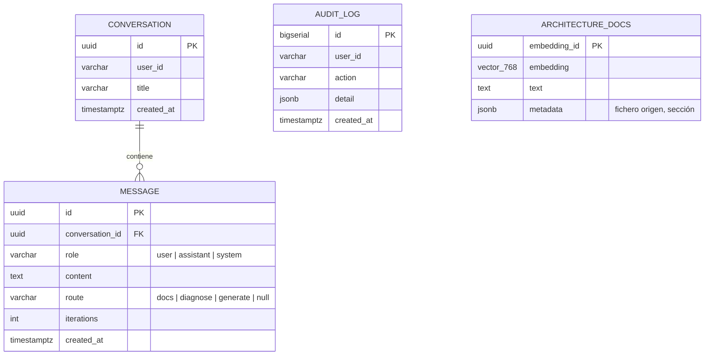

# 05 — Contratos de API y modelo de datos

Contratos estables entre las tres piezas. Cualquier cambio aquí implica tocar dos servicios: pensarlo dos veces.

## 1. API pública del gateway (`/api`, consumida por Angular)

Autenticación: JWT Bearer en todas las rutas salvo `/api/auth/login` y `/api/actuator/health`.

### POST `/api/auth/login`

```json
// request
{ "username": "demo", "password": "..." }
// response 200
{ "token": "eyJ...", "expiresAt": "2026-06-11T20:00:00Z", "displayName": "Demo User" }
// 401 si credenciales inválidas (Problem Details)
```

### POST `/api/chat` — la operación principal

```json
// request
{
  "conversationId": "9b2f...-uuid | null",   // null = crear conversación nueva
  "prompt": "Genera un deployment para un servicio Java en el puerto 8080"
}
// response 200
{
  "conversationId": "9b2f...",
  "messageId": "77ab...",
  "answer": "Aquí tienes el manifiesto...",   // markdown
  "route": "generate",                         // docs | diagnose | generate
  "yaml": "apiVersion: apps/v1\nkind: Deployment...",  // null en rutas docs/diagnose
  "validation": {
    "valid": true,
    "iterations": 2,                           // pasadas del generador
    "pendingErrors": []                        // no vacío solo si se abortó por max iteraciones
  }
}
```

Errores: `504` si el agente supera el timeout; `502` si el agente devuelve error; ambos como Problem Details con `detail` legible para mostrar en la UI.

### Conversaciones

| Método y ruta | Descripción | Respuesta |
|---|---|---|
| `GET /api/conversations` | Lista del usuario autenticado, ordenada por actividad | `[{id, title, createdAt, lastMessageAt}]` |
| `GET /api/conversations/{id}` | Mensajes de una conversación | `{id, title, messages: [{id, role, content, route, iterations, createdAt}]}` |
| `DELETE /api/conversations/{id}` | Borrado (cascada de mensajes) | `204` |

El `title` lo fija el gateway con los primeros ~60 caracteres del primer prompt.

## 2. API interna del agente (consumida solo por el gateway)

Sin autenticación propia en el MVP (no expuesto fuera del clúster; ClusterIP). Si se quisiera defensa en profundidad: token compartido por header, vía Secret.

### POST `/agent/run`

```json
// request
{
  "prompt": "¿Por qué falla el pod payments-api?",
  "history": [                                  // últimas N interacciones, para contexto
    { "role": "user", "content": "..." },
    { "role": "assistant", "content": "..." }
  ]
}
// response 200
{
  "answer": "El pod está en CrashLoopBackOff porque...",
  "route": "diagnose",
  "yaml": null,
  "validation": { "valid": null, "iterations": 0, "pendingErrors": [] }
}
```

Mapeo directo desde `AutoOpsState` final (doc 03 §6): `answer=finalAnswer`, `yaml=lastYaml`, `iterations`, `pendingErrors=validationError` troceado.

### POST `/agent/rag/ingest`

Ingesta (o re-ingesta) del corpus de documentación interna:

```json
// request
{ "source": "corpus", "clear": true }   // clear: vaciar el store antes de indexar
// response 200
{ "documentsIndexed": 12, "chunks": 184 }
```

En el MVP el corpus son los markdown de `corpus/` montados en la imagen del agente (o un volumen); la ingesta se lanza manualmente tras el despliegue.

### GET `/actuator/health` (liveness/readiness)

Readiness incluye: conexión BD y reachability del proveedor LLM (check ligero, cacheado, para no quemar cuota).

## 3. DTOs compartidos (forma canónica)

En Java ambos lados los definen como `record` propios (sin librería compartida en el MVP; el contrato es JSON):

```java
// agente
public record AgentRequest(String prompt, List<ChatTurn> history) {}
public record ChatTurn(String role, String content) {}
public record AgentResponse(String answer, String route, String yaml, Validation validation) {
    public record Validation(Boolean valid, int iterations, List<String> pendingErrors) {}
}
```

> `valid` es `Boolean` (nullable): `null` significa "no aplica" (rutas docs/diagnose). La UI lo usa para decidir si pinta el panel de validación.

## 4. Modelo de datos (PostgreSQL)

Dos esquemas en la BD `autoops` (DDL ejecutable en la guía de infraestructura `03-postgresql-pgvector.md`):



- `chat.conversation`, `chat.message`, `chat.audit_log` → propiedad del **gateway** (JPA, `default_schema=chat`).
- `rag.architecture_docs` → propiedad del **agente** vía `PgVectorEmbeddingStore` (dimensión 768 = `text-embedding-004` de Gemini; si cambia el modelo de embeddings, recrear tabla y re-ingestar).
- Regla: **ningún servicio toca el esquema del otro.**

## 5. Cadena de timeouts

El presupuesto de tiempo debe ser decreciente hacia dentro para que los errores sean claros:

```
Ingress (180 s) > gateway→agent RestClient (120 s) > suma de llamadas LLM del grafo
```

El peor caso del grafo: router + 3×(generate+validate) + compose ≈ 5 llamadas LLM. Con Gemini Flash (~2-6 s/llamada) sobra margen; si un día no, el grafo debe fallar primero (timeout por llamada LLM en el builder del modelo, p. ej. 30 s) para que el error que viaje sea "el LLM tardó", no un corte mudo del proxy.

## 6. Versionado del contrato

MVP: sin versionado de URL (`/api/v1`) — innecesario con un solo consumidor. Disciplina mínima: cambios **aditivos** en respuestas JSON (añadir campos no rompe; renombrar/eliminar sí). Si el agente se reescribiera (p. ej. en Python, ADR-001), el contrato de `/agent/run` es la especificación a respetar.
