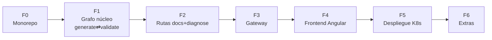

# 07 — Roadmap de implementación

Plan por fases pensado para ejecutarse en **conversaciones de desarrollo separadas**: cada fase cabe en una o dos sesiones, tiene entregable verificable y deja el sistema en un estado demostrable. El orden minimiza el trabajo en falso: primero el valor diferencial (el grafo), luego las capas alrededor.

---

## F0 — Reestructuración a monorepo

**Objetivo:** dejar el esqueleto de [04-organizacion-codigo.md](04-organizacion-codigo.md).

- [ ] POM padre `io.github.mikel0ne.autoops:autoops-parent` con módulos `agent` y `gateway`.
- [ ] Módulo `agent`: Spring Boot 3 + LangChain4j 1.x + LangGraph4j (BOM); migrar del código semilla la config de Gemini (adaptando `ChatLanguageModel.generate` → `ChatModel.chat`, ADR-004) y el `FileCacheManager` (como utilidad opcional de dev).
- [ ] Módulo `gateway`: esqueleto Spring Boot 3 con Actuator y OpenAPI (reutilizar `OpenApiConfig` existente).
- [ ] Eliminar el árbol `src/` raíz; actualizar README.
- [ ] Carpetas `k8s/`, `corpus/`, `frontend/` (vacías con README de intención).

**Verificación:** `mvn clean package` en raíz compila ambos módulos; ambos arrancan y responden `/actuator/health`.

## F1 — El grafo núcleo: ciclo generar⇄validar (el diferencial)

**Objetivo:** el `StateGraph` de [03-flujo-langgraph4j.md](03-flujo-langgraph4j.md) con la ruta `generate` completa. Sin RAG ni K8s todavía: el router enruta, pero `docs`/`diagnose` responden "no implementado".

- [ ] `AutoOpsState` con schema (appender de `yamlAttempts`).
- [ ] Nodos: `RouterNode`, `GenerateYamlNode`, `ValidateYamlNode`, `ComposeAnswerNode`.
- [ ] `YamlValidationService` con las 5 `PolicyRule` (doc 03 §4.5) y tests unitarios por regla.
- [ ] `AutoOpsGraphBuilder` con edges condicionales y `MAX_ITERATIONS=3`.
- [ ] Prompts en `resources/prompts/` (generar + corregir + componer).
- [ ] `AgentRunService` + `POST /agent/run` (contrato del doc 05 §2).
- [ ] Tests de integración del ciclo con `ScriptedChatModel` (doc 06 §5): converge, aborta, registra iteraciones.

**Verificación (demo):** `curl POST /agent/run` con "genera un deployment nginx sin limits" devuelve YAML **con** limits, `validation.valid=true`, `iterations≥1`. Es la demo estrella del proyecto: dejar grabado el caso.

## F2 — Rutas `docs` (RAG) y `diagnose` (K8s)

**Objetivo:** completar las tres rutas del grafo.

- [ ] PostgreSQL+pgvector local para desarrollo (docker compose o el manifiesto de la guía de infra + port-forward).
- [ ] `EmbeddingStoreConfig` (PgVectorEmbeddingStore, esquema `rag`, 768 dims) + `IngestionService` (markdown → chunks ~500 tokens con solape → embeddings) + `POST /agent/rag/ingest`.
- [ ] Redactar 4-6 documentos de `corpus/` (estándares ficticios pero realistas: convención de microservicios, política de recursos, guía de probes…). Doble uso: alimentan el RAG y son las políticas que valida F1.
- [ ] `RetrieveDocsNode` + plantilla `compose_docs` con instrucción anti-alucinación.
- [ ] `K8sClientConfig` (fabric8: kubeconfig en local, ServiceAccount in-cluster) + `K8sInspectionService` (dossier: estado, eventos, logs recientes, restarts).
- [ ] `DiagnoseNode` + plantilla `compose_diagnose`.

**Verificación:** con un pod roto a propósito (imagen inexistente), "¿por qué falla el pod X?" produce un diagnóstico que cita el evento real (`ErrImagePull`). "¿Cuál es nuestra política de probes?" responde citando el corpus.

## F3 — Gateway: negocio, persistencia y seguridad

**Objetivo:** la fachada completa de [05-contratos-api-datos.md](05-contratos-api-datos.md) §1.

- [ ] Entidades y repositorios JPA (esquema `chat`); migraciones con Flyway (el DDL de la guía de infra pasa a ser `V1__init.sql` — fuente única).
- [ ] `AgentClient` (RestClient, timeout 120 s, mapeo de errores a 502/504 Problem Details).
- [ ] `POST /api/chat`: crea/recupera conversación → llama al agente con historial reciente → persiste ambos mensajes (con `route`/`iterations`) → audita → responde.
- [ ] Endpoints de conversaciones + borrado.
- [ ] Seguridad: JWT (login con usuarios estáticos `UserProperties`), filtro, rutas públicas mínimas.
- [ ] Tests: `@SpringBootTest` + Testcontainers + WireMock (o stub) del agente.

**Verificación:** flujo completo por Swagger UI: login → chat → el mensaje queda en BD → re-consulta del historial.

## F4 — Frontend Angular

**Objetivo:** el dashboard.

- [ ] Esqueleto Angular 18+ standalone + Angular Material (o Tailwind), layout dashboard.
- [ ] Login + interceptor JWT + guardia.
- [ ] Vista chat: markdown render, bloque YAML con copiar/descargar, badges de ruta y de iteraciones ("se auto-corrigió 2 veces"), panel de validación.
- [ ] Vista historial: lista, abrir conversación, borrar.
- [ ] Proxy de desarrollo (`proxy.conf.json` → gateway local).

**Verificación:** demo end-to-end en local (sin K8s): las tres rutas visibles desde la UI con sus badges.

## F5 — Despliegue en Kubernetes local

**Objetivo:** todo el stack corriendo en el clúster. **Guías ya escritas**: seguir `docs/infraestructura/` 01→07 (rama `autoops/docs-infraestructura`).

- [ ] Extraer los manifiestos de las guías a `k8s/` (y `01-secrets.yaml` a `.gitignore`).
- [ ] Dockerfiles de los tres servicios (guía infra 04) + perfil `k8s` de Spring.
- [ ] Desplegar; ejecutar la ingesta RAG (`POST /agent/rag/ingest` vía port-forward).
- [ ] Probar CU-2 contra el propio clúster: AutoOps diagnosticándose a sí mismo (gran momento de demo).

**Verificación:** checklist de la guía infra 07 §7 completa; demo desde `http://autoops.local`.

## F6 — Extras de porfolio (opcionales, en orden de retorno)

1. **Streaming SSE**: `graph.stream()` → eventos de progreso por nodo en la UI ("validando… corrigiendo intento 2…"). Muy vistoso y barato gracias a la decisión del doc 03 §6.
2. **Checkpointing/memoria** del grafo (`MemorySaver`) por conversación.
3. **CI con GitHub Actions**: build + tests + imágenes.
4. **Observabilidad**: histograma de iteraciones del ciclo, tokens por petición (Micrometer).
5. **Human-in-the-loop**: aprobación del YAML antes de la respuesta final.
6. **README de porfolio** con GIF de la demo y el diagrama del grafo (el discurso del documento original del prototipo).

---

## Riesgos y mitigaciones

| Riesgo | Impacto | Mitigación |
|---|---|---|
| Cuota gratuita de Gemini (429) en demos | Demo rota | Modelo `flash-lite`; caché dev; tener grabación de respaldo |
| El router clasifica mal peticiones ambiguas | UX confusa | Fallback a `docs` (sin efectos); few-shot en el prompt; badge de ruta visible para detectar errores |
| El ciclo no converge en YAMLs complejos | Respuestas "abort" frecuentes | Errores de validación accionables (mensaje por regla); subir MAX_ITERATIONS es un parámetro, no un cambio |
| Versiones LangGraph4j/LangChain4j se mueven rápido | Fricción al empezar cada fase | Fijar versiones en el POM padre en F0 y no actualizarlas a mitad de fase |
| Scope creep (es un porfolio, no un producto) | No se termina | La lista "fuera del MVP" del doc 01 es contractual; los extras solo tras F5 |
