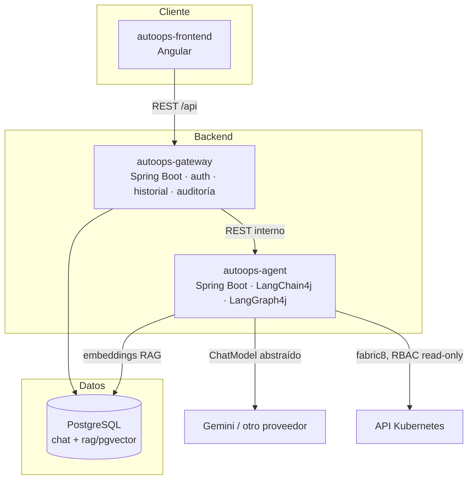

# AutoOps — Documentación de Arquitectura

**AutoOps** (Enterprise DevOps & Architecture Copilot) es un sistema multi-agente que asiste a equipos de desarrollo que operan sobre Kubernetes: responde dudas sobre documentación de arquitectura interna (RAG), diagnostica workloads del clúster y genera manifiestos YAML con un **ciclo de auto-corrección** orquestado con **LangGraph4j**.

Esta documentación define **todo lo necesario a nivel de código** para construirlo: arquitectura del sistema, diseño del grafo de agentes, organización del código, contratos de API, modelo de datos y plan de implementación por fases. Está pensada para ejecutarse en **conversaciones de desarrollo separadas**: cada documento es autocontenido y referencia a los demás cuando lo necesita.

> La documentación de **infraestructura** (despliegue en Kubernetes local) vive en la rama `autoops/docs-infraestructura`, en `docs/infraestructura/`.

## Decisiones marco (fijadas)

| Decisión | Valor | Por qué |
|---|---|---|
| Motor de agentes | **Java + LangGraph4j** (`org.bsc.langgraph4j`) | Stack único Java; alineado con las reglas del repo (`.github/copilot-instructions.md`: LangGraph4j obligatorio para flujos de grafos de estado) |
| Framework LLM | **LangChain4j 1.x** | Ya en uso en el repo; integración oficial `langgraph4j-langchain4j` |
| Proveedor LLM | **Abstraído por configuración; implementación por defecto Gemini** (Google AI Studio, capa gratuita) | Coste cero en desarrollo; cambiar de proveedor = 1 bean + 1 propiedad (ver doc 06) |
| Despliegue | **Kubernetes local** (Docker Desktop / Minikube) | Sin coste de nube; demostrable en cualquier máquina |
| Persistencia | **PostgreSQL + pgvector** | Una sola BD para historial, auditoría y embedding store |
| Frontend | **Angular 18+** | Zona de confort del autor; dashboard empresarial |

## Vista de pájaro

## Índice

1. [01-vision-alcance.md](01-vision-alcance.md) — Qué hace AutoOps, casos de uso, qué queda fuera del MVP.
2. [02-arquitectura-sistema.md](02-arquitectura-sistema.md) — Componentes, responsabilidades y registro de decisiones (ADRs).
3. [03-flujo-langgraph4j.md](03-flujo-langgraph4j.md) — **El corazón:** diseño del `StateGraph` (estado, nodos, edges condicionales, ciclo de auto-corrección) con código LangGraph4j.
4. [04-organizacion-codigo.md](04-organizacion-codigo.md) — Estructura del monorepo, paquetes Java de cada servicio y convenciones.
5. [05-contratos-api-datos.md](05-contratos-api-datos.md) — Endpoints REST de gateway y agente, DTOs y modelo de datos.
6. [06-abstraccion-llm.md](06-abstraccion-llm.md) — Cómo se abstrae el proveedor LLM y cómo añadir uno nuevo.
7. [07-roadmap-implementacion.md](07-roadmap-implementacion.md) — Plan por fases con entregables verificables (la guía para las conversaciones de desarrollo).

## Cómo usar esta documentación

- Para **empezar a implementar**: ir directo a [07-roadmap-implementacion.md](07-roadmap-implementacion.md), que ordena el trabajo y enlaza el documento de detalle de cada pieza.
- Para **entender el sistema** (o prepararse una entrevista): leer 01 → 02 → 03.
- Regla de oro del repo: los flujos cíclicos/agénticos se implementan **siempre** con la sintaxis LangGraph4j documentada en `llms-lgraph.txt`; los servicios Spring Boot y wiring LangChain4j siguen `llms-lc4j.txt`.
