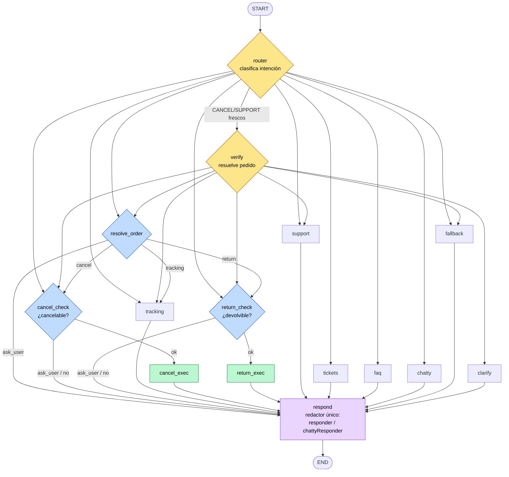

# Grafo del agente de soporte (LangGraph4j)

Diagrama de la topología del grafo (`SupportAgentGraph.build()`). Cada turno HTTP
recorre el grafo de `START` a `END`; el ciclo conversacional se materializa entre
turnos gracias al checkpointer.

## Leyenda

- 🟡 **Decisión** (`router`, `verify`): no redactan; deciden el siguiente nodo
  mediante *conditional edges* (`SupportRouting`).
- 🔵 **Gates** (`resolve_order`, `cancel_check`, `return_check`): comprueban reglas
  de negocio y ramifican (ejecutar o preguntar al usuario → `respond`).
- 🟢 **Exec** (`cancel_exec`, `return_exec`): ejecutan la acción real.
- 🟣 **respond**: redactor único (embudo final). Elige `responder` o
  `chattyResponder` según la intención.
