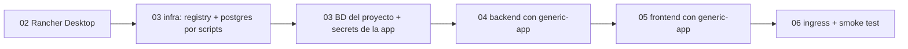

# 01 — Visión general de la infraestructura

## Objetivo

Desplegar el prototipo completo (frontend Angular + backend Spring Boot/LangGraph4j +
PostgreSQL) en un **Kubernetes local ligero**, con un modelo que escala a varios
servicios del portfolio: infraestructura compartida instalada por scripts en sus
namespaces propios, un namespace por aplicación, imágenes propias en un registry del
clúster, secretos fuera del repo y un único punto de entrada por Ingress.

No es infraestructura de producción (sin HA, sin TLS real, sin GitOps), pero cada
simplificación está señalada con su alternativa "seria".

## Decisiones de infraestructura

### D-1: Rancher Desktop (k3s) como clúster local
**Elegido** frente a Docker Desktop/minikube/kind por ligereza: k3s es una distribución
mínima de Kubernetes que pesa mucho menos en RAM/CPU con varios servicios levantados.
Además trae **Traefik como Ingress Controller de serie** (una pieza menos que instalar)
y la instalación incluye `kubectl`, `helm` y el CLI de contenedores.

- En un entorno real: EKS/GKE/AKS + registry gestionado + CI que publica imágenes.

### D-2: Infra compartida por scripts; aplicaciones por Helm
La infra del clúster (registry, PostgreSQL) se despliega con manifiestos crudos vía
los scripts de [`infra/scripts/`](../../infra/scripts) (`02-setup-registry.sh`,
`03-setup-postgres.sh`). Razón: son piezas que se instalan **una vez por clúster** y
viven al margen de cualquier aplicación; el script es más directo que un chart y queda
controlado al detalle (versión, NodePort, recursos).

Las **aplicaciones** sí usan Helm: existe un **chart genérico reutilizable**
[`infra/charts/generic-app`](../../infra/charts/generic-app) (Deployment + Service +
ConfigMap + Ingress + HPA parametrizados por values) y cada proyecto solo aporta sus
`values-<app>.yaml`. Ver D-6.

### D-3: Namespace `infra` compartido entre proyectos; un namespace por app
`infra` aloja el motor PostgreSQL: **una sola instancia para todo el portfolio**, con
**una base de datos por proyecto** (este proyecto usa `l1_copilot`, otro podrá usar
`autoops`, etc.). El registry vive en su propio namespace `registry` por separarlo
limpiamente. Cada aplicación vive en su propio namespace (`l1-copilot`) y consume la
infra por DNS entre namespaces (`postgres.infra.svc.cluster.local`).

- En un entorno real: BD gestionada u operador (CloudNativePG); registry gestionado.

### D-4: El esquema de la BD del proyecto se aplica con un script propio
El Postgres compartido se levanta vacío (solo crea `appdb`/`appuser`). Cada proyecto
crea **su BD y su esquema** con un script propio: en este repo,
[`scripts/setup-l1-copilot-db.sh`](../../scripts/setup-l1-copilot-db.sh) crea la BD
`l1_copilot` y aplica `backend/src/main/resources/schema-postgresql.sql` +
`data-postgresql.sql`. El backend arranca con `ddl-auto: validate` y
`sql.init.mode: never` (no toca el esquema en prod).

- En un entorno real: migraciones Flyway/Liquibase ejecutadas por la app o un Job.

### D-5: Traefik único con host `copilot.localtest.me`
Un solo host sirve la SPA (`/`) y la API (`/api`): el frontend usa rutas relativas, no
hay CORS y el modelo es idéntico al de producción. `*.localtest.me` resuelve a
`127.0.0.1` públicamente → no hay que tocar `C:\Windows\System32\drivers\etc\hosts`.
El Ingress lo genera el chart `generic-app` con el recurso `Ingress` estándar
(`ingressClassName: traefik`), no CRDs de Traefik: portable a cualquier controller.

### D-6: Chart genérico `generic-app` para las aplicaciones
Cada app del portfolio se despliega con el mismo chart (Deployment + Service +
ConfigMap + Ingress + HPA) y solo aporta `values-<app>.yaml` con: imagen, puerto,
réplicas/estrategia, probes, ConfigMap, `secretEnv` (referencias a Secrets externos,
nunca creados por el chart), Ingress, recursos. Esto evita duplicar manifiestos y
permite que un cambio en el chart beneficie a todos los proyectos.

### D-7: Secretos como `Secret` creados imperativamente
Los valores reales (`GEMINI_API_KEY`, password de Postgres) se crean con
`kubectl create secret` o con
[`infra/scripts/create-secrets.ps1`](../../infra/scripts/create-secrets.ps1) (lee un
`.env` git-ignorado) y **nunca** se commitean. El chart `generic-app` referencia los
Secrets en `secretEnv` pero no los crea.

- En un entorno real: External Secrets Operator / Sealed Secrets / Vault.

### D-8: Backend a 1 réplica con `strategy: Recreate` (limitación consciente)
El estado conversacional del grafo vive en un `MemorySaver` en memoria del pod: con
más de una réplica los turnos de una conversación caerían en pods distintos. Escalar
exige antes un `BaseCheckpointSaver` persistente (Postgres/Redis) — apuntado como
extensión en la arquitectura (ADR-6).

## Requisitos de máquina

| Recurso | Mínimo |
|---|---|
| RAM para Rancher Desktop | 4-6 GB asignados (k3s es notablemente más ligero que el K8s de Docker Desktop) |
| Disco | ~6 GB (imágenes + PVCs: postgres 1 Gi, registry 5 Gi) |
| Software | Rancher Desktop ≥ 1.16 (incluye kubectl, helm, docker/nerdctl), WSL2, bash |
| Red | Salida HTTPS a `generativelanguage.googleapis.com` (Gemini) |

## Inventario de ficheros

```
infra/                                      # FUENTE DE VERDAD de la infraestructura
├── INFRA.md                                # documentación cross-project de infra
├── .gitignore                              # bloquea .env con secretos
├── scripts/                                # instalación del clúster e infra compartida
│   ├── 01-install-rancher-desktop.sh           # instala Rancher Desktop (winget desde WSL)
│   ├── 02-setup-registry.sh                    # registry:2 en namespace registry, NodePort 30500
│   ├── 03-setup-postgres.sh                    # postgres:16-alpine en namespace infra
│   ├── 04-setup-postgres-ingress.sh            # opcional: Traefik TCP postgres en localhost:5432
│   ├── 05-setup-registry-ingress.sh            # opcional: Traefik TCP registry en localhost:15000
│   ├── add-postgres-host.ps1                   # Admin: postgres.local → 127.0.0.1 en hosts Windows
│   ├── add-registry-host.ps1                   # Admin: registry.local → 127.0.0.1 en hosts Windows
│   └── create-secrets.ps1                      # convierte un .env en Secret de K8s
├── charts/generic-app/                     # chart Helm reutilizable para apps stateless
│   ├── Chart.yaml
│   ├── values.yaml                             # contrato completo (todos los parámetros)
│   ├── templates/                              # deployment, service, configmap, ingress, hpa
│   └── values-examples/                        # plantillas listas (Java backend, frontend nginx)
├── namespace-l1-copilot.yaml               # namespace de la app (helm no crea namespaces)
├── values-l1-copilot-backend.yaml          # values del backend (release l1-copilot-backend)
└── values-l1-copilot-frontend.yaml         # values del frontend (release l1-copilot-frontend)

scripts/                                    # scripts ESPECÍFICOS del proyecto
└── setup-l1-copilot-db.sh                  # crea BD l1_copilot y aplica schema+seed

docker/
├── backend.Dockerfile                      # multi-stage Maven → JRE 17
├── frontend.Dockerfile                     # multi-stage Node → nginx
└── frontend-nginx.conf                     # SPA fallback
```

## Orden de despliegue (dependencias)



El backend no arranca sano sin Postgres y sin la BD del proyecto (readiness incluye la
conexión). El Ingress lo monta el chart del backend (`values-l1-copilot-backend.yaml`)
con `ingressExtraPaths` apuntando al Service del frontend.
