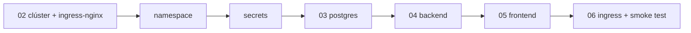

# 01 — Visión general de la infraestructura

## Objetivo

Desplegar el prototipo completo (frontend Angular + backend Spring Boot/LangGraph4j + PostgreSQL) en un **Kubernetes local**, de forma reproducible y lo más parecida posible a un despliegue real: imágenes propias, configuración por entorno, secretos fuera del repo, probes de salud y un único punto de entrada por Ingress.

No es infraestructura de producción (sin HA, sin TLS real, sin GitOps), pero cada simplificación está señalada con la alternativa "seria".

## Decisiones de infraestructura

### D-1: Docker Desktop con Kubernetes integrado
**Elegido** frente a minikube/kind/k3d porque el entorno de trabajo es Windows 11 con Docker Desktop ya habitual, comparte el daemon de Docker (las imágenes construidas en local están disponibles en el clúster **sin registry**) y trae un `LoadBalancer` que publica en `localhost`.

- Alternativa documentada: **kind** (guía 02 incluye el equivalente, que requiere `kind load docker-image`).
- En un entorno real: EKS/GKE/AKS + registry (ECR/GAR/ACR) + CI que publica imágenes.

### D-2: PostgreSQL dentro del clúster como StatefulSet
Un StatefulSet de 1 réplica con PVC es suficiente y enseña el patrón correcto (identidad estable + volumen persistente). El esquema y el seed se aplican con el mecanismo estándar de la imagen oficial (`/docker-entrypoint-initdb.d` vía ConfigMap).

- En un entorno real: BD gestionada (RDS/Cloud SQL) u operador (CloudNativePG).

### D-3: El backend NO crea el esquema en prod
`spring.sql.init.mode=never` y `ddl-auto=validate` en el perfil `prod`: el esquema lo pone la infra (init de Postgres). Evita carreras entre réplicas y deja claro el ownership del esquema.

- En un entorno real: migraciones con Flyway/Liquibase ejecutadas por el propio backend o un Job.

### D-4: Ingress único con ingress-nginx
Un solo host (`copilot.localtest.me`) sirve la SPA (`/`) y la API (`/api`). Así el frontend usa rutas relativas, no hay CORS y el modelo es idéntico al de producción.

`*.localtest.me` resuelve a `127.0.0.1` públicamente → no hay que editar `C:\Windows\System32\drivers\etc\hosts`.

### D-5: Secretos como `Secret` creados imperativamente
Los valores reales (`GEMINI_API_KEY`, password de Postgres) se crean con `kubectl create secret` y **nunca** se commitean; en el repo solo hay ficheros `*.example.yaml`.

- En un entorno real: External Secrets Operator / Sealed Secrets / Vault.

### D-6: Backend a 1 réplica (limitación consciente)
El estado conversacional del grafo vive en un `MemorySaver` en memoria del pod. Con más de una réplica, los turnos de una misma conversación caerían en pods distintos y perderían el estado. Escalar exige antes implementar un `BaseCheckpointSaver` persistente (Postgres/Redis) — está apuntado como extensión en la arquitectura (ADR-6).

## Requisitos de máquina

| Recurso | Mínimo |
|---|---|
| RAM para Docker Desktop | 6 GB asignados (Postgres ~256 MB, backend ~768 MB, frontend ~32 MB, sistema K8s ~1.5 GB) |
| Disco | ~5 GB (imágenes + PVC 1 Gi) |
| Software | Docker Desktop ≥ 4.30 con Kubernetes activado, kubectl, PowerShell |
| Red | Salida HTTPS a `generativelanguage.googleapis.com` (Gemini) |

## Inventario de ficheros

```
k8s/
├── namespace.yaml                    # Namespace l1-copilot
├── postgres-init-configmap.yaml      # schema.sql + data.sql para initdb
├── postgres.yaml                     # Service headless + StatefulSet + PVC
├── postgres-credentials.example.yaml # plantilla del Secret (NO usar tal cual)
├── gemini-secret.example.yaml        # plantilla del Secret de la API key
├── backend-configmap.yaml            # config no sensible (perfil, URL JDBC)
├── backend.yaml                      # Deployment + Service del backend
├── frontend.yaml                     # Deployment + Service del frontend
└── ingress.yaml                      # Ingress copilot.localtest.me
docker/
├── backend.Dockerfile                # multi-stage Maven → JRE 17
├── frontend.Dockerfile               # multi-stage Node → nginx
└── frontend-nginx.conf               # SPA fallback (try_files → index.html)
```

## Orden de despliegue (dependencias)



El backend no arranca sano sin Postgres (probe de readiness incluye la BD), y el Ingress no tiene sentido sin los dos Services detrás — `kubectl apply -f k8s/` lo aplica todo junto y Kubernetes converge solo, pero para la primera vez las guías van paso a paso para poder verificar cada pieza.
