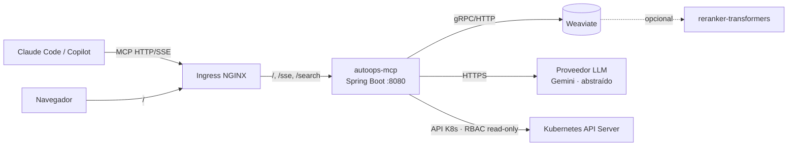

# AutoOps MCP — Documentación de Infraestructura (Kubernetes local)

Guías de despliegue del servidor **AutoOps MCP** sobre un clúster de **Kubernetes local** (Docker Desktop o
Minikube). Sin dependencias de nube: coste cero. El propio clúster es, además, el sujeto que AutoOps diagnostica.

> La documentación de arquitectura (tools MCP, núcleo RAG, organización del código) vive en `docs/arquitectura/`.

## Componentes a desplegar

| Componente | Tecnología | Imagen | Puerto | Exposición |
|---|---|---|---|---|
| `autoops-mcp` | Spring Boot 3 · Spring AI MCP · LangChain4j · LangGraph4j · fabric8 | `autoops/mcp:0.1.0` | 8080 | Ingress (`/` chat, `/sse` MCP, `/search`, `/actuator`) |
| `weaviate` | `cr.weaviate.io/semitechnologies/weaviate` | — | 8080/50051 | Solo interno (ClusterIP) |
| `weaviate-reranker` *(opcional)* | `semitechnologies/reranker-transformers` | — | 8080 | Solo interno (ClusterIP) |

Todo en el namespace **`autoops`**, con acceso externo por **NGINX Ingress** en el host `autoops.local`.

## Topología



El agente y Weaviate no se exponen fuera del clúster; solo `autoops-mcp` se publica por Ingress. AutoOps lee la
API de Kubernetes con un **ServiceAccount de solo lectura** (sin escritura, sin Secrets).

## Índice de guías

Seguir en orden la primera vez:

1. [01-prerrequisitos.md](01-prerrequisitos.md) — Herramientas y elección Docker Desktop vs Minikube.
2. [02-topologia-kubernetes.md](02-topologia-kubernetes.md) — Namespace, secret del LLM y **RBAC read-only**.
3. [03-weaviate.md](03-weaviate.md) — Base vectorial (embeddings + híbrido + reranking opcional).
4. [04-dockerizacion.md](04-dockerizacion.md) — Dockerfile multi-stage del servidor y carga de imagen.
5. [05-despliegue-servicios.md](05-despliegue-servicios.md) — Deployment, Service y probes de `autoops-mcp`.
6. [06-ingress-acceso.md](06-ingress-acceso.md) — NGINX Ingress (incl. **SSE**) y entrada en `hosts`.
7. [07-operacion-troubleshooting.md](07-operacion-troubleshooting.md) — Logs, fallos típicos, ingesta y limpieza.

## Despliegue rápido (resumen)

```powershell
# 1. Namespace, secret del LLM, RBAC read-only
kubectl apply -f k8s/00-namespace.yaml -f k8s/01-secrets.yaml -f k8s/02-rbac.yaml

# 2. Base vectorial
kubectl apply -f k8s/10-weaviate.yaml

# 3. Servidor MCP (imagen construida y cargada: ver guía 04)
kubectl apply -f k8s/20-autoops-mcp.yaml

# 4. Ingress
kubectl apply -f k8s/30-ingress.yaml

kubectl get pods -n autoops
```

Tras desplegar, **ingestar el corpus** (guía 07 §3) y **registrar el MCP** en el cliente (guía 06 §4).

## Convenciones usadas en todas las guías

- **Namespace:** `autoops`.
- **Secret:** `autoops-llm-secret` (clave del proveedor LLM). Weaviate corre sin autenticación en local (no
  requiere secret).
- **Imágenes locales:** `autoops/<servicio>:<versión>` con `imagePullPolicy: IfNotPresent` (no hay registry).
- **Salud:** `autoops-mcp` expone `GET /actuator/health/liveness` y `/actuator/health/readiness`.
- **Shell:** comandos en PowerShell (entorno Windows); equivalentes en bash salvo indicación.
