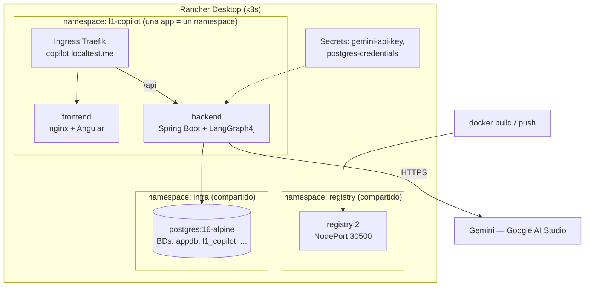

# Infraestructura — L1 Support Copilot

Guías de despliegue sobre **Rancher Desktop (k3s) + Helm** en Windows 11. El modelo
separa la **infraestructura compartida del clúster** (namespace `infra`: PostgreSQL;
namespace `registry`: registry de imágenes — instalada por los scripts de
[`infra/scripts/`](../../infra/scripts)) de las **aplicaciones** (un namespace por
proyecto, desplegadas con el chart Helm genérico
[`infra/charts/generic-app`](../../infra/charts/generic-app)).

> Pensado para ejecutarse **en sesiones separadas**: cada guía es autocontenida,
> indica prerrequisitos y termina con una verificación. La arquitectura de la
> aplicación está en [docs/arquitectura](../arquitectura/README.md).

## Modelo de despliegue



| Pieza | Cómo se instala | Notas |
|---|---|---|
| Clúster | Rancher Desktop (k3s) | Traefik incluido de serie; `kubectl`, `helm`, `docker` vienen con la instalación |
| Registry | [`infra/scripts/02-setup-registry.sh`](../../infra/scripts/02-setup-registry.sh) | namespace `registry`, NodePort `30500`. Opcional: `05-setup-registry-ingress.sh` añade Traefik TCP en `15000` |
| PostgreSQL 16 | [`infra/scripts/03-setup-postgres.sh`](../../infra/scripts/03-setup-postgres.sh) | namespace `infra`, NodePort `15432`. Opcional: `04-setup-postgres-ingress.sh` lo expone en `localhost:5432` |
| BD del proyecto | [`scripts/setup-l1-copilot-db.sh`](../../scripts/setup-l1-copilot-db.sh) | crea `l1_copilot` dentro del Postgres compartido y aplica `schema-postgresql.sql` + `data-postgresql.sql` |
| Backend / Frontend | chart [`infra/charts/generic-app`](../../infra/charts/generic-app) + values del proyecto en [`infra/values-l1-copilot-*.yaml`](../../infra) | un único chart parametrizable; cada release es una app |
| Secretos | `kubectl create secret` o [`infra/scripts/create-secrets.ps1`](../../infra/scripts/create-secrets.ps1) | nunca en valores versionados |

> **Réplicas del backend:** 1 réplica y `strategy: Recreate` mientras el checkpointer
> del grafo sea `MemorySaver` (estado conversacional en memoria del pod). Documentado
> en la guía 04.

## Índice

| Guía | Contenido |
|---|---|
| [01 — Visión general](01-vision-general.md) | Topología, decisiones (Rancher Desktop, scripts vs Helm, chart genérico), requisitos |
| [02 — Clúster local](02-cluster-local.md) | Rancher Desktop: instalación, motor de contenedores, Traefik, helm |
| [03 — Infra compartida](03-infra-compartida.md) | Registry y PostgreSQL desplegados con `infra/scripts/`; BD del proyecto |
| [04 — Backend](04-backend.md) | Imagen, configuración por entorno, despliegue con `generic-app` |
| [05 — Frontend](05-frontend.md) | Build Angular, imagen nginx, despliegue con `generic-app` |
| [06 — Ingress y acceso](06-ingress-y-acceso.md) | Traefik, host local, smoke test extremo a extremo |
| [07 — Secretos y configuración](07-secretos-y-configuracion.md) | Qué va en cada sitio; qué no puede tocar el repo |
| [08 — Operación](08-operacion.md) | helm upgrade/rollback, logs, troubleshooting, limpieza |

## TL;DR (cuando todo está construido)

```bash
# 1. Infra compartida (una vez por clúster, desde WSL)
bash infra/scripts/01-install-rancher-desktop.sh   # solo la primera vez
bash infra/scripts/02-setup-registry.sh
bash infra/scripts/03-setup-postgres.sh

# 2. BD del proyecto dentro del Postgres compartido (desde la raíz del repo)
bash scripts/setup-l1-copilot-db.sh

# 3. Namespace y Secrets de la app
kubectl apply -f infra/namespace-l1-copilot.yaml
kubectl create secret generic gemini-api-key -n l1-copilot --from-literal=GEMINI_API_KEY=<key>
kubectl create secret generic postgres-credentials -n l1-copilot \
  --from-literal=POSTGRES_USER=appuser \
  --from-literal=POSTGRES_PASSWORD=change-me

# 4. Build + push de las imágenes al registry
docker build -t localhost:30500/l1-copilot-backend:1.0.0 -f docker/backend.Dockerfile .
docker push localhost:30500/l1-copilot-backend:1.0.0
docker build -t localhost:30500/l1-copilot-frontend:1.0.0 -f docker/frontend.Dockerfile .
docker push localhost:30500/l1-copilot-frontend:1.0.0

# 5. Despliegue de las apps con el chart genérico
helm upgrade --install l1-copilot-backend  infra/charts/generic-app -f infra/values-l1-copilot-backend.yaml
helm upgrade --install l1-copilot-frontend infra/charts/generic-app -f infra/values-l1-copilot-frontend.yaml

# 6. Acceso
start http://copilot.localtest.me
```
