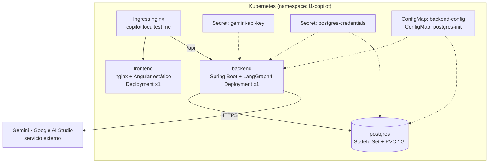

# Infraestructura — L1 Support Copilot

Guías de despliegue de toda la infraestructura del **L1 Support Copilot** sobre **Kubernetes local** (Docker Desktop en Windows 11), con manifiestos listos en [`k8s/`](../../k8s) y Dockerfiles en [`docker/`](../../docker).

> Pensado para ejecutarse **en sesiones separadas**: cada guía es autocontenida, indica prerrequisitos y termina con una verificación. El orden recomendado es el del índice. La arquitectura de la aplicación está en la rama `docs/arquitectura-l1-copilot`.

## Qué se despliega



| Componente | Tipo K8s | Imagen | Notas |
|---|---|---|---|
| PostgreSQL 16 | StatefulSet + Service headless + PVC | `postgres:16-alpine` | esquema/seed por ConfigMap de init |
| Backend | Deployment + Service ClusterIP | `l1-copilot-backend` (build local) | perfil `prod`, probes Actuator |
| Frontend | Deployment + Service ClusterIP | `l1-copilot-frontend` (build local) | nginx sirve la SPA y NO proxya /api (lo hace el Ingress) |
| Ingress | Ingress (ingress-nginx) | — | host `copilot.localtest.me` (resuelve a 127.0.0.1 sin tocar hosts) |
| Secretos | Secret | — | `GEMINI_API_KEY` y credenciales de BD; nunca en el repo |

> **Réplicas:** backend fijado a **1 réplica** mientras el checkpointer del grafo sea `MemorySaver` (en memoria de proceso): con 2+ réplicas las conversaciones se romperían al alternar pods. Está documentado como limitación en la guía 04.

## Índice

| Guía | Contenido |
|---|---|
| [01 — Visión general](01-vision-general.md) | Topología, decisiones, requisitos de máquina |
| [02 — Clúster local](02-cluster-local.md) | Docker Desktop + Kubernetes, kubectl, ingress-nginx, namespace |
| [03 — PostgreSQL](03-postgresql.md) | Secret, PVC, StatefulSet, init del esquema, verificación |
| [04 — Backend](04-backend.md) | Dockerfile multi-stage, configuración por entorno, Deployment, probes |
| [05 — Frontend](05-frontend.md) | Build Angular, imagen nginx, Deployment |
| [06 — Ingress y acceso](06-ingress-y-acceso.md) | Ruteo /, /api; hostname local; smoke test extremo a extremo |
| [07 — Secretos y configuración](07-secretos-y-configuracion.md) | Gestión de secretos, ConfigMaps, qué NO commitear |
| [08 — Operación](08-operacion.md) | Logs, troubleshooting, actualización de imágenes, limpieza |

## TL;DR (cuando todo está construido)

```powershell
# 1. Secretos (una vez; valores reales, no commiteados)
kubectl create secret generic gemini-api-key -n l1-copilot --from-literal=GEMINI_API_KEY=<tu-key>
kubectl create secret generic postgres-credentials -n l1-copilot `
  --from-literal=POSTGRES_USER=copilot --from-literal=POSTGRES_PASSWORD=<password> --from-literal=POSTGRES_DB=copilot

# 2. Todo lo demás
kubectl apply -f k8s/namespace.yaml
kubectl apply -f k8s/

# 3. Acceso
start http://copilot.localtest.me
```
