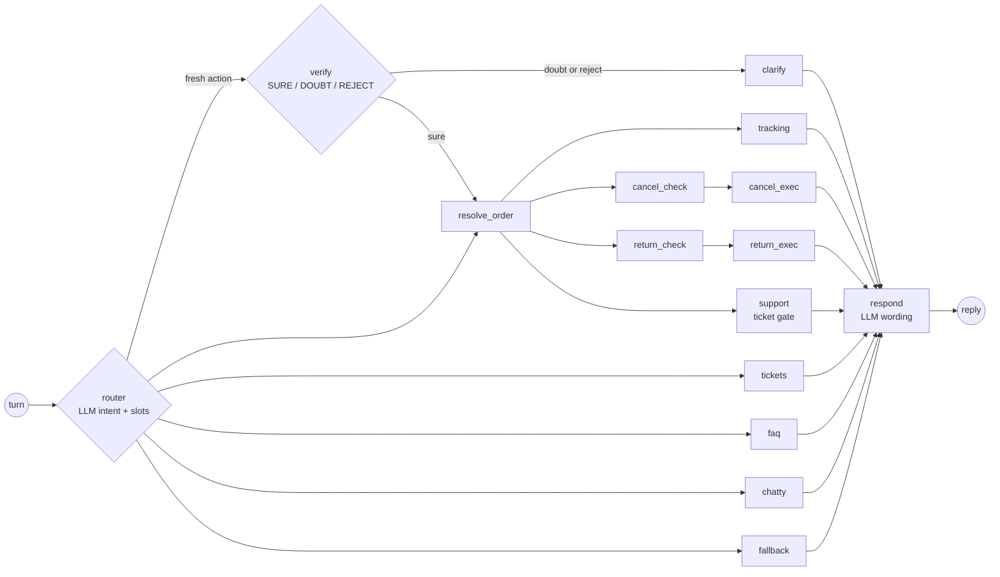

# L1 Support Copilot

An autonomous **level-1 support agent** for an e-commerce site, built with **Spring Boot, LangChain4j,
LangGraph4j and Gemini**. It tracks orders, cancels them, starts returns, looks up tickets and escalates to a
human by opening one, with real effects on the database.

It is not a command bot: it routes the conversation semantically, resolves ambiguity proactively and keeps
conversation state across HTTP turns through a checkpointed state graph.

```text
User:   ¿Dónde está mi pedido?                 (Where is my order?)
Agent:  Tienes dos pedidos recientes: un portátil (#123) y un ratón (#456).
        ¿Sobre cuál quieres consultar el estado?
User:   El portátil                             (The laptop)
Agent:  Tu pedido #123 está EN REPARTO y llegará mañana con SEUR.
```

That exchange exercises intent detection, missing-information detection, a proactive tool call (fetch the
recent orders instead of asking for an id), a clarification loop that survives between requests and
reference resolution ("the laptop" -> #123).

## The problem

Classic support bots either follow rigid menus or let the LLM decide everything, including whether an order
can be cancelled. This agent splits the work: **the LLM classifies, Java code decides**. Routing is a set of
pure functions over the graph state, business rules live in the tools (`OrderStatus.isCancellable()`, not a
prompt) and every irreversible action needs an explicit confirmation from the user.

## Agent graph

Every HTTP turn runs the graph from start to end; the `MemorySaver` checkpointer, keyed by user and conversation id,
carries the state into the next turn.



The full topology, including digressions (an FAQ in the middle of a cancellation suspends and later resumes
it) and navigation (back to the list, back to the menu), is in
[`docs/arquitectura/04-grafo-langgraph.md`](docs/arquitectura/04-grafo-langgraph.md).

## What it does

| Intent | Behaviour |
|---|---|
| `TRACKING` | Order status and shipment, disambiguating between recent orders when needed. |
| `CANCEL` | Cancels an order after the business-rule check and an explicit confirmation button. |
| `RETURN` | Starts a return for a delivered order and issues a printable return label. |
| `SUPPORT` | Proposes a ticket, asks for details and only creates it once the user confirms. |
| `TICKETS` | Lists the user's open tickets. |
| `FAQ` | Answers from the store knowledge base, without losing the task in progress. |
| `CHATTY` / `OTHER` | Small talk or out-of-scope requests, without touching data. |

## Design decisions

The ADRs are in [`docs/arquitectura/02-arquitectura-sistema.md`](docs/arquitectura/02-arquitectura-sistema.md) (Spanish):

| ADR | Decision |
|---|---|
| 1 | LangGraph4j state graph instead of LangChain4j chains: the agent needs cycles and shared mutable state. |
| 2 | One HTTP turn is one graph invocation that always reaches the end; the checkpointer resumes it. |
| 3 | The LLM only produces a label and slots (structured output); Java `switch` edges route, tools enforce the rules. |
| 4 | The `userId` comes from the session, never from the user's text, so a prompt cannot reach another user's data. |
| 5 | H2 in development, PostgreSQL when deployed, with SQL scripts per dialect. |
| 6 | In-memory `MemorySaver` checkpointer: single replica and `Recreate` strategy until a Postgres-backed saver exists. |

Other choices visible in the code:

- **One model per role** with its own temperature and thinking level: deterministic router and verifier (0.0),
  ticket drafting (0.2), business answers (0.35), small talk (0.7).
- **A verifier node** double-checks fresh actions before acting; on doubt it asks instead of acting.
- **Deterministic shortcuts** for UI buttons and card clicks: confirming a cancellation never depends on how
  the LLM reads a message.
- **Per-role conversation memory**: each LLM sees its own window of the history.

## Stack

Java 17 · Spring Boot 3.5 · **LangChain4j 1.16** (AiServices: `IntentClassifier`, `Verifier`, `Responder`,
`TicketWriter`) · **LangGraph4j 1.8** · Gemini through Google AI Studio (Gemma via the OpenAI-compatible endpoint
also supported) · Spring Data JPA · PostgreSQL / H2 · Angular 17 · Helm on k3s.

## Running it

**Tests** (the LLM roles are replaced by mocks, no API key needed):

```bash
cd l1-copilot/backend
./mvnw verify                     # unit, routing, full-flow and security tests
./mvnw test -Dgroups=security     # only the prompt injection, IDOR and confirmation-injection suite
ROUTER_EVAL=true GEMINI_API_KEY=... ./mvnw test -Dtest=RouterEvalTest   # opt-in golden set against the real model
```

**Locally with H2** (dev profile, seeded on startup):

```bash
export GEMINI_API_KEY=...         # free key at https://aistudio.google.com/app/apikey
./scripts/start.sh                # from the repo root: backend :8079/api, frontend :4199
```

Swagger UI: http://localhost:8079/api/swagger-ui/index.html. The `local` profile uses the shared PostgreSQL
of the cluster instead (`l1-copilot/scripts/setup-l1-copilot-db.sh` creates and seeds the database).

**On k3s**, after the shared platform is in place (see [`infra/INFRA.md`](../infra/INFRA.md)):

```bash
bash l1-copilot/scripts/setup-l1-copilot-db.sh
./infra/scripts/deploy.sh --project l1-copilot --component all
./infra/scripts/setup-app-ingress.sh --project l1-copilot     # http://l1-copilot.local
```

## API

| Endpoint | Purpose |
|---|---|
| `POST /api/copilot/chat` | One conversation turn: `{ conversationId, message }`, header `X-User-Id` |
| `GET /api/copilot/users` | Demo users for the simulated login |
| `GET /api/copilot/tickets/{id}` | Detail of one of the session user's tickets, header `X-User-Id` (404 otherwise) |
| `GET /api/copilot/returns/{id}` | Return label of one of the session user's orders with a return in progress, header `X-User-Id` |

`X-User-Id` stands in for a real session token (authentication is out of scope); unknown users get 401.

## Notes

- Internal design docs and infrastructure guides are in Spanish: [`docs/`](docs).
- The product talks to Spanish-speaking customers, so prompts, UI and replies are in Spanish.
- Orders, users, tickets and the FAQ are **synthetic demo data**; the two avatars are AI-generated.
