# 09 — Plan de implementación

Plan troceado en **fases independientes y demostrables**, pensado para ejecutarse en sesiones/conversaciones separadas. Cada fase indica: entradas (docs a releer), tareas, y criterio de aceptación (DoD) verificable.

> **Estado:** Fases 0-7 ✅ completadas. Backend funcional, frontend Angular en `l1-copilot/frontend/` y despliegue en K8s verificado (`l1-copilot.local`). El proyecto vive en el monorepo (`l1-copilot/`), no en repos separados. Desviaciones de diseño aplicadas al implementar: `CancellationCheck` como DTO propio de la comprobación (las aristas no parsean strings), aristas extraídas a `SupportRouting` (funciones estáticas puras) y campo `confirmation` YES/NO/NONE en lugar del booleano `confirmed`. Además, sobre el alcance original se añadieron las skills `RETURN`, `TICKETS`, `FAQ` y `CHATTY`, los nodos `verify`/`clarify`, navegación jerárquica (BACK_*), digresión con retorno, tratamiento tú/usted, caché de respuestas y `turn_log`. El trabajo de mejora continúa por el [backlog](../mejoras/00-resumen.md).

```mermaid
gantt
    dateFormat X
    axisFormat %s
    section Backend
    F0 Upgrade dependencias   :f0, 0, 1
    F1 Dominio y datos        :f1, after f0, 2
    F2 Tools                  :f2, after f1, 1
    F3 Grafo LangGraph4j      :f3, after f2, 3
    F4 API REST               :f4, after f3, 1
    section Frontend
    F5 Angular chat           :f5, after f4, 2
    section Cierre
    F6 Demo + docs            :f6, after f5, 1
    F7 Despliegue K8s         :f7, after f6, 2
```

---

## Fase 0 — Alineación de dependencias (la que desbloquea todo)

**Releer:** [07 — Organización del código](07-organizacion-codigo.md) (nota de compatibilidad).

1. Consultar la matriz de versiones de [langgraph4j](https://github.com/langgraph4j/langgraph4j) y fijar el par `langgraph4j` / `langchain4j` (previsiblemente ambos 1.x).
2. Subir `langchain4j` en el `pom.xml`; añadir `langchain4j` (AiServices), `langgraph4j-core`, `langchain4j-google-ai-gemini`, `langchain4j-open-ai`, `spring-boot-starter-data-jpa`, `spring-boot-starter-validation`, `h2`, `postgresql`. (Nota: **no** hizo falta `langgraph4j-langchain4j`; el estado usa tipos serializables simples, basta el serializer por defecto.)
3. Adaptar el código existente a la API 1.x: `Config.java` (`ChatLanguageModel`→`ChatModel`, `generate()`→`chat()`).
4. Smoke test: `mvn test` + arrancar y probar por Swagger con `GEMINI_API_KEY`.

**DoD:** la app arranca, `mvn dependency:tree` sin conflictos de langchain4j duplicado. (El andamiaje `LlmController`/`LlmService` que existía aquí se retiró después, ver mejora #2.)

## Fase 1 — Dominio y datos

**Releer:** [03 — Modelo de datos](03-modelo-datos.md).

1. Entidades `User`, `Order` (+`OrderStatus`), `Ticket` (+`TicketStatus`); repositorios con variantes `...AndUserId`.
2. Esquema y seed separados por dialecto: `schema-h2.sql`/`data-h2.sql` (perfil `dev`, `platform=h2`) y `schema-postgresql.sql`/`data-postgresql.sql` (perfiles `local`/`prod`, `platform=postgresql`); fechas relativas a `CURRENT_DATE`.
3. Records de `dto/tools` (`OrderSummary`, `ShipmentStatus`, `CancellationResult`, `TicketCreated`).
4. Tests `@DataJpaTest`: seed cargado, `findTop3ByUserIdOrderByOrderDateDesc` devuelve orden correcto, `findByIdAndUserId` no cruza usuarios.

**DoD:** tests verdes; consola H2 muestra los datos del seed.

## Fase 2 — Tools

**Releer:** [05 — Tools Java](05-tools-java.md).

1. `OrderTools` (`getRecentOrders`, `trackShipment`, `checkCancellable`, `cancelOrder`) y `TicketTools` (`createTicket`), con `@Tool`/`@P` y transaccionalidad.
2. `OrderNotFoundException` + reglas de cancelación en `OrderStatus.isCancellable()`.
3. Tests unitarios de reglas y de propiedad (matriz del doc 05).

**DoD:** cancelar pedido `SHIPPED` devuelve rechazo con motivo; pedido de otro usuario → `OrderNotFoundException`.

## Fase 3 — El grafo (el corazón; reservar la sesión más larga)

**Releer:** [04 — Grafo LangGraph4j](04-grafo-langgraph.md) **y** los ejemplos de `llms-lgraph.txt` (adaptive-rag y memory-agent).

1. `SupportState` + `SCHEMA` (solo canal `history` como appender) + enums `Intent`/`Awaiting`/`Verdict`/`Navigation`/`Treatment`; estado con tipos serializables simples (sin serializer a medida).
2. AiServices: `IntentClassifier` (salida estructurada `RouterDecision`) y `Responder`; probarlos sueltos con un `main`/test `@Tag("llm")`.
3. Nodos en orden de dificultad: `FallbackNode` → `RespondNode` → `RouterNode` → `TrackingNode` → `ResolveOrderNode` → `CancelCheckNode`/`CancelExecNode` → `SupportNode`.
4. `SupportAgentGraph.build()` con las aristas condicionales (funciones puras) + `AgentConfig` (compile con `MemorySaver`).
5. Tests: unitarios de aristas; flujo completo con fakes de los AiServices verificando la secuencia de nodos vía `graph.stream(...)`.
6. Exportar el diagrama (`GraphRepresentation.Type.MERMAID`) y pegarlo en el README.

**DoD:** test de integración (LLM fake) reproduce el escenario de referencia: turno 1 acaba en pregunta de desambiguación con `awaiting=ORDER_CHOICE`; turno 2 con mismo `threadId` resuelve `#123` y devuelve el estado del envío.

## Fase 4 — API REST

**Releer:** [06 — API REST](06-api-rest.md).

1. `ConversationService` (invoke por `threadId`) + `ChatController` (`/chat`, `/users`) + DTOs validados.
2. `ApiExceptionHandler` (problem+json) y timeout/retry del modelo.
3. Probar por Swagger los 3 escenarios completos **contra Gemini real**.

**DoD:** desde Swagger, una conversación multivuelta funciona con el mismo `conversationId`; cancelación de `SHIPPED` rechazada; ticket creado visible en BD.

## Fase 5 — Frontend Angular

**Releer:** [08 — Frontend Angular](08-frontend-angular.md).

1. Scaffold (`ng new frontend --standalone`), proxy, interceptor, `AuthService`.
2. Login simulado (usuarios de `/api/copilot/users`) + guard.
3. Chat: store con signals, burbujas, typing indicator, badge de intención, nueva conversación.
4. Tests de `ChatStore` e interceptor.

**DoD:** demo end-to-end en local (dos terminales: `cd l1-copilot/backend && mvn spring-boot:run` + `cd l1-copilot/frontend && ng serve`) con los 3 escenarios.

## Fase 6 — Demo y documentación de cierre

1. Guion de demo (los 3 escenarios + 1 intento de prompt-injection mostrando la defensa).
2. README del repo: qué es, gif/captura del chat, diagrama Mermaid del grafo generado desde código, cómo arrancar.
3. Revisión de coherencia docs ↔ código (actualizar estos documentos si la implementación divergió y por qué).

**DoD:** una persona nueva clona el repo y levanta la demo solo con el README.

## Fase 7 — Despliegue en Kubernetes

**Seguir [`docs/infraestructura/`](../infraestructura/README.md)** (guías 01-08): imágenes Docker de backend y frontend (Dockerfiles en `docker/`), PostgreSQL y Registry instalados por los scripts de `infra/scripts/`, BD del proyecto creada con `l1-copilot/scripts/setup-l1-copilot-db.sh`, y app desplegada con `infra/scripts/deploy.sh --project l1-copilot --component <c>` (build + push + Secrets + chart `generic-app` parametrizado por `infra/values-l1-copilot-{backend,frontend}.yaml`), con el Ingress aplicado por `infra/scripts/setup-app-ingress.sh --project l1-copilot`.

**DoD:** los 3 escenarios funcionan accediendo por el Ingress del clúster local.

---

## Riesgos y mitigaciones

| Riesgo | Impacto | Mitigación |
|---|---|---|
| Incompatibilidad langgraph4j ↔ langchain4j 0.36.2 | bloquea Fase 3 | Fase 0 dedicada; decidir versiones ANTES de codificar |
| El router clasifica mal con `flash-lite` | flujos erráticos | salida estructurada + few-shot en el prompt; si no basta, subir a `gemini-2.5-flash` solo para el router |
| Serialización del estado (ChatMessage) | checkpointer falla | usar serializer del módulo `langgraph4j-langchain4j`; mantener el estado simple (records/strings) |
| Cuota de la capa gratuita de AI Studio | demo caída | caché existente reutilizable para el router en demos; respuestas 503 elegantes; clave de respaldo |
| Scope creep (streaming, auth real, RAG) | no se acaba | fuera de alcance explícito (doc 01); apuntarlas como issues "v2" |
