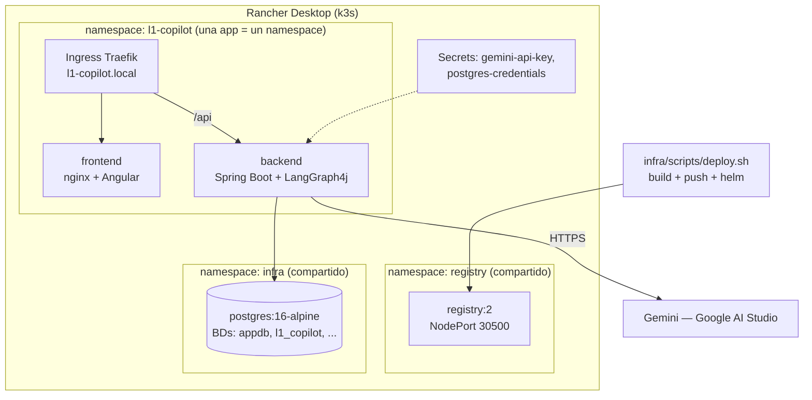

# Infraestructura — L1 Support Copilot

Guías de despliegue sobre **Rancher Desktop (k3s) + Helm** en Windows 11. El modelo
separa la **infraestructura compartida del clúster** (namespace `infra`: PostgreSQL;
namespace `registry`: registry de imágenes — instalada por los scripts de
[`infra/scripts/`](../../infra/scripts)) de las **aplicaciones** (un namespace por
proyecto, desplegadas con el chart Helm genérico
[`infra/charts/generic-app`](../../infra/charts/generic-app)).

> Pensado para ejecutarse **en sesiones separadas**: cada guía es autocontenida,
> indica prerrequisitos y termina con una verificación. La arquitectura de la
> aplicación está en [docs/arquitectura](../arquitectura/README.md).

## Modelo de despliegue



> **Flujo de despliegue real:** las apps se despliegan con el script genérico
> [`infra/scripts/deploy.sh`](../../infra/scripts/deploy.sh) `--project l1-copilot
> --component <backend|frontend> --tag <tag>`, parametrizado por el descriptor
> [`infra/projects/l1-copilot.env`](../../infra/projects/l1-copilot.env). El script hace
> namespace + Secrets + build + push + `helm upgrade --install` en un solo paso. La fuente
> de verdad cross-project de infraestructura es [`infra/INFRA.md`](../../infra/INFRA.md).

| Pieza | Cómo se instala | Notas |
|---|---|---|
| Clúster | Rancher Desktop (k3s) | Traefik incluido de serie; `kubectl`, `helm`, `docker` vienen con la instalación |
| Registry | [`infra/scripts/02-setup-registry.sh`](../../infra/scripts/02-setup-registry.sh) | namespace `registry`, NodePort `30500`. Opcional: `05-setup-registry-ingress.sh` añade Traefik TCP en `15000` |
| PostgreSQL 16 | [`infra/scripts/03-setup-postgres.sh`](../../infra/scripts/03-setup-postgres.sh) | namespace `infra`, NodePort `15432`. Opcional: `04-setup-postgres-ingress.sh` lo expone en `localhost:5432` |
| BD del proyecto | [`l1-copilot/scripts/setup-l1-copilot-db.sh`](../../scripts/setup-l1-copilot-db.sh) | crea `l1_copilot` dentro del Postgres compartido y aplica `schema-postgresql.sql` + `data-postgresql.sql` |
| Backend / Frontend | [`infra/scripts/deploy.sh --project l1-copilot --component <c>`](../../infra/scripts/deploy.sh) (chart [`infra/charts/generic-app`](../../infra/charts/generic-app) + values en [`infra/values-l1-copilot-*.yaml`](../../infra)) | un único script + chart parametrizable; cada release es una app |
| Secretos | `infra/.env.local` (lo sincroniza `deploy.sh`); ver guía 07 | nunca en valores versionados |

> **Réplicas del backend:** 1 réplica y `strategy: Recreate` mientras el checkpointer
> del grafo sea `MemorySaver` (estado conversacional en memoria del pod). Documentado
> en la guía 04.

## Índice

| Guía | Contenido |
|---|---|
| [01 — Visión general](01-vision-general.md) | Topología, decisiones (Rancher Desktop, scripts vs Helm, chart genérico), requisitos |
| [02 — Clúster local](02-cluster-local.md) | Rancher Desktop: instalación, motor de contenedores, Traefik, helm |
| [03 — Infra compartida](03-infra-compartida.md) | Registry y PostgreSQL desplegados con `infra/scripts/`; BD del proyecto |
| [04 — Backend](04-backend.md) | Imagen, configuración por entorno, despliegue con `generic-app` |
| [05 — Frontend](05-frontend.md) | Build Angular, imagen nginx, despliegue con `generic-app` |
| [06 — Ingress y acceso](06-ingress-y-acceso.md) | Traefik, host local, smoke test extremo a extremo |
| [07 — Secretos y configuración](07-secretos-y-configuracion.md) | Qué va en cada sitio; qué no puede tocar el repo |
| [08 — Operación](08-operacion.md) | helm upgrade/rollback, logs, troubleshooting, limpieza |

## TL;DR (cuando todo está construido)

```bash
# 1. Infra compartida (una vez por clúster, desde WSL)
bash infra/scripts/01-install-rancher-desktop.sh   # solo la primera vez
bash infra/scripts/02-setup-registry.sh
bash infra/scripts/03-setup-postgres.sh

# 2. BD del proyecto dentro del Postgres compartido (desde la raíz del repo)
bash l1-copilot/scripts/setup-l1-copilot-db.sh

# 3. Secrets reales (una vez, sirve para todos los proyectos): rellena infra/.env.local
#    (git-ignored) a partir de infra/.env.local.example  → los sincroniza deploy.sh

# 4. Despliegue de cada componente con el script genérico (namespace + secrets +
#    build + push + helm, todo en uno). Pasar SIEMPRE un --tag único.
bash infra/scripts/deploy.sh --project l1-copilot --component backend  --tag "$(date +%s)"
bash infra/scripts/deploy.sh --project l1-copilot --component frontend --tag "$(date +%s)"

# 5. Ingress de la app (frontend en "/", backend en "/api")
bash infra/scripts/setup-app-ingress.sh --project l1-copilot

# 6. Acceso (añade el host con infra/scripts/add-copilot-host.ps1 la primera vez)
start http://l1-copilot.local
```
